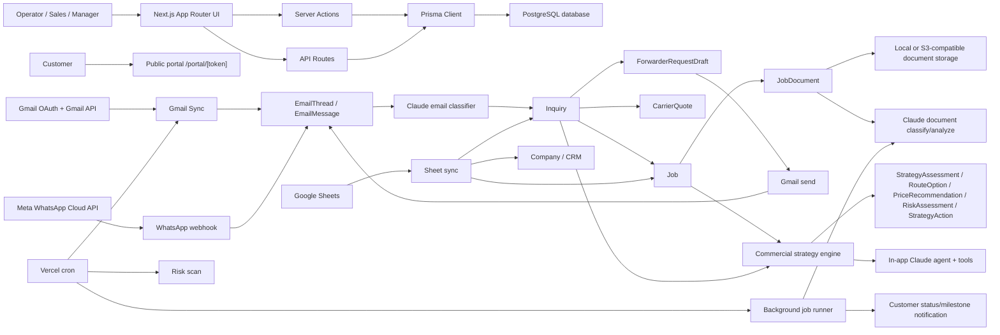
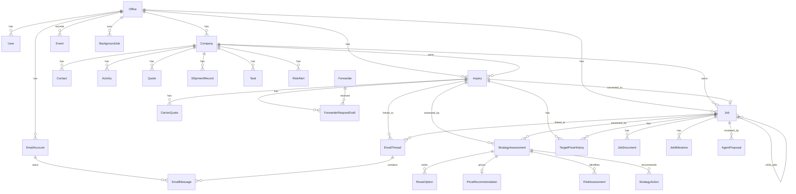

# Codebase Deep Discovery Report

Discovery date: 2026-06-21

Scope: static repository review of `/Users/mert/Desktop/derya crm`. I read the repository structure, product docs, Prisma schema, server actions, API routes, integration code, AI prompts/tools, cron/background job code, env references, and the main domain modules. I did not run a live database audit or production mailbox sync. This is an onboarding report, not an optimization pass.

Evidence convention: each conclusion lists the path and, where useful, function/model/line references.

## 1. Executive Summary

### What this company does

Derya Freight OS is an automated freight forwarding and procurement platform for forwarding offices. The codebase is not just a generic CRM. The CRM exists, but it is supporting infrastructure for a freight desk that captures RFQs, parses them, sources rates, builds quotes, tracks jobs, and manages customer/customer-contact history.

Evidence:

- `README.md:1-3` describes Derya Freight OS as an automated freight forwarding and procurement platform that captures RFQs, parses with AI, sources rates, builds quotes, tracks jobs, and includes CRM.
- `docs/PROJECT_CONTEXT.md:3-14` says the goal is to replace manual forwarding office work: reading RFQs, emailing carriers/agents/truckers, comparing offers, adding margin, booking, and tracking docs/milestones.
- `docs/PROJECT_CONTEXT.md:31-35` explicitly makes CRM a sub-module, not the headline product.

### Core product

The product is an operator workbench for freight sales, pricing, procurement, and job execution:

- RFQ intake from Gmail, WhatsApp, Google Sheets, pasted text, or manual form.
- AI extraction/classification of RFQs, supplier offers, documents, and job facts.
- Commercial strategy engine for price, route, margin, risk, target posture, and next action.
- Pricing desk for forwarder directory, outbound RFQ drafts, carrier quote comparison, target price history, and customer quote drafting.
- Job pipeline for proposed/inquiry/quoted/booked/in-transit/customs/delivered/cancelled.
- Customer portal via public magic link.
- CRM for companies, contacts, activities, quotes, tasks, ownership, and risk alerts.

Evidence:

- App routes in `README.md:50-59` list dashboard, inbox, jobs, pricing, RFQ, settings, CRM, and quote PDF.
- `prisma/schema.prisma:438-492` defines `Inquiry` as RFQ intake.
- `prisma/schema.prisma:515-535` defines `CarrierQuote`.
- `prisma/schema.prisma:537-582` defines forwarder directory and outbound request drafts.
- `prisma/schema.prisma:613-678` defines operational `Job`.
- `prisma/schema.prisma:714-842` defines the commercial decision brain snapshots.
- `src/lib/commercial-strategy.ts:3133` implements `assessCommercialStrategy`.
- `src/lib/agent-tools.ts:1931` dispatches agent tool calls over operational and strategy tools.

### Customer workflow

The intended workflow is:

1. Customer sends RFQ by email/WhatsApp or it appears in Google Sheets/manual input.
2. System stores inbound messages as `EmailThread` and `EmailMessage`, classifies them, and creates or links an `Inquiry`.
3. System creates a `PROPOSED` job for operator review.
4. Operator confirms/matures the RFQ. Maturity requires core cargo facts and target price/no-target status.
5. Pricing desk creates forwarder request drafts for mature RFQs and can send reviewed drafts through allowed Gmail sender accounts.
6. Carrier/supplier replies are parsed/summarized, and carrier quote rows are used for route/price comparison.
7. Strategy engine recommends route, price, risk posture, negotiation plan, and next action.
8. Operator drafts/apply customer quote, books selected option, tracks docs/milestones, and optionally exposes status/docs via portal.

Evidence:

- `src/lib/gmail-sync.ts:118-356` syncs Gmail threads/messages, classifies inbound mail, links or creates inquiries, and enqueues prewarming.
- `src/lib/whatsapp.ts:98-253` ingests WhatsApp messages into the same email-thread model.
- `src/lib/google-sheets-sync.ts:241-325` imports request rows into `Inquiry`; `src/lib/google-sheets-sync.ts:328-401` imports operation rows into `Company`/`Job`.
- `src/lib/thread-actions.ts:149-390` auto-links, skips, or creates inquiries from email threads.
- `src/lib/job-actions.ts:44-81` creates `PROPOSED` jobs from inquiries.
- `src/lib/rfq-qualification.ts:192-242` gates RFQ maturity.
- `src/lib/forwarder-drafts.ts:15-119` creates forwarder request drafts only after strategy/maturity checks pass.
- `src/app/dashboard/jobs/[jobId]/actions.ts:373-417` adds/selects carrier quotes.
- `src/app/dashboard/jobs/[jobId]/actions.ts:439-484` drafts customer quotes with guardrails.

### How money is made

The code implies margin on freight forwarding/procurement transactions, not SaaS subscription revenue. There is no billing/subscription/payment module in the repository. Revenue is modeled as sellside freight quote/job revenue and profit is modeled by revenue minus buy cost.

Evidence:

- `docs/PROJECT_CONTEXT.md:9-11` says operators compare carrier offers, build a sellside quote with margin, and book on acceptance.
- `prisma/schema.prisma:262-284` has `Quote.value`, `Quote.currency`, and outcome `WON/LOST/PENDING`.
- `prisma/schema.prisma:585-609` has historical shipment `revenue` and `profit`.
- `prisma/schema.prisma:651-653` has `Job.revenue`, `Job.cost`, `Job.currency`.
- `prisma/schema.prisma:776-798` persists floor/recommended/stretch/walk-away prices, margin percent, and expected gross profit.

Uncertainty: no explicit pricing, invoices, commissions, payment processor, subscription plan, or accounting integration exists. If the business also sells software subscriptions, the code does not model that.

### Main user personas

- Operator/dispatcher: triages inbox, confirms RFQs, manages jobs, milestones, documents, customer updates.
- Pricing/procurement user: sources rates, manages forwarder directory, sends RFQs to forwarders, compares quotes.
- Sales/CRM user: manages companies, contacts, activities, tasks, quotes, follow-ups.
- Manager/founder: watches pipeline, reports, decision queue, risk, profitability, bottlenecks.
- Customer: uses read-only portal link for job status and documents.

Evidence:

- `prisma/schema.prisma:12-16` defines `ADMIN`, `MANAGER`, `SALES`.
- `src/app/dashboard/jobs/[jobId]/actions.ts` contains operator job/doc/milestone/pricing actions.
- `src/app/dashboard/pricing/page.tsx` owns pricing desk and forwarder send controls.
- `src/app/dashboard/customers/[companyId]/page.tsx` owns CRM customer record actions.
- `src/app/portal/[token]/page.tsx` implements customer-facing portal.

### Key business processes

- RFQ intake and qualification.
- Forwarder/carrier RFQ drafting and sending.
- Carrier quote comparison.
- Commercial pricing/risk/route strategy.
- Customer quote drafting and PDF generation.
- Booking and job lifecycle management.
- Document checklist, upload, classification, analysis.
- Milestone tracking and customer notifications.
- CRM account/contact/activity/task management.
- Decision queue and risk scanning.

Uncertainties:

- Real production data source of truth is not settled. Google Sheets sync exists but docs say conflict rules are missing (`docs/BLOCKERS.md:32-38`).
- Outlook/IMAP are modeled in strings/UI copy but not implemented (`src/lib/gmail-sync.ts:133`, `src/lib/gmail-send.ts:33`, `docs/EMAIL_SETUP.md:98`).
- Production storage is not chosen (`docs/BLOCKERS.md:57-63`).
- Carrier APIs/customs/tracking APIs are planned, not implemented (`docs/PRODUCTIZATION_ROADMAP.md:74-83`).

## 2. System Architecture

### High-level architecture map

### Frontend applications

There is one Next.js application using App Router, React 19, and server actions.

Evidence:

- `package.json:20-29` dependencies include Next, React, Prisma, Anthropic, OpenAI, pdf-parse, zod.
- `src/app` contains UI routes and API routes.
- `README.md:12-16` lists Next.js, Prisma, cookie auth, and Anthropic Claude.

Major UI routes:

- `/dashboard`: control workbench and decision queue.
- `/dashboard/inbox`: email/WhatsApp triage and RFQ intake.
- `/dashboard/jobs`: job pipeline.
- `/dashboard/jobs/[jobId]`: job workbench.
- `/dashboard/pricing`: pricing desk, lane rates, margin profiles, forwarders, RFQ handoff.
- `/dashboard/rfq` and `/dashboard/rfq/[inquiryId]`: RFQ qualification.
- `/dashboard/customers` and `/dashboard/customers/[companyId]`: CRM.
- `/dashboard/reports`: operational/sales reports.
- `/dashboard/settings/email`: Gmail/WhatsApp/Sheets/storage setup visibility.
- `/portal/[token]`: customer portal.

Evidence:

- `README.md:50-59`.
- `src/app` route files listed by repository inspection.

### Backend services

There is no separate backend service. Backend behavior lives inside Next.js server actions, API routes, and `src/lib`.

Key backend surfaces:

- Server actions in `src/app/dashboard/**/actions.ts`.
- API routes in `src/app/api/**/route.ts`.
- Domain/integration logic in `src/lib`.
- Prisma data access in `src/lib/prisma.ts`.

### APIs

Internal/public API routes:

- Gmail OAuth and attachment proxy: `src/app/api/auth/gmail/*`, `src/app/api/gmail/attachment/route.ts`.
- Google Sheets sync: `src/app/api/google-sheets/sync/route.ts`.
- WhatsApp webhook/send: `src/app/api/webhooks/whatsapp/route.ts`, `src/app/api/whatsapp/send/route.ts`.
- Cron: `src/app/api/cron/gmail-sync/route.ts`, `src/app/api/cron/risk-scan/route.ts`, `src/app/api/cron/background-jobs/route.ts`, `src/app/api/cron/stuck-jobs/route.ts`.
- Documents: `src/app/api/jobs/document/[id]/route.ts`.
- Quote PDF: `src/app/api/jobs/[jobId]/quote-pdf/route.ts`.
- Transcription: `src/app/api/transcribe/route.ts`.
- Health/debug/export/demo setup: `src/app/api/health/route.ts`, `src/app/api/debug/office/route.ts`, `src/app/api/export/companies/route.ts`, `src/app/api/admin/run-demo-setup/route.ts`.

### Database

The active Prisma datasource is PostgreSQL, despite older docs saying SQLite/demo.

Evidence:

- `prisma/schema.prisma:6-9` sets provider `postgresql`.
- `.env.example:1-2` uses PostgreSQL URLs.
- `README.md:13` and `docs/PROJECT_CONTEXT.md:67` still mention SQLite/dev drift. That documentation is stale and should be fixed.

### Queues and workers

There is a database-backed background job table and a cron runner. There is no external queue like Redis/BullMQ/Inngest.

Evidence:

- `prisma/schema.prisma:320-343` defines `BackgroundJob`.
- `src/lib/background-jobs.ts:1-22` defines job types.
- `src/lib/background-jobs.ts:42-70` enqueues jobs with dedupe.
- `src/lib/background-jobs.ts:73-105` executes known job types.
- `src/lib/background-jobs.ts:107-184` polls due queued jobs, claims them, retries/fails.
- `vercel.json:1-16` schedules risk scan, Gmail sync, and background jobs.

Current queue risks:

- Jobs stuck in `RUNNING` are reported by health check but not automatically reclaimed in `runDueBackgroundJobs`.
- Work is serialized inside a cron request; this is okay for a demo but weak for production mailbox/document load.

### AI systems

AI is mostly direct Anthropic calls embedded in product code. There is no central prompt registry, no RAG service, no embedding index, and no evaluation framework except commercial strategy tests.

Evidence:

- `src/lib/agent-chat.ts:139-267` contains the in-app agent system prompt.
- `src/lib/agent-tools.ts:33+` defines tool schemas; `src/lib/agent-tools.ts:1931+` dispatches them.
- `src/lib/email-classifier.ts:53-164` classifies inbound email with Claude.
- `src/lib/thread-actions.ts:10-390` parses/link/creates inquiry from email threads with Claude.
- `src/lib/doc-analyze.ts:14-140` analyzes PDF documents with Claude.
- `src/lib/doc-classify.ts:14-119` classifies email attachments with Claude.
- `src/lib/sourcing-offers.ts:26-134` extracts supplier offers with Claude.
- `src/app/api/transcribe/route.ts:12-33` uses OpenAI Whisper.

### External integrations

Implemented:

- Anthropic Claude.
- OpenAI Whisper for transcription.
- Gmail OAuth, Gmail read, Gmail send, attachment fetch.
- Google Sheets API/service-account/API-key/CSV fallback.
- Meta WhatsApp Cloud API webhook/send.
- Local or S3-compatible document storage.
- Vercel cron.

Not implemented or only modeled:

- Outlook/IMAP.
- Carrier APIs.
- Tracking APIs.
- Customs APIs.
- Slack.
- Twilio.
- Payment/accounting.
- Data warehouse.
- Product analytics.

### Primary data flow

RFQ flow:

`Gmail/WhatsApp/Sheets/manual/paste` -> `EmailThread/EmailMessage or Inquiry` -> `email-classifier/thread-actions` -> `Inquiry` -> `createProposedJobForInquiry` -> `Job(PROPOSED)` -> `confirmProposedJob` -> RFQ maturity checks -> forwarder drafts -> Gmail send -> `CarrierQuote(PENDING/RECEIVED)` -> commercial strategy -> customer quote draft/PDF -> job booking/milestones/docs/portal.

AI strategy flow:

`Inquiry/Job + carrier quotes + lane rates + historical jobs + margin policy + target history + documents` -> `loadInquiryStrategyInput` or `loadJobStrategyInput` -> `assessCommercialStrategy` -> `persistStrategy` -> strategy tables -> decision queue/agent/quote drafting/pricing cockpit.

## 3. Repository Map

### Root

Purpose: product docs, project config, dependency scripts, deployment config.

Important files:

- `README.md`: product and dev quickstart.
- `package.json`: scripts and dependency surface.
- `.env.example`: environment configuration skeleton.
- `vercel.json`: cron schedule.
- `prisma.config.ts`: Prisma seed/config.

Dependencies:

- Next.js 15, React 19, Prisma 6, Anthropic SDK, OpenAI SDK, pdf-parse, zod.

Business ownership:

- Shared CTO/product operations.

Notes:

- `package.json:7` runs `prisma generate && next build`.
- `package.json:11-16` has strategy tests, tenant audit, Prisma generate/migrate/push.
- `.env.example` omits several env vars used by code: `ANTHROPIC_API_KEY`, `OPENAI_API_KEY`, `GOOGLE_CLIENT_ID`, `GOOGLE_CLIENT_SECRET`, `GOOGLE_REDIRECT_URI`, and `CRON_SECRET`. That is sloppy and will waste deployment time.

### `/docs`

Purpose: product context, roadmap, integration setup, blockers, feature audit.

Important files:

- `docs/PROJECT_CONTEXT.md`: business model and platform sides.
- `docs/PRODUCTIZATION_ROADMAP.md`: roadmap from RFQ-aware CRM to automated forwarding office.
- `docs/FEATURE_AUDIT.md`: latest working/incomplete status.
- `docs/BLOCKERS.md`: forwarder send, Sheets, WhatsApp, storage, agent evidence blockers.
- `docs/EMAIL_SETUP.md`, `docs/GOOGLE_SHEETS_SYNC.md`, `docs/WHATSAPP_SETUP.md`: setup docs.

Business ownership:

- Product, operations, integrations.

Critical note:

- Docs are partly stale. `docs/PROJECT_CONTEXT.md:67` says SQLite dev; schema is PostgreSQL. `docs/PRODUCTIZATION_ROADMAP.md:11-16` says Gmail backend/OCR/reply ingestion missing, but code now has Gmail sync, send, attachment classification, document analysis, and partial supplier-offer parsing. Treat docs as historical unless refreshed.

### `/prisma`

Purpose: database schema and seed data.

Important files:

- `prisma/schema.prisma`: canonical data model.
- `prisma/seed.ts`, `prisma/seed-jobs.ts`: demo data.
- `prisma/dev.db`: old local database artifact.

Dependencies:

- Prisma Client, PostgreSQL.

Business ownership:

- Data model, tenant boundaries, commercial strategy persistence.

Notes:

- There are no checked-in migrations. This is acceptable for a fast prototype and indefensible for production. `scripts/guard-db-push.ts` tries to reduce damage, but it is not a migration strategy.

### `/scripts`

Purpose: local validation/audit utilities.

Important files:

- `scripts/commercial-strategy.test.ts`: deterministic tests for pricing/risk/strategy behavior.
- `scripts/audit-tenant-scope.ts`: static audit for Prisma queries missing tenant scope.
- `scripts/guard-db-push.ts`: blocks accidental remote `prisma db push` without explicit permission.

Business ownership:

- Engineering quality and release safety.

Notes:

- Tenant audit defaults to non-strict mode unless `STRICT_TENANT_SCOPE=1` (`scripts/audit-tenant-scope.ts:66-72`). A report-only guard is not enough for production.

### `/src/app`

Purpose: Next.js app routes, server components, server actions, API routes.

Important areas:

- `src/app/dashboard`: operator/founder control center.
- `src/app/dashboard/jobs`: job board and job workbench.
- `src/app/dashboard/pricing`: pricing desk, lane rates, forwarder directory, forwarder RFQ send.
- `src/app/dashboard/rfq`: RFQ list/detail/new forms.
- `src/app/dashboard/inbox`: email/WhatsApp triage.
- `src/app/dashboard/customers`: CRM.
- `src/app/dashboard/settings/email`: integration readiness UI.
- `src/app/api`: integrations, cron, docs, quote PDF, transcribe.
- `src/app/portal/[token]`: customer portal.

Dependencies:

- `src/lib` for all real business logic.
- Prisma via server actions.

Business ownership:

- Product surface and workflow orchestration.

Risk:

- Too much business behavior lives inside route pages/actions. Example: `src/app/dashboard/pricing/page.tsx` contains hardcoded allowed forwarder senders and a large chunk of pricing-desk logic. That is not fatal now, but it will become a maintenance tax quickly.

### `/src/components`

Purpose: reusable UI pieces for jobs, CRM, agent sidecar, quote/pricing tools, document UI, inbox actions.

Important files:

- `src/components/agent-chat-widget.tsx`: agent UI.
- `src/components/commercial-decision-cockpit.tsx`: strategy UI.
- `src/components/pricing-scenario-sandbox.tsx`: what-if pricing UI.
- `src/components/jobs-table.tsx`, `src/components/pipeline-board.tsx`: operational job views.
- `src/components/document-viewer.tsx`: document Q&A.
- `src/components/sourcing-offers-table.tsx`: supplier offer extraction/review.

Dependencies:

- Server actions and `src/lib` outputs.

Business ownership:

- Operator workflow UX.

### `/src/lib`

Purpose: the real backend. Domain logic, AI prompts, tool schemas, integrations, strategy, queueing, auth, document storage, Google/Gmail/WhatsApp sync, and workflow helpers all live here.

Important files by responsibility:

- Auth: `auth.ts`, `password.ts`.
- Prisma: `prisma.ts`.
- AI agent: `agent-chat.ts`, `agent-tools.ts`, `agent-proposals.ts`, `agent-actions.ts`, `agent-intent.ts`.
- Commercial strategy: `commercial-strategy.ts`, `commercial-strategy-persistence.ts`, `rfq-qualification.ts`, `pricing-scenario.ts`, `decision-queue.ts`, `risk.ts`.
- Email/Gmail: `gmail-oauth.ts`, `gmail-sync.ts`, `gmail-send.ts`, `email-classifier.ts`, `thread-actions.ts`.
- WhatsApp: `whatsapp.ts`.
- Google Sheets: `google-sheets-sync.ts`.
- Document storage/AI: `document-storage.ts`, `doc-classify.ts`, `doc-analyze.ts`, `document-readiness.ts`.
- Freight workflows: `job-actions.ts`, `forwarder-drafts.ts`, `forwarder-draft-core.ts`, `customer-quote-drafts.ts`, `customer-quote-draft.ts`, `customer-notify.ts`, `sourcing-award.ts`, `sourcing-offers.ts`, `job-email.ts`, `job-populate.ts`, `missing-info-draft.ts`, `negotiation-plan-draft.ts`.
- Operational automation: `background-jobs.ts`, `stuck-jobs.ts`, `prewarm-summary.ts`.

Business ownership:

- This directory owns almost everything important. That is convenient today and messy tomorrow. There is no `/services`, `/agents`, `/workflows`, `/integrations`, or `/prompts` directory despite the domain being large enough to deserve them.

## 4. Data Model

### Entity overview

The database is tenant-rooted by `Office`. Almost every business table has `officeId`. The main transactional chain is:

`Office -> Company/Contact -> Inquiry -> CarrierQuote/ForwarderRequestDraft -> Job -> JobDocument/JobMilestone/EmailThread -> StrategyAssessment`.

### ERD

### Major entities

#### Office

Purpose: tenant root.

Fields:

- `id`, `name`, timestamps.
- Relations to users, companies, activities, quotes, shipments, docs, lane rates, margin profiles, inquiries, jobs, email accounts/threads, events, tasks, risk alerts, target history, agent proposals, forwarders, strategy snapshots, background jobs.

Relationships:

- One office owns almost all product data.

Source of truth:

- `prisma/schema.prisma:73-110`.

Usage:

- Tenant scoping across app/server actions.

#### User

Purpose: authenticated internal operator.

Fields:

- `officeId`, `email`, `passwordHash`, `fullName`, `role`, `isActive`, `canViewWholeOffice`.

Relationships:

- Belongs to office; owns companies and created activities.

Source of truth:

- `prisma/schema.prisma:142-163`.

Usage:

- Auth/session and CRM visibility.
- `src/lib/auth.ts` signs cookie sessions; `src/lib/password.ts` hashes/verifies passwords.

#### Company

Purpose: customer/account CRM record.

Fields:

- `name`, `status`, `class1`, `class2`, `product`, `lane`, `direction`.

Relationships:

- Contacts, owners, activities, quotes, shipment history, docs, assignment changes, tasks, risk alerts, jobs, inquiries.

Source of truth:

- `prisma/schema.prisma:165-201`.

Usage:

- CRM, customer memory, risk, job ownership, founder analytics.

#### Contact

Purpose: person at a company.

Fields:

- `fullName`, `title`, `email`, `phone`, `notes`, `isApprovedForInbox`, `approvedForInboxAt`.

Relationships:

- Belongs to company.

Source of truth:

- `prisma/schema.prisma:203-221`.

Usage:

- Inbox trust/known-person filter, CRM contact list.

#### Activity

Purpose: CRM interaction log.

Fields:

- `officeId`, `companyId`, `type` (`VISIT`, `CALL`, `EMAIL`, `WHATSAPP`), `occurredAt`, `subject`, `body`, `audioUrl`, creator.

Relationships:

- Belongs to office/company; optional creator.

Source of truth:

- `prisma/schema.prisma:239-260`.

Usage:

- Customer history, risk scanning, founder dashboard.

#### Quote

Purpose: CRM quote/outcome row.

Fields:

- `companyId`, `result`, `origin`, `destination`, `mode`, `value`, `currency`, `lostReason`, `quotedAt`.

Relationships:

- Belongs to office/company.

Source of truth:

- `prisma/schema.prisma:262-284`.

Usage:

- Sales funnel, pending quote follow-up, revenue/outcome analytics.

Note:

- This is separate from `CarrierQuote` and job quote lines. Naming is overloaded. That will confuse future engineers.

#### Event

Purpose: generic event/audit log.

Fields:

- `officeId`, `type`, `entityType`, `entityId`, `payload`, `createdAt`.

Relationships:

- Belongs to office.

Source of truth:

- `prisma/schema.prisma:305-318`.

Usage:

- Agent runs, proposal review, risk scans, draft events, ad hoc audit.

Weakness:

- It is not a real event stream yet. No canonical event schema, no actor/source fields, no source object identity, no retention/search/indexing policy.

#### BackgroundJob

Purpose: DB-backed async queue.

Fields:

- `type`, `status`, `payload`, `dedupeKey`, attempts/maxAttempts, run/lock/start/complete/fail times, `lastError`.

Relationships:

- Belongs to office.

Source of truth:

- `prisma/schema.prisma:320-343`.

Usage:

- Document analysis, summary prewarming, customer status/milestone notification.
- Implementation: `src/lib/background-jobs.ts`.

#### Task and RiskAlert

Purpose:

- `Task`: reminders/follow-ups against a company.
- `RiskAlert`: open/closed customer risk signal.

Fields:

- `Task`: title/details/dueAt/status/assignees.
- `RiskAlert`: level/reason/isOpen/resolvedAt.

Source of truth:

- `prisma/schema.prisma:345-381`.

Usage:

- CRM and founder "customers at risk" surface.
- Risk refresh: `src/lib/risk.ts:47-104`.

#### CompanyDocument

Purpose: customer-level documents.

Fields:

- `name`, `url`, `docType`, uploader.

Source of truth:

- `prisma/schema.prisma:383-397`.

Usage:

- CRM document links.

#### LaneRate and MarginProfile

Purpose:

- Lane benchmark pricing and margin policy.

Fields:

- `LaneRate`: origin, destination, mode, baseAmount, currency, validity.
- `MarginProfile`: label, customerTier, urgency, marginPercent.

Source of truth:

- `prisma/schema.prisma:401-433`.

Usage:

- Pricing desk and commercial strategy.
- `src/lib/commercial-strategy-persistence.ts:71-183` loads margin, customer stats, historical jobs, and lane/history inputs.

#### Inquiry

Purpose: RFQ/deal intake record.

Fields:

- Sender/company fields: `fromEmail`, `fromCompany`, `companyId`.
- Route/mode/cargo: origin, destination, mode, container count/type, packages, dimensions, stackable, topLoad, dangerousGoods, customsBy, commodity, weight, volume, incoterms, cargoReadyDate.
- Commercial target: targetPrice, targetCurrency, targetPriceStatus, targetPriceSource.
- Workflow: `type` (`FORWARDING`/`SOURCING`), `status`, rawEmailBody, parsedData, notes, summaryCache, receivedAt.

Relationships:

- Carrier quotes, job, email threads, target price history, agent proposals, forwarder drafts, strategy assessments.

Source of truth:

- `prisma/schema.prisma:438-492`.

Usage:

- RFQ qualification, strategy input, pricing desk, agent tools, Google Sheets import, Gmail/WhatsApp intake.

#### TargetPriceHistory

Purpose: internal audit trail for target/budget changes.

Fields:

- inquiry/job pointers, amount, currency, status, source, note, user, createdAt.

Source of truth:

- `prisma/schema.prisma:494-513`.

Usage:

- Strategy engine target posture and audit.
- Updated from RFQ edit, manual creation, pricing desk, job edit, new job, proposals, email populate per `docs/FEATURE_AUDIT.md:31`.

#### CarrierQuote

Purpose: inbound carrier/forwarder/supplier rate quote.

Fields:

- `carrier` free text, `quoteType`, rate totals by equipment, transit days, service, validity, transshipments, status.

Relationships:

- Belongs to inquiry.

Source of truth:

- `prisma/schema.prisma:515-535`.

Usage:

- Quote comparison and strategy route/price input.

Weakness:

- No supplier/forwarder foreign key. `carrier` free text is not good enough once volume grows.

#### Forwarder and ForwarderRequestDraft

Purpose:

- Forwarder directory and reviewed outbound RFQ drafts.

Fields:

- `Forwarder`: name, email, modeCoverage, apiType, active, notes.
- `ForwarderRequestDraft`: inquiry/forwarder, toEmail, subject/body, status, sender account, Gmail message/thread IDs, send error.

Source of truth:

- `prisma/schema.prisma:537-582`.

Usage:

- Pricing desk forwarder handoff.
- `src/lib/forwarder-drafts.ts:15-119` creates drafts.
- `src/app/dashboard/pricing/page.tsx` sends approved drafts through allowed Gmail accounts.

#### ShipmentRecord

Purpose: historical shipment data for customer/lane/profit learning.

Fields:

- company, origin/destination, mode, weight/volume, revenue/profit/currency, shipment date, reference, source (`manual`/`siber`).

Source of truth:

- `prisma/schema.prisma:585-609`.

Usage:

- Commercial strategy customer/lane history.

Weakness:

- Siber bridge is planned, not implemented (`docs/PROJECT_CONTEXT.md:79`).

#### Job

Purpose: operational load/deal record.

Fields:

- `reference`, optional title/cadence, `status`, `type`, route/mode/cargo fields, target price fields, `quoteLines`, ETD/ETA, revenue/cost/currency, notes, portalToken, notifyCustomer, customerEmail, parentJobId.

Relationships:

- Office, optional company, optional inquiry, parent/children, documents, milestones, threads, target history, agent proposals, strategy assessments.

Source of truth:

- `prisma/schema.prisma:613-678`.

Usage:

- Pipeline, workbench, customer portal, strategy, documents, milestones, customer notifications.

#### AgentProposal

Purpose: human review layer for AI-suggested changes/actions.

Fields:

- user, job/inquiry, kind/status, payload, sourceType/sourcePreview, toolTrace, reviewer/decision/note, timestamps.

Source of truth:

- `prisma/schema.prisma:680-708`.

Usage:

- Pasted RFQ updates, bulk inbox actions, agent-controlled mutations.
- `src/lib/agent-proposals.ts:102-283` creates proposal types.
- `src/lib/agent-proposals.ts:353-395` records proposal review events.

#### StrategyAssessment, RouteOption, PriceRecommendation, RiskAssessment, StrategyAction

Purpose: persisted commercial decision brain.

Fields:

- `StrategyAssessment`: recommendation, label, memo, score, band, confidence, components, evidence, decisionBrief, inputHash, active/superseded.
- `RouteOption`: provider/source/cost/transit/reliability/risk/confidence/tradeoff/evidence.
- `PriceRecommendation`: buyCost, floor/recommended/stretch/walk-away, margin, expected gross profit, win probability, guardrail status.
- `RiskAssessment`: category, level, score, reason, mitigation, evidence.
- `StrategyAction`: action type, priority, status, title, rationale, payload, approval fields.

Source of truth:

- `prisma/schema.prisma:714-842`.

Usage:

- Commercial strategy audit, decision queue, agent tools, pricing/cockpit UI.
- `src/lib/commercial-strategy-persistence.ts:246-361` persists ACTIVE/SUPERSEDED snapshots based on input hash.

#### JobDocument and JobMilestone

Purpose:

- Document checklist and milestone tracking.

Fields:

- `JobDocument`: name, url, docType, status, uploader, AI summary/flags/key fields/analyzedAt.
- `JobMilestone`: type, plannedAt, actualAt, note.

Source of truth:

- `prisma/schema.prisma:844-881`.

Usage:

- Job workbench, portal, document AI, customer notifications.
- `src/app/dashboard/jobs/[jobId]/actions.ts:229-365`.

#### EmailAccount, EmailThread, EmailMessage

Purpose:

- Connected mailbox/WhatsApp-like account, conversation thread, individual messages.

Fields:

- `EmailAccount`: office/email/provider/accessToken/refreshToken/isActive/lastSyncAt.
- `EmailThread`: job/inquiry links, subject, participants, provider thread id, auto-link fields, supplier offer JSON, awarded/hide/snooze fields, message count/last message.
- `EmailMessage`: provider IDs, direction, from/to/cc, subject, body text/html, attachments JSON, sentAt, read/classification/reason.

Source of truth:

- `prisma/schema.prisma:885-963`.

Usage:

- Gmail sync, WhatsApp ingest, RFQ classification, supplier offer extraction, customer memory, inbox.

Critical risk:

- OAuth access/refresh tokens are stored in plaintext (`prisma/schema.prisma:890-891`; `src/app/api/auth/gmail/callback/route.ts:55-68`).

## 5. Freight Forwarding Domain Model

### Where logistics knowledge lives

Logistics knowledge is split across:

- Schema fields for cargo/route/status/docs/milestones.
- RFQ maturity checks.
- Commercial strategy engine.
- Pricing desk/forwarder draft logic.
- Document readiness/analyze modules.
- Agent prompt/tool rules.

There is no single domain package. The knowledge is real, but scattered.

### Shipment lifecycle

Representation:

- `JobStatus` enum: `PROPOSED`, `INQUIRY`, `QUOTED`, `BOOKED`, `IN_TRANSIT`, `CUSTOMS`, `DELIVERED`, `CANCELLED`.
- Job field model includes ETD/ETA, revenue/cost, route, cargo, portal token, parent/child jobs.

Evidence:

- `prisma/schema.prisma:57-66`.
- `prisma/schema.prisma:613-678`.
- `src/app/dashboard/jobs/[jobId]/actions.ts:49-70` updates job status and enqueues customer notification.

### Booking workflow

Current booking is lightweight:

- Operator receives/selects a carrier quote.
- Selecting quote copies cost to job and marks job `BOOKED`.
- Sourcing award path creates a child forwarding job.

Evidence:

- `src/app/dashboard/jobs/[jobId]/actions.ts:373-417` adds/selects `CarrierQuote`.
- `src/lib/sourcing-award.ts:13-147` awards supplier, marks sourcing inquiry/job, and creates child forwarding job.

Missing:

- No carrier booking API.
- No booking confirmation document generation beyond draft/email helpers.
- No hard validation of required docs before stage transitions.

### Tracking workflow

Current tracking is manual plus reminders:

- `JobMilestone` stores planned/actual dates.
- Stuck job scanner finds jobs that have not moved.
- Customer portal exposes job status/milestones/docs.
- Customer notifications can be enqueued on status/milestone changes.

Evidence:

- `prisma/schema.prisma:868-881`.
- `src/app/dashboard/jobs/[jobId]/actions.ts:325-365`.
- `src/lib/stuck-jobs.ts:21-85`.
- `src/lib/customer-notify.ts:23-113`.
- `src/app/portal/[token]/page.tsx`.

Missing:

- No container/BL tracking aggregator.
- No actual carrier milestone webhooks.
- No demurrage/detention engine beyond roadmap.

### Customs workflow

Representation:

- Cargo fields include `customsBy` on `Inquiry` and `Job`.
- Milestone enum allows `CUSTOMS` status and milestone types include customs comments.
- Docs include `CUSTOMS` document type.

Evidence:

- `prisma/schema.prisma:455`, `prisma/schema.prisma:637`.
- `prisma/schema.prisma:63`.
- `prisma/schema.prisma:850-851`, `prisma/schema.prisma:871`.

Missing:

- No customs broker integration.
- No declaration workflow.
- No compliance rules by country/incoterm/mode.

### Quoting workflow

Representation:

- `Inquiry` captures RFQ and target price.
- `TargetPriceHistory` audits target changes.
- `ForwarderRequestDraft` sends buy-side RFQs.
- `CarrierQuote` stores buy-side replies.
- `PriceRecommendation` stores strategy output.
- `Job.quoteLines` stores sellside line items as pipe-delimited strings.
- Quote PDF API renders printable customer quote.

Evidence:

- `prisma/schema.prisma:438-492`, `494-535`, `556-582`, `776-798`, `646`.
- `src/lib/rfq-qualification.ts:192-242`.
- `src/lib/commercial-strategy.ts:3133-3565`.
- `src/app/dashboard/jobs/[jobId]/actions.ts:439-484`.
- `src/app/api/jobs/[jobId]/quote-pdf/route.ts`.

Critical note:

- `Job.quoteLines` as pipe-delimited text is a prototype shortcut. It is explicitly called out in docs (`docs/PROJECT_CONTEXT.md:41`). Keep it out of any serious accounting workflow.

### Carrier/forwarder management

Representation:

- `Forwarder` directory with mode coverage and email/API type.
- `ForwarderRequestDraft` per outbound request.
- `CarrierQuote.carrier` free text for received quotes.

Evidence:

- `prisma/schema.prisma:537-582`.
- `src/lib/forwarder-drafts.ts:15-119`.
- `src/app/dashboard/pricing/page.tsx:25` hardcodes allowed sender emails.

Missing:

- No normalized carrier/supplier model related to quotes.
- No response SLA tracking beyond fields in roadmap.
- No API connectors.

### Documentation handling

Representation:

- `JobDocument` tracks status and AI analysis fields.
- Upload goes through storage driver.
- Gmail attachments can be turned into documents.
- AI classifies and analyzes PDFs.

Evidence:

- `prisma/schema.prisma:844-866`.
- `src/app/dashboard/jobs/[jobId]/actions.ts:229-306`.
- `src/lib/document-storage.ts:173-233`.
- `src/lib/doc-classify.ts:14-119`.
- `src/lib/doc-analyze.ts:14-140`.

Limitations:

- PDF text extraction only; scanned PDFs need OCR and currently return "No extractable text found" (`src/lib/doc-analyze.ts:82-84`).
- Production storage/access policy is unresolved (`docs/BLOCKERS.md:57-63`).

## 6. AI Architecture

### Models used

- Anthropic `claude-haiku-4-5-20251001`: parsing, classification, linked-thread creation, document classify/analyze, sourcing offers, stuck-job summaries, in-app agent tool loop.
- Anthropic `claude-opus-4-6`: meeting notes and email drafts in `src/lib/assistant.ts`.
- OpenAI `whisper-1`: audio transcription in `src/app/api/transcribe/route.ts`.

Evidence:

- `src/lib/assistant.ts:9-43`, `src/lib/assistant.ts:67-108`.
- `src/lib/agent-chat.ts:278-298`, `src/lib/agent-chat.ts:1046-1184`.
- `src/lib/email-classifier.ts:101-142`.
- `src/app/api/transcribe/route.ts:23-32`.

### Prompt locations

Prompts are inline in code, not centralized:

- In-app agent system prompt: `src/lib/agent-chat.ts:139-267`.
- Pasted RFQ parser prompt: `src/lib/agent-chat.ts:278-298`.
- Email classifier prompt: `src/lib/email-classifier.ts:101-142`.
- Thread-to-inquiry prompts: `src/lib/thread-actions.ts:30-70`, `src/lib/thread-actions.ts:206-246`.
- Document classify/analyze prompts: `src/lib/doc-classify.ts:58-80`, `src/lib/doc-analyze.ts:87-117`.
- Sourcing offer extractor prompt: `src/lib/sourcing-offers.ts:78-113`.
- Stage email/counter-offer drafts: `src/lib/job-email.ts:27-111`.

This is workable now but not maintainable. You will not get reliable evals while prompts are scattered like this.

### Agent systems

The main in-app agent:

- Trigger: user sends a message in agent chat.
- Input: chat history, user message, optional focused job.
- Context: active jobs, pending RFQs, reference control sheet summary, focused job details, documents, target history, linked threads, attachments, strategy packet.
- Processing: optional special RFQ paste path, optional commercial brain preflight, Anthropic tool-calling loop, dispatch through `agent-tools`.
- Output: assistant reply, tool trace, page cues, optional proposal IDs.
- Failure modes: missing `ANTHROPIC_API_KEY`, JSON parse failures in special parsers, wrong tool routing, stale tool context, source span limitations, token/context truncation.

Evidence:

- `src/lib/agent-chat.ts:416-459` builds ops context.
- `src/lib/agent-chat.ts:461-632` builds focused job context.
- `src/lib/agent-chat.ts:635-649` exports `chatWithAgent`.
- `src/lib/agent-chat.ts:651+` implements core flow.
- `src/lib/agent-chat.ts:697-1044` special pasted RFQ handling.
- `src/lib/agent-chat.ts:1046-1184` tool loop.
- `src/lib/agent-tools.ts:33+` tool schemas.
- `src/lib/agent-tools.ts:1931+` dispatch.

Human-in-loop:

- Agent mutations often create `AgentProposal` rows instead of directly writing.
- Review events are stored.

Evidence:

- `prisma/schema.prisma:680-708`.
- `src/lib/agent-proposals.ts:102-283`.
- `src/lib/agent-proposals.ts:353-395`.
- `docs/FEATURE_AUDIT.md:24-31`, `docs/FEATURE_AUDIT.md:70`.

### Memory systems

Existing memory-like stores:

- `Event`: generic event/audit payload.
- `EmailThread`/`EmailMessage`: customer/supplier conversations.
- `Activity`: CRM notes/calls/emails/WhatsApp.
- `JobDocument.aiSummary/aiFlags/aiKeyFields`: document memory.
- `StrategyAssessment.decisionBrief/evidence/components`: commercial decision memory.
- `AgentProposal`: AI-suggested changes/actions and review history.
- `Inquiry.summaryCache`: supplier summary cache.
- `TargetPriceHistory`: target price memory.

Missing:

- No vector memory.
- No embeddings.
- No RAG retrieval layer.
- No canonical memory/event schema.
- No source-span table.
- No cross-system entity resolution layer.
- No feedback/evaluation loop beyond some proposal review fields.

### AI workflow inventory

| Workflow | Trigger | Input | Processing | Output | Failure modes |
| --- | --- | --- | --- | --- | --- |
| Inbound email classification | Gmail sync or reclassify | Message subject/body/sender plus open inquiries/jobs/customers | Claude classifier | `EmailMessage.classification`, parsed RFQ/rate hints | Missing API key returns `OTHER`; JSON parse can fail; prompt may over/under-link |
| Thread auto-create/link | Gmail sync/WhatsApp ingest/manual action | Full thread transcript, open inquiries/jobs | Claude chooses skip/link/create | `Inquiry`, linked `EmailThread`, proposed `Job` | Duplicate or wrong linking; no exact source spans |
| Pasted RFQ parsing | Agent chat paste | User message | Claude JSON extraction, then proposal/direct create | `AgentProposal` or `Inquiry`/target history | JSON parse; hallucinated fields mitigated by prompt but not schema-validated |
| Commercial strategy | Job/RFQ pages, agent tools, decision queue | Inquiry/job, quotes, lanes, history, margin, documents, target trail | Deterministic engine | `StrategyAssessment`, route/price/risk/action tables | Bad inputs produce bad strategy; not AI, but depends on data quality |
| Customer quote draft | Job action/agent tool | Strategy + job/RFQ context | Deterministic draft builder | Draft subject/body/line items | Blocks if quote gate not ready; no actual send in this flow |
| Negotiation/missing-info drafts | Job actions/agent tools | Strategy, RFQ gaps, route/quote context | Deterministic/templated helpers | Drafts/events | Draft only; freshness key helps but not enough for legal audit |
| Forwarder draft creation | Pricing/job/agent tool | Inquiry + strategy + forwarder directory | Deterministic draft builder | `ForwarderRequestDraft` rows | Blocks if RFQ immature; send operationally blocked by sender/directory setup |
| Document attachment classification | Gmail sync/job doc flow | Attachment metadata + email/body/job context | Claude classify | `JobDocument` filled/updated | No OCR; attachment URL/proxy dependence |
| PDF document analysis | Document approval/background job | PDF bytes/text | `pdf-parse` + Claude JSON | AI summary/flags/key fields | Scanned docs fail; arbitrary URL fetch risk; JSON parse failure |
| Supplier offer extraction | Operator/agent/source summary | Linked email threads | Claude batches extraction | `EmailThread.supplierOffer` JSON | Offer fields are JSON strings; no normalized supplier offer table |
| Sourcing award/counter/reply | Operator action | Thread/inquiry/job context | Deterministic mutations + Claude draft | Awarded supplier, child forwarding job, draft emails | Requires good linked threads; not a full procurement state machine |
| Stuck job summary | Cron/API/tool | Old jobs | Optional Claude summary | Stuck job list with next action | Missing API key produces fallback |
| Voice transcription | `/api/transcribe` upload | Audio file | OpenAI Whisper | Transcript | No durable transcript entity by itself |

### RAG, embeddings, evals, MCP

- RAG: not present.
- Embeddings: not present.
- Vector DB/pgvector: not present.
- Evaluation systems: only deterministic strategy tests (`scripts/commercial-strategy.test.ts`).
- MCP servers: none in repo.
- Background AI jobs: document analysis, summary prewarm, optional customer notifications via `BackgroundJob`.

## 7. Integrations

| Integration | Where implemented | Authentication | Key functions | Risks |
| --- | --- | --- | --- | --- |
| Anthropic Claude | `src/lib/assistant.ts`, `agent-chat.ts`, `email-classifier.ts`, `thread-actions.ts`, `doc-*`, `sourcing-*`, `job-email.ts` | `ANTHROPIC_API_KEY` | Parsing, classification, drafts, agent tool loop, document analysis | Prompts scattered; JSON parsing fragile; no central evals; `.env.example` omits key |
| OpenAI Whisper | `src/app/api/transcribe/route.ts` | `OPENAI_API_KEY` | Audio transcription | No durable transcript workflow obvious; `.env.example` omits key |
| Gmail OAuth/read/send | `src/lib/gmail-oauth.ts`, `gmail-sync.ts`, `gmail-send.ts`, auth routes | Google OAuth client ID/secret/redirect; stored OAuth tokens | Mail sync, outbound send, attachments | Tokens plaintext; Gmail-only despite Outlook/IMAP docs; send scope and allowed sender setup required |
| Google Sheets | `src/lib/google-sheets-sync.ts`, `src/app/api/google-sheets/sync/route.ts` | Service account JWT, API key, or public CSV fallback | Import requests/jobs | Conflict/source-of-truth rules missing; source IDs are weak row keys |
| WhatsApp Cloud API | `src/lib/whatsapp.ts`, webhook/send API routes | Verify token, app secret, access token, phone number ID | Inbound/outbound WhatsApp through email-thread model | App secret optional for local; office resolution fails with multiple offices unless env set; no rich UI review policy yet |
| Document storage | `src/lib/document-storage.ts`, document API/actions | Local disk or S3-compatible keys | Upload/read job docs | Production storage not chosen; local storage not production-safe; portal access policy unresolved |
| Vercel cron | `vercel.json`, `src/app/api/cron/*` | `CRON_SECRET` bearer/query | Risk scan, Gmail sync, background job runner | `.env.example` omits `CRON_SECRET`; cron job capacity limited |
| PDF print route | `src/app/api/jobs/[jobId]/quote-pdf/route.ts` | Session auth | Printable customer quote | HTML interpolation needs escaping audit |

Explicit non-integrations:

- Outlook/IMAP: modeled in `EmailAccount.provider` comment and UI docs, but `gmail-sync.ts`/`gmail-send.ts` reject non-Gmail.
- Carrier APIs: `Forwarder.apiType` exists, but no actual API handoff.
- Tracking/customs/payment/Slack/support: absent.

## 8. Customer Knowledge Sources

### Current customer information

- CRM account record: `Company`, `Contact`, `CompanyOwner`.
- CRM activity: `Activity` with body/audio URL.
- Sales quotes: `Quote`.
- Historical shipments: `ShipmentRecord`.
- Current RFQs: `Inquiry`, including raw email body and parsed data.
- Current jobs: `Job`.
- Email/WhatsApp conversations: `EmailThread`, `EmailMessage`.
- Supplier offers: `EmailThread.supplierOffer`.
- Documents: `CompanyDocument`, `JobDocument` with AI summaries/flags/key fields.
- Pricing strategy: `StrategyAssessment`, `PriceRecommendation`, `RiskAssessment`.
- Target price trail: `TargetPriceHistory`.
- Agent/audit: `AgentProposal`, `Event`.
- Google Sheets imported rows: persisted into `Inquiry`, `Company`, `Job`, plus `parsedData.sourceKey`.

### What must be connected for a complete customer memory system

Connect and normalize:

- All inbound/outbound Gmail and WhatsApp messages with source spans.
- CRM contacts/activities/tasks/risk alerts.
- RFQs, jobs, quotes, shipment records, carrier quotes, target history.
- Document contents and extracted fields.
- Portal activity and customer views/downloads.
- Support tickets or complaint channels if they exist outside the repo.
- Slack/internal discussions if used by operators.
- Product feedback and feature requests.
- Accounting/invoices/payments if customer value/risk needs real money data.
- External shipment tracking/customs events.
- Google Sheets rows with stable external IDs and conflict policy.

Right now the system has useful fragments, not a reliable company memory. It can answer "what do we know in this database?" It cannot answer "what happened across the company?" because many sources are missing or not evented.

## 9. Company Brain Assessment

### Existing knowledge sources

- Operational DB: Prisma/Postgres tables above.
- Emails and WhatsApp: mapped to `EmailThread`/`EmailMessage`.
- Google Sheets: imported to RFQs/jobs.
- Documents: uploaded local/S3 or linked Gmail attachments, plus AI summaries.
- AI decisions: `StrategyAssessment`, `AgentProposal`, `Event`.
- Product docs: `/docs` markdown files.
- Demo/reference data: seeds and reference deal helpers.

### Missing knowledge sources

- Product analytics/events.
- Support tickets.
- Slack/internal chat.
- Customer portal events.
- Billing/accounting/invoices.
- Real shipment tracking events.
- Customs/broker events.
- Carrier API responses.
- Exact source spans for every AI-extracted field.
- Formal feedback/rejection reason data for AI proposals.

### Existing event streams

- Generic DB `Event`.
- `EmailMessage` stream.
- `BackgroundJob` status stream.
- Job milestones/status changes.
- Agent proposal review history.
- Strategy assessment snapshots.

Weakness:

- These are tables, not a coherent event stream. No durable event contract, no event versioning, no replay/rebuild design, no cross-source source IDs.

### Existing data warehouse

None.

There are dashboard/report queries directly over OLTP tables, not a warehouse/mart.

### Existing document stores

- Local private storage or S3-compatible object storage for job docs.
- Gmail attachments fetched through API/proxy.
- Raw URLs in documents.

Evidence:

- `.env.example:5-17`.
- `src/lib/document-storage.ts:25-236`.

### Recommended company brain architecture

Build a proper memory layer around the current OLTP system instead of trying to make the agent scrape random tables forever.

Recommended primitives:

1. `KnowledgeSource`
   - id, officeId, type (`gmail`, `whatsapp`, `sheet`, `document`, `crm`, `job`, `agent`, `portal`, `support`, `slack`), external account/ref, sync state, trust level.

2. `KnowledgeObject`
   - id, officeId, sourceId, sourceType, sourceExternalId, canonicalType (`message`, `document`, `job_event`, `customer_note`, `shipment_event`, `strategy_decision`, `product_feedback`), title, occurredAt, ingestedAt, hash, rawRef, visibility, retention policy.

3. `KnowledgeChunk`
   - objectId, text, token count, source span, page/message offsets, metadata JSON, embedding vector.

4. `EntityMention`
   - chunk/object linked to Company, Contact, Inquiry, Job, Quote, Carrier/Forwarder, document, lane, route, product.

5. `MemoryEvent`
   - canonical event log: actor, action, entity type/id, source object/id, payload version, happenedAt, ingestedAt, provenance.

6. `AgentMemory`
   - agent-specific durable facts, preferences, open loops, rejected assumptions, resolved decisions, all linked back to source objects and human review state.

7. `Feedback/Eval`
   - user accepted/rejected, reason, expected output, extracted field correctness, tool run trace, model/prompt version.

Use Postgres with `pgvector` if the deployment supports it. If not, use a separate vector DB, but keep source-of-truth metadata in Postgres. Do not put business truth only in a vector DB.

### Memory types

Customer memory:

- Company dossier built from CRM, emails, WhatsApp, RFQs, quotes, jobs, docs, risk alerts, payments, support.
- Must include recency, profitability, lanes, complaints, commitments, open loops, key contacts, price sensitivity, target history.

Operational memory:

- Every job status/milestone/doc/rate/customer update as events.
- Stuck job and bottleneck analytics.
- Carrier/forwarder response quality.

Product memory:

- Feature usage events, customer feedback, support complaints, agent failed intents, requested features.
- Currently basically missing.

Institutional memory:

- Product docs, runbooks, decisions, policies, blocker docs, pricing policies, customer-specific instructions.
- Store docs as source objects/chunks with owners and freshness.

AI agent memory:

- Tool runs, proposals, accepted/rejected edits, source spans, prompt/model version, reviewer notes, outcome.
- Current `AgentProposal` is a decent seed but not complete.

## 10. Founder Dashboard Queries

| Question | Current data source | Query path today | Missing instrumentation |
| --- | --- | --- | --- |
| Which customers are at risk? | `RiskAlert`, `Activity`, `Quote`, `Job`, `EmailThread`, strategy risk | `src/lib/risk.ts:47-104`; `Company` joins to activities/jobs/quotes | Complaint classification, support tickets, portal usage, invoice/payment status, customer sentiment |
| Which features drive revenue? | Not available | No feature usage model; revenue exists on `Job`, `Quote`, `ShipmentRecord` | Product analytics table/events, feature adoption events linked to company/user/job, attribution model |
| Biggest operational bottlenecks? | `DecisionQueue`, `Job`, `Inquiry`, `ForwarderRequestDraft`, `CarrierQuote`, `EmailThread`, `BackgroundJob` | `src/lib/decision-queue.ts:567+`, `src/lib/stuck-jobs.ts:21-85`, health background backlog | Stage duration eventing, SLA timestamps, reason codes, owner queues, carrier response timestamps |
| Most common customer complaints? | Email/WhatsApp bodies, Activity notes | Manual search only; classifier does not produce complaint taxonomy | Complaint classifier, ticket ingestion, sentiment/topic labels, customer contact reason taxonomy |
| Fastest growing lanes? | `Job`, `Inquiry`, `ShipmentRecord`, Google Sheet imported ops | Group by origin/destination/mode over time | Normalize lane geography, stable external IDs, distinguish quotes vs won jobs vs delivered shipments |
| Most profitable customers? | `Job.revenue/cost`, `ShipmentRecord.revenue/profit`, `Quote.value/result` | Aggregate by company | Final cost ledger, invoices, currency normalization, landed cost breakdown |
| Most requested features? | Not available except docs/manual notes | No product feedback model | Product feedback table, support/Slack/customer call ingestion, agent "unhandled request" capture |

Blunt version: founder analytics beyond freight operations will be fantasy until product analytics, support feedback, and billing/accounting events exist.

## 11. Technical Debt

### Critical

1. Plaintext OAuth tokens.
   - Evidence: `prisma/schema.prisma:890-891`; `src/app/api/auth/gmail/callback/route.ts:55-68`.
   - Risk: database leak becomes mailbox compromise. Encrypt tokens at rest with key rotation.

2. No migrations, production data drift risk.
   - Evidence: no `prisma/migrations`; `package.json:15-16` includes migrate and db push; `scripts/guard-db-push.ts` gates but does not replace migrations.
   - Risk: schema changes are not auditable or safely deployable.

3. Public portal token model needs hardening.
   - Evidence: `prisma/schema.prisma:656`; `src/lib/portal.ts:8-10`; `src/app/portal/[token]/page.tsx:56-66` first looks up `portalToken`, then falls back to `job.id`.
   - Risk: bearer links with no expiry/access log, plus raw job IDs currently work as portal tokens. That is not a "later hardening" issue; remove the ID fallback before any real customer documents are exposed.

4. Quote PDF HTML injection audit needed.
   - Evidence: `src/app/api/jobs/[jobId]/quote-pdf/route.ts` builds raw HTML from DB values.
   - Risk: customer/company/notes fields can become HTML injection unless every inserted value is escaped.

### High

1. Tenant isolation is ad hoc.
   - Evidence: `scripts/audit-tenant-scope.ts` exists and is non-strict by default.
   - Risk: one unscoped Prisma query leaks tenant data. Add Prisma middleware/RLS or a scoped repository layer.

2. AI JSON parsing is fragile and untyped.
   - Evidence: repeated `text.match(/\{[\s\S]*\}/)` and `JSON.parse` in `agent-chat.ts`, `email-classifier.ts`, `thread-actions.ts`, `doc-analyze.ts`, `doc-classify.ts`.
   - Risk: malformed output or prompt drift silently degrades workflows. Use zod validation and prompt/model versioning.

3. `src/lib` is a junk drawer for core business logic.
   - Evidence: integrations, workflows, AI, strategy, storage, auth, and domain helpers all mixed in one flat directory.
   - Risk: fast today, painful tomorrow. Engineers will change the wrong layer because no layer exists.

4. Background jobs are underpowered.
   - Evidence: `src/lib/background-jobs.ts:107-184` polls queued jobs and reports failures but has no robust worker fleet/reclaim model.
   - Risk: long AI/mail/doc jobs will timeout or wedge under real volume.

5. Source-of-truth conflicts are unresolved for Google Sheets.
   - Evidence: `docs/BLOCKERS.md:32-38`.
   - Risk: sync overwrites or duplicates operational truth.

6. Forwarder send depends on hardcoded allowed senders and external setup.
   - Evidence: `docs/BLOCKERS.md:5-24`; `src/app/dashboard/pricing/page.tsx:25`.
   - Risk: operational feature works in code but fails in real office setup.

7. No normalized supplier/carrier model for quotes.
   - Evidence: `CarrierQuote.carrier` free text at `prisma/schema.prisma:518`; `Forwarder` is separate at `537-554`.
   - Risk: response rates, pricing quality, and carrier performance analytics will be garbage.

### Medium

1. Pipe-delimited quote lines.
   - Evidence: `prisma/schema.prisma:646`; `docs/PROJECT_CONTEXT.md:41`.
   - Risk: brittle quoting/accounting. Make a `JobQuoteLine` table.

2. Prompt sprawl.
   - Evidence: prompts embedded across many modules.
   - Risk: no eval/version control. Add prompt registry and eval cases.

3. Health endpoint exposes environment presence and redirect URI.
   - Evidence: `src/app/api/health/route.ts:1-80`.
   - Risk: useful for debugging, but should be restricted or sanitized in production.

4. Document OCR missing.
   - Evidence: `src/lib/doc-analyze.ts:82-84`.
   - Risk: many freight docs are scans. A document AI system without OCR will miss a lot.

5. EmailAccount provider says Outlook/IMAP but code only supports Gmail.
   - Evidence: `prisma/schema.prisma:889`; `src/lib/gmail-sync.ts:133`; `src/lib/gmail-send.ts:33`.
   - Risk: product promises exceed implementation.

6. Generic `Event` is not enough for company memory.
   - Evidence: `prisma/schema.prisma:305-318`.
   - Risk: agents cannot safely reason over company history without provenance and schema.

### Low

1. Docs stale/inconsistent.
   - Evidence: README/docs SQLite/OAuth status vs current code.
   - Risk: onboarding drag.

2. Demo seed data and placeholders remain.
   - Evidence: `docs/FEATURE_AUDIT.md:68`.
   - Risk: okay for demo; bad if confused with production evidence.

3. Static reference/control sheet logic appears embedded in agent context.
   - Evidence: `src/lib/agent-chat.ts:416-459`.
   - Risk: can go stale unless promoted to a real knowledge source.

## 12. Missing Documentation

The following docs should exist. Some can be generated directly from this report, but they need ownership and maintenance.

### Architecture docs

- `docs/ARCHITECTURE.md`
  - Next app structure.
  - Server actions vs API routes.
  - Data flow diagrams.
  - Cron/background job flow.
  - Integration boundaries.

### Entity docs

- `docs/DATA_MODEL.md`
  - Entity definitions.
  - Ownership/source of truth.
  - Lifecycle/state transitions.
  - Tenant scoping rules.
  - Deprecated/legacy fields.

### Workflow docs

- `docs/WORKFLOWS/RFQ_INTAKE.md`
- `docs/WORKFLOWS/PRICING_AND_FORWARDER_OUTREACH.md`
- `docs/WORKFLOWS/CUSTOMER_QUOTE.md`
- `docs/WORKFLOWS/JOB_EXECUTION.md`
- `docs/WORKFLOWS/DOCUMENTS.md`
- `docs/WORKFLOWS/SOURCING.md`

Each should include triggers, state transitions, DB writes, failure handling, and human review points.

### AI docs

- `docs/AI_ARCHITECTURE.md`
  - Models, prompts, tools, model-specific config, prompt ownership.
  - Tool schemas and side effects.
  - Proposal/review safety policy.
  - JSON schema validation.
  - Evaluation strategy.

- `docs/AI_PROMPTS.md`
  - Prompt registry, version IDs, test cases, expected output schema.

### Integration docs

- `docs/INTEGRATIONS/GMAIL.md`
- `docs/INTEGRATIONS/GOOGLE_SHEETS.md`
- `docs/INTEGRATIONS/WHATSAPP.md`
- `docs/INTEGRATIONS/DOCUMENT_STORAGE.md`
- `docs/INTEGRATIONS/ANTHROPIC_OPENAI.md`

Each needs env vars, scopes, failure modes, retry behavior, data ownership, and security notes.

### Runbooks

- `docs/RUNBOOKS/DEPLOYMENT.md`
- `docs/RUNBOOKS/DB_MIGRATIONS.md`
- `docs/RUNBOOKS/MAILBOX_SYNC_FAILURE.md`
- `docs/RUNBOOKS/BACKGROUND_JOBS.md`
- `docs/RUNBOOKS/DOCUMENT_STORAGE.md`
- `docs/RUNBOOKS/AI_INCIDENTS.md`
- `docs/RUNBOOKS/TENANT_DATA_LEAK_RESPONSE.md`

### Analytics docs

- `docs/ANALYTICS_TAXONOMY.md`
  - Product events.
  - Freight events.
  - Customer health metrics.
  - Revenue attribution.
  - Dashboard query definitions.

### Company brain docs

- `docs/COMPANY_BRAIN.md`
  - Memory schema.
  - Source connectors.
  - Entity resolution.
  - Access controls.
  - Retrieval policy.
  - Agent memory write policy.
  - Retention and deletion.

## 13. Build Me a Company Brain Plan

Goal: every customer interaction, shipment, email, document, product discussion, and operational event becomes queryable by AI agents with source provenance and human-review safety.

### Phase 1: 2 weeks

Build the spine. Do not boil the ocean.

1. Create a canonical memory/event schema.
   - Add tables: `KnowledgeSource`, `KnowledgeObject`, `KnowledgeChunk`, `EntityMention`, `MemoryEvent`.
   - Keep `Event` for compatibility but start writing all new durable events through a `recordMemoryEvent` helper.
   - Fields required: `officeId`, `sourceType`, `sourceExternalId`, `entityType`, `entityId`, `actorType`, `actorId`, `occurredAt`, `ingestedAt`, `payloadVersion`, `payload`, `provenance`.

2. Backfill from existing DB.
   - Companies, contacts, activities.
   - Inquiries/jobs/carrier quotes/target history.
   - Email threads/messages.
   - Job documents and AI summaries.
   - Strategy assessments.
   - Agent proposals/reviews.

3. Add source spans for AI extraction.
   - For email/thread-derived fields, store message ID and character offsets or at least excerpt+message ID.
   - Start with `Inquiry.parsedData`, `AgentProposal.payload`, `EmailMessage.classification`, `JobDocument.aiKeyFields`.

4. Add agent memory tools.
   - `search_customer_memory(companyId|query)`.
   - `get_customer_dossier(companyId)`.
   - `search_operational_events(jobId|query)`.
   - `explain_strategy_decision(jobId|inquiryId)` using persisted strategy plus evidence.

5. Fix deployment blockers that poison memory quality.
   - Add missing env vars to `.env.example`.
   - Encrypt Gmail tokens.
   - Baseline Prisma migrations.
   - Make tenant audit strict in CI.

Expected output:

- A queryable, source-linked memory table set.
- Agent can answer "what do we know about this customer/job?" without scraping half the schema.

### Phase 2: 1 month

Make the memory useful and less brittle.

1. Add vector retrieval.
   - Use Postgres `pgvector` if available; otherwise external vector DB.
   - Embed `KnowledgeChunk` text for emails, docs, activities, notes, product docs.
   - Keep canonical truth in Postgres.

2. Build customer dossiers.
   - Nightly/triggered summaries: relationship, active jobs, target price history, profit, complaints, commitments, open loops, risk.
   - Store summaries with source object IDs and freshness.

3. Normalize supplier/forwarder knowledge.
   - Add `Supplier`/`Carrier` table and relate `CarrierQuote`.
   - Track response time, win rate, lane coverage, quote reliability.

4. Add complaint and feedback taxonomy.
   - Classify inbound customer messages into complaint/request/quote/ops/status/document/payment.
   - Create `CustomerSignal` or `FeedbackItem` table.

5. Improve document memory.
   - Add OCR for scanned PDFs.
   - Store extracted text chunks with page numbers and bounding/source metadata.

6. Prompt and eval registry.
   - Move prompts into versioned modules.
   - Add zod schemas for every AI JSON output.
   - Add eval fixtures from accepted/rejected proposals.

Expected output:

- Agents can retrieve relevant customer/email/document history with citations.
- Founder dashboard can answer customer risk and bottlenecks with real signals.

### Phase 3: 3 months

Turn memory into operational leverage.

1. Replace DB-only background jobs with a real worker system.
   - Use Inngest, BullMQ/Redis, or a dedicated worker with leases/recovery.
   - Move mailbox sync, document OCR, embeddings, AI extraction, and summary generation to workers.

2. Connect missing sources.
   - Slack/internal product discussions.
   - Support tickets.
   - Customer portal events.
   - Billing/invoices/payment status.
   - Shipment tracking provider.
   - Customs/broker feeds if available.

3. Build analytics marts.
   - `customer_health_daily`.
   - `lane_growth_weekly`.
   - `job_stage_durations`.
   - `supplier_response_stats`.
   - `feature_usage_by_customer`.
   - `complaint_topics`.

4. Build agent operating loops.
   - Morning briefing: risk, bottlenecks, stuck jobs, customers needing follow-up.
   - Pricing agent: recommends quote/rate strategy with source citations.
   - Procurement agent: drafts supplier outreach and summarizes replies.
   - Customer success agent: drafts follow-ups and detects churn risk.

5. Add human approval policies.
   - Which actions can auto-send?
   - Which require review?
   - Which are forbidden?
   - Store policy decisions as data, not prompt text.

Expected output:

- The company brain becomes a real operational co-pilot, not a chat UI with table access.

### Phase 4: 6 months

Operate the company through memory-backed agents.

1. Full event-sourced operational history.
   - Every job, quote, document, customer contact, product signal, and agent action has provenance.
   - Agents can answer with citations and can explain why they know something.

2. Closed-loop commercial intelligence.
   - Pricing decisions learn from win/loss, margin, supplier reliability, lane growth, customer elasticity.
   - Strategy engine uses historical outcomes and model-evaluated confidence.

3. Autonomous but governed workflows.
   - Agents can prepare outbound RFQs, follow-ups, customer updates, document requests, and risk escalations.
   - Human approval is mandatory by policy for high-risk sends, margin exceptions, and customer-facing claims.

4. Company-wide search and memory.
   - Search across emails, WhatsApp, docs, jobs, CRM, support, Slack, product docs, and billing.
   - Filters by customer, lane, job, supplier, source, date, actor, confidence, and sensitivity.

5. Board/founder intelligence.
   - Revenue by workflow/feature.
   - At-risk customers.
   - Profitability by lane/customer/supplier.
   - Bottleneck root causes.
   - Complaint/product request trends.
   - Agent ROI and error rates.

6. Security and compliance.
   - Token encryption/key rotation.
   - Tenant isolation at DB and app layer.
   - Access controls by user role/source sensitivity.
   - Audit log export.
   - Retention/deletion policies.

Expected output:

- An AI agent can operate with minimal human assistance because the necessary information exists, is linked to real entities, has provenance, and is governed by approval policy.

### Exact first implementation recommendations

Start here:

1. Add `docs/ARCHITECTURE.md` and `docs/DATA_MODEL.md` from this report.
2. Add migrations baseline; stop relying on `db push`.
3. Add token encryption for `EmailAccount`.
4. Create `src/lib/memory/record-event.ts` and `src/lib/memory/schema.ts`.
5. Add `KnowledgeSource`, `KnowledgeObject`, `KnowledgeChunk`, `EntityMention`, `MemoryEvent` to Prisma.
6. Emit `MemoryEvent` from:
   - Gmail sync message ingest.
   - WhatsApp ingest.
   - Google Sheets sync.
   - RFQ create/update.
   - Job status/milestone/doc updates.
   - Forwarder draft send.
   - Customer quote draft/apply.
   - Agent proposal create/apply/discard.
   - Strategy assessment persist.
7. Add source spans to new AI outputs.
8. Add a customer dossier endpoint/tool used by the agent.

Do that before building fancy "AI brain" UI. Without event/provenance plumbing, a brain UI is just a confident search box over messy data.
