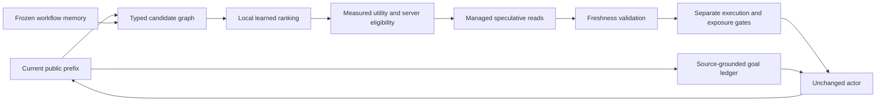

# GoalSpec v4: local controller and explicit goal state

V4 keeps the actor fixed and replaces the remote next-tool predictor in GoalSpec
with a small local controller. It shares one session implementation between
Derya and the native research service. Application behavior has no baseline
mode switch. The research harness retains Base, paper-based PASTE,
Salesforce-style memory speculation, and GoalSpec as experimental arms.

The architectural references and their implementation limits remain in
[V3_SOURCE_AUDIT.md](V3_SOURCE_AUDIT.md). APIGen is a dataset, not the Salesforce
runtime architecture. Hosted paper-based controls are not verified upstream
reproductions. No superiority claim follows merely from implementing them.

## Requested intent and observed progress

The goal ledger records active and superseded interpretations, prohibitions,
unresolved choices, resolved facts, and observed progress separately. Every
requested-goal binding uses a currently visible user source and an exact quote.
Tool observations cannot create user intent or authorization. Typed qualifiers
retain extrema, negation, dates, and route direction. Relative dates remain
literal unless the invocation binder has a current calendar anchor.

The mini model returns the complete active set, normally one complete objective,
by selecting exact spans prepared by the server from the visible user history.
It generates no quote strings or source-retirement bookkeeping. The server
atomically retires previous interpretations and validates every citation.
Omitted prior citations are recorded for semantic evaluation; citation coverage
alone does not prove requirement completeness. Read boundaries preserve
the selected literal spans. Material request changes suppress stale inferred
goals while the asynchronous refresh is pending. Unrelated reads update
progress without another goal request.

The first v4 delta protocol accumulated competing goals and failed a paid
development replay. A second iteration rejected too many model-written quotes
and source-retirement operations. Both outputs, code, costs and scores are
preserved. The span-selection protocol is a separately frozen iteration,
assessed against the same original teacher references and frozen blinded second
annotations. Teacher agreement measures consistency with those annotations,
not independent goal truth or task completion.

## Candidate universe and local learning

The typed graph binds current identities, owned entities, arrays, multi-argument
tuples, routes and dates. It separates possible proposals from policy-ready
reads. Historical entity values cannot fill current arguments without current
provenance. A per-frame proof map avoids regenerating the graph for every
candidate while retaining exact invocation and binding checks.

V4 retrieves frozen workflow patterns and uses experience-trained weights. The
older remote-candidate prompt containing retrieved episodic transitions and
confusions is inactive in this path; it remains active in the Salesforce-style
control. V4 does not claim an active episodic prompt benefit.

The selected CPU logistic controller ranks at most 32 candidates and predicts
READ versus NO_READ. An MLP, same-base fine-tuning variants and model soup were
tested; selection-fold results favored logistic. The auxiliary multiclass head
is telemetry only, and has no learned STOP class. Details, artifact hashes,
data splits, limitations and reproduction commands are in
[V4_CONTROLLER.md](V4_CONTROLLER.md).

Training uses public-prefix features and future-action imitation labels only
after candidate construction. Inferred goals are actor-visible but are not
learned features because the Base training tapes contain no goal predictions.
Source features exclude the reserved server policy entry to match training and
runtime. Python and TypeScript features and exported model scores are checked
against shared fixtures and actual trained weights.

## Execution, exposure and utility

The scheduler retains exact invocation promotion, cancellation confirmation,
generation fencing, read-only eligibility, bounded concurrency and complete
accounting. The session tracks binding dependencies so unrelated observations
do not discard usable work. Scope, policy, requirements and mutation changes
invalidate affected results before reuse.

Execution and actor-visible exposure are separate decisions. Optional evidence
is capped at two entries and 512 tokens including its actual rendered heading
and separators. Oversized observations are withheld before expensive validation;
selected observations still require a successful freshness check. The actor's
requested constraints have their own mandatory context treatment.

Utility subtracts validation, scheduling, local prediction, contention and
context costs. It assigns no invented actor-round benefit. Future observed use
is not causal exposure benefit, so the exposure head remains untrained. Cheap
native reads may rationally receive no normal speculative admission.

Development alone permits up to two experimental starts with randomized
expose/withhold assignments and a 25 ms bounded local read head start. Both
assignment groups receive the same wait. Remote goal inference is never awaited
at an actor boundary. The normal default is zero wait; confirmation disables
exploration. Every conditional assignment and its eligible pool are recorded.
The small experiment cannot by itself establish a generally useful causal head.

## Integration and evaluation

Derya retains its existing GPT-5.6 actor, generic six-round loop, native batch
behavior and specialized branches. Only audited office-wide reads are eligible.
Successful full-projection rereads and current access checks remain mandatory;
verified reuse is not reported as avoided database work. Derya's native model
and business distribution require separate live evaluation. The retail/airline
controller artifact is not validated for business ranking.

The Python step gateway owns native state, simulator, read snapshots and leases.
V4 uses fresh custom retail/airline compositions, structurally separated into
development and confirmation families before execution. Independent reference
and negative checks precede actor execution. Results are a custom tau-compatible
pilot, not an official full tau-bench score. V3's published-task subset remains
a separate historical result.

All paid work uses the original shared $500 ledger and allocation limits, local
infrastructure only, pinned model identities, complete paired reservations and
all declared failures. Confirmation size depends on development costs. Executed
source bytes, inputs, seeds, artifacts and model hashes are frozen. Evaluation
does not update the memory or controller it scores. Total live trial latency
includes per-trial managed drain; startup, independent verification and replay
timing are reported separately.

## Closed development diagnostics

The three paid goal protocols are preserved as separate iterations. On the same
77 graded request revisions, their Top-1 teacher agreement was 17/77, 25/77 and
44/77. The final literal-span protocol produced 78 valid outputs out of 80
revisions, but its 57.1 percent teacher agreement remains below the prior
49/77, or 63.6 percent. Two contract failures remain misses. Three unavailable
original grades are not silently replaced. Better output validity is not a
claim of better semantic agreement.

The fresh development controller replay contains four Base runs with 14 read
decisions and 19 NO_READ decisions. On an identical policy-ready candidate pool,
the prior versus frozen logistic controller achieved tool Top-1 of 3/14 versus
6/14 and full-argument Top-1 of 2/14 versus 5/14. Exact candidate coverage was
only 5/14 for both. After the action gate, full-argument Top-1 was 2/14 for both.
These separate numbers expose the remaining binding and gating bottlenecks.

All four development arms completed 4/4 tasks. GoalSpec averaged 28.14 seconds
versus Base's 29.40, but used 23 physical calls versus 19. Its paired latency
interval included no improvement. These development results selected the
confirmation utility settings; they are not the final confirmation result.
The final measured report belongs in the dated v4 report directory, with
development and confirmation kept separate.
