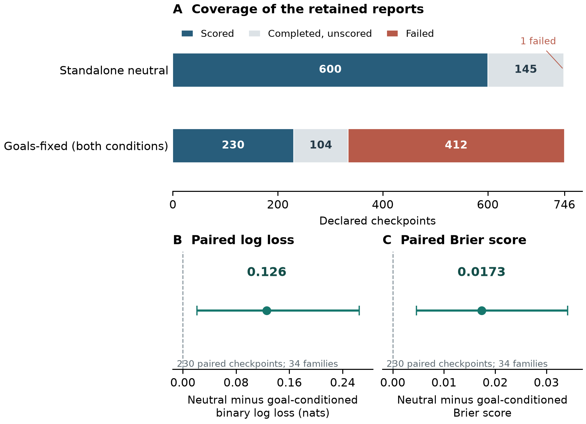
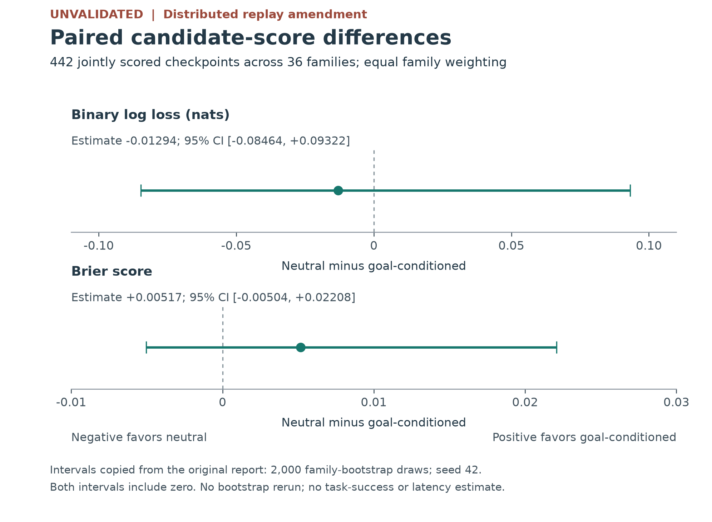
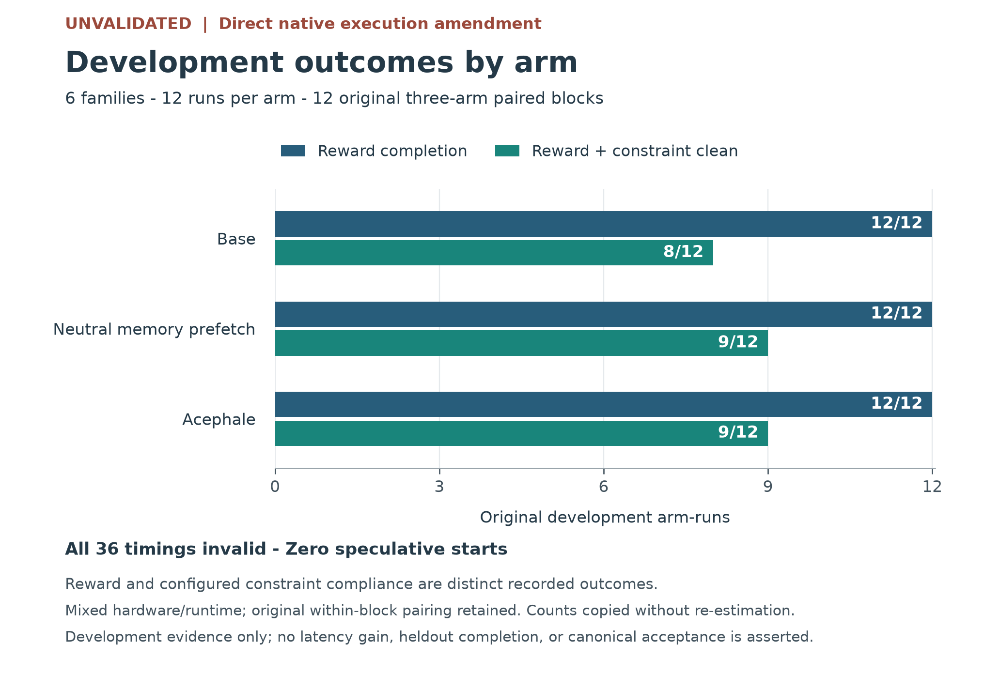

# Acephale: goal-conditioned speculative tool execution

**Exploratory report; original qualification requirements were not met.** The selected experiment is reported with its failures, censoring and missing measurements.

## Abstract

We study whether source-grounded goal information improves prediction of an agent's next read-only tool call. A frozen Qwen3.5-9B actor is paired with a Qwen3.5-0.8B LoRA predictor and speculative execution guarded by exact invocation matching and freshness checks. In retained fixed-panel replay, seed 17 improves equal-family binary log loss by 0.126 nats (95% family-bootstrap interval [0.021, 0.265]) on 230 jointly scored checkpoints, but 412 of 746 predictions fail in each condition. An exploratory distributed seed-29 continuation gives -0.0129 nats [-0.0846, 0.0932] on 442 checkpoints. Goal conditioning does not improve exact-call Top-1 hit rates within either seed. Native evaluation is a custom tau-compatible pilot with 36 development runs and 96 scheduled held-out slots. The held-out outcomes include 84 database-reward successes, 11 execution/evaluation errors and one step-limit censor. Source and lifecycle logs indicate a 90-minute service cutoff during both cohorts. All 247 development and 809 held-out prefetch checkpoints are rejected before retrieval, goal inference or ranking, so the nominal native arms execute demand-only paths. Required host-health observations are absent, leaving no valid comparative latency samples. These results do not establish a native goal-conditioning benefit or speedup; they identify candidate coverage, numerical serving disagreement, admission costs and service lifetime as barriers to a qualified test.

## 1. Question and scope

An agent often waits for a tool after deciding which call to make. A second model can predict a useful read during the actor's generation and start it early. The speculative result is reusable only if the actor later requests exactly the same invocation and freshness validation succeeds. This can hide latency, but a wrong prediction consumes resources, and predictor contention can slow the actor.

The question is whether goal information improves this prediction enough to justify its cost. Goal conditioning is not guaranteed to help: an inferred goal may be incorrect, the candidate pool may omit the required call, or extra inference may cost more time than the read saves.

PASTE motivates overlapping tool execution and generation, exact invocation matching, and cost-aware admission [1]. Speculate with Memory motivates reuse of trajectory experience and prediction errors [2]. Acephale studies goal conditioning within an implementation inspired by these methods. It is not a verified reproduction of their complete serving systems or reported benchmarks.

## 2. Implementation

### 2.1 Models and training

The actor is Qwen3.5-9B and the auxiliary predictor is Qwen3.5-0.8B. The actor is frozen across native arms. Serving uses the pinned vLLM 0.32.0 environment and BF16 configuration. Actor input/output budgets are 28,672/4,096 tokens; predictor budgets are 7,168/1,024. Thinking is disabled in this profile. Exact checkpoint, tokenizer, adapter and image identities are retained with the artifacts.

Only the predictor is fine-tuned. The existing recipe uses rank-16 LoRA, alpha 32, dropout 0.05, AdamW at 1e-4, weight decay 0.01, clipping at 1, effective batch size 16, and at most three epochs or 500 optimizer steps. Targets include selected text attention, feed-forward and gated-delta projections; the actor, base parameters, embeddings and language head remain frozen. Training uses completion-only cross entropy with separate goal-inference, neutral-ranking and goal-conditioned-ranking prompts.

Ranking outputs an action class and one binary hit token per candidate. Serving normalizes the logits of the 0/1 token pair, then applies the retained calibration map. Because decoding is autoregressive, later scores condition on earlier generated tokens. They are not independent marginal probabilities. A discriminative ranking head was proposed but is not an evaluated component of this frozen experiment.

The actual fitting manifest contains 1,074 supervised examples from 358 complete checkpoints across 24 families; 79 checkpoints contain a positive read. Each checkpoint contributes goal inference, neutral ranking and goal-conditioned ranking supervision. Both seed receipts record 204 completed optimizer steps. Three epochs was the configured recipe; completed epochs, training duration and final loss are not independently supplied by the recovered receipts. Each unmerged adapter has 10,822,656 trainable parameters in 372 tensors across 186 modules, stored in FP32 and served with BF16 LoRA. The base recipe retains 18 A_log tensors in FP32.

### 2.2 Public context, memory and candidates

The input compiler includes the visible conversation, policy, tool contracts and current argument evidence. Future actions, hidden native state and evaluator outcomes are excluded. Families are split before annotation or memory mining. Requested-goal labels see the public checkpoint only.

Workflow patterns encode observed ordering, argument dependencies and verified endpoints. At a new checkpoint, symbolic binding resolves arguments from currently visible fields and indices. A historical entity value cannot authorize a current argument.

The implementation supports filtered episodic retrieval for compatible model, tool, environment, policy, authorization and family scope. The optional embedding/exact-cosine and reciprocal-rank-fusion route is a capability, not an evaluated native path in these runs. All retained development and retained held-out native configurations omit episodicEmbeddingsPath. Without a retrieval port, the configured fallback uses lexical token-set cosine with at most four episodes, a 16,000-character limit and strict-policy, verified and family filters.

Even this lexical fallback was not reached at the observed native prefetch checkpoints: the earlier perfect-predictor opportunity bound returned before retrieval, inferGoals or rank. The completed development audit is reported in Section 5.1. Fixed-panel predictor replay remains a separate experiment and must not be conflated with the native execution path.

When admitted past the opportunity bound, the proposal implementation deduplicates exact invocations and constructs a common, goal-neutral candidate window before conditional ranking. The proposal pool is bounded at 128, and at most three candidates are selected. A positive label means the exact invocation occurs anywhere in the immediately following authoritative batch. Multiple candidates may be positive.

### 2.3 Speculative execution

The scheduler admits audited, read-only calls with current authorization and source-bound arguments. The configured limits are two speculative reads per run, four globally, twelve starts per run, one-hop lookahead and a five-second read deadline. These are within-trial limits.

Native speculative reads use isolated Python-owned snapshots. An authoritative invocation may join matching work, but consumption requires successful freshness validation. Mutations invalidate pending evidence. Cancelled and wasted work remains counted; prefetched observations are never fabricated as tool-call results.

Calibration uses reserved families rather than held-out labels. Opportunity profiling measures actor lead time, predictor cost, scheduling overhead, tool duration, validation and contention. Its conservative admission heuristic uses lower-tail benefits and upper-tail costs. A failed opportunity profile is retained as a failed prerequisite, not replaced with a favorable subset.

## 3. Experimental design and estimands

The compositional task library contains 44 families: 24 for fitting, six for calibration, six for development and eight held out. Each family has two synthetic customer/entity variants. Operation sets differ across partitions, while primitive actions overlap. This is compositional generalization, not an unseen-intent claim.

The tasks use pinned native tools, policies and database evaluators from tau2-bench [3]. Expected database changes and omission checks are specified before actor execution. The generated cohort is a **custom tau-compatible pilot**, not an official full-benchmark score. Database reward and conversational policy compliance are separate outcomes.

The three native arms are the base actor, neutral-memory prefetch, and goal-conditioned memory prefetch. Tasks, actor weights, trial seeds, tool access and step limits are shared; arm order is randomized within each paired block. Development contains 36 arm-runs. The actual frozen held-out target is eight families, two variants, two trials and three arms: 96 selected arm-runs. The original selector selected all eight families before execution.

Replay reports candidate-level binary log loss, Brier score and coverage. These quantities are not full-action cross entropy or true conditional entropy. Paired differences use the original equal-family bootstrap with 2,000 draws and seed 42. Conditional-on-observation intervals do not correct selective missing predictions.

Native reporting preserves every declared run, failures and censoring. It separates database reward, policy constraints, tool calls, speculation and revalidation, costs, and timing validity. The two predictor seeds are confounded with assigned variant/trial/time groups; they do not support a causal seed comparison.

## 4. Prediction and opportunity results

| Replay comparison | Jointly scored checkpoints / families | Neutral-minus-goal log loss, nats (95% CI) | Brier difference (95% CI) |
|---|---:|---:|---:|
| Retained seed 17 | 230 / 34 | 0.125995 [0.021043, 0.265059] | 0.017339 [0.004602, 0.034146] |
| Distributed seed 29, exploratory | 442 / 36 | -0.012936 [-0.084643, 0.093218] | 0.005168 [-0.005044, 0.022080] |

Positive values favor goal conditioning on the observed comparison panel. Seed 17 retained 334 completed predictions and 412 failures per fixed-panel condition. Seed 29 retained 582 completed predictions and 164 failures per fixed-panel condition. The standalone neutral reports use a different scored cohort and are not substitutes for the paired neutral rows.

Seed 17 shows an observed-subset improvement, but its high failure rate limits interpretation. Seed 29's intervals include zero. Neither result establishes a general goal-conditioning benefit, equivalence, or a native latency improvement. The distributed continuation also changed hardware and runtime execution placement, so it is not a clean seed replication.

The fixed-panel exact-invocation hit rates do not improve with goal conditioning. Both reports declare 266 checkpoints whose next authoritative batch contains an eligible read, out of 746 total checkpoints; the other 480 are no-read checkpoints.

| Replay / condition | Exact-call Top-1 hit rate | Exact-call Top-3 hit rate | Candidate-panel any-hit coverage |
|---|---:|---:|---:|
| Seed 17, neutral | 20.68% | 20.68% | 45.86% |
| Seed 17, goal-conditioned | 20.68% | 20.68% | 45.86% |
| Seed 29, neutral | 39.47% | 40.23% | 45.86% |
| Seed 29, goal-conditioned | 39.47% | 40.23% | 45.86% |

Each rate uses the declared 266 eligible-read checkpoints, including missing predictions rather than conditioning on successfully decoded outputs. A hit requires the tool and full arguments to match an invocation in the next authoritative batch. At most three preselected candidates are ranked. These are exact-invocation hit rates, not tool-name-only accuracy. The equal rates show that seed 17's probability-loss improvement did not change these top-ranked-hit outcomes. Different missing-prediction rates prevent treating the two seed rows as a clean causal seed comparison.

The original seed-17 opportunity profile completed 8 of 20 measurements; the other 12 requested a different read from the profiled candidate. Seed 29 completed 7 of 20, with 12 measured read misses and one interruption-censored row. Both fail the unchanged minimum of ten completed measurements. Read misses are prediction failures at those prefixes, not evidence that the actor failed the customer's task.

Goal-teacher agreement is also distinct from native reward. The retained seed-17 reliability artifact reports 6 agreements among 141 graded cases and a Wilson lower bound of 0.01965. The seed-29 continuation reports 15 agreements among 141 cases and a lower bound of 0.06554. The annotation audit used zero human reviews and a separate prompt to the same teacher model; reviewer-model independence is not claimed.

Figure 1. Retained seed-17 prediction evidence. Positive neutral-minus-goal differences favor goal conditioning on the jointly observed subset; missing predictions remain reported.

Figure 2. Exploratory seed-29 paired replay differences. Both intervals include zero, and this distributed continuation is not a clean seed replication.

## 5. Native evaluation

### 5.1 Completed development cohort

All 36 declared development arm-runs completed: six families, two task variants and three arms. The original native estimators were applied to the saved evaluator outputs. The following results are exploratory; none is a held-out result.

| Metric | Base actor | Neutral-memory prefetch | Goal-conditioned prefetch |
|---|---:|---:|---:|
| Completed / declared arm-runs | 12 / 12 | 12 / 12 | 12 / 12 |
| Database reward 1.0 | 12 / 12 | 12 / 12 | 12 / 12 |
| Reward 1.0 with no recorded policy violation | 8 / 12 | 9 / 12 | 9 / 12 |
| Runs with a recorded policy violation | 4 | 3 | 3 |
| Logical / physical tool calls, total | 77 / 77 | 77 / 77 | 76 / 76 |
| Speculative reads / revalidation calls | 0 / 0 | 0 / 0 | 0 / 0 |
| Valid comparative latency samples | 0 | 0 | 0 |
| Recorded hosted user/judge usage, USD | 0.153230 | 0.146678 | 0.152834 |

Database reward and policy compliance differ because the database evaluator can find the expected final state while a separate assertion flags missing explicit confirmation before a mutation. The recorded policy verdict is retained; database reward alone is not unconditional task correctness.

The equal-family paired difference in constraint-clean success is +0.0833 for either prefetch arm relative to the base actor, with the original 95% family-bootstrap interval [0, 0.25]. Goal-conditioned minus neutral prefetch is 0 with interval [-0.25, 0.25]. Goal-conditioned minus base logical tool calls is -0.0833 per run, with interval [-0.3333, 0.1667]. These estimates use six families and 12 paired trials, with 2,000 resamples and seed 42. They compare nominal configurations whose auxiliary prediction paths were never entered, so their differences cannot be attributed to inferred goals, retrieval or trained-predictor efficacy.

All arms have empirical database-reward estimates and bootstrap intervals of 1.0 [1.0, 1.0]; all paired reward differences are 0 [0, 0]. These degenerate empirical intervals reflect the uniformly successful observed sample. They do not establish population-perfect performance, equivalence or a ceiling on future failures.

The completed raw event logs record 370 local model dispatches and 370 completions, all Qwen3.5-9B actor requests; no auxiliary goal-inference or candidate-ranking request occurs. Every one of the 247 prefetch-arm checkpoints is rejected by the unchanged perfect-predictor opportunity bound before retrieval, inferGoals or rank. The two retained opportunity estimates have predictionMs greater than actorLeadMs (541.052832 versus 479.775439, and 1673.486294 versus 890.310045). The original overlap formula is therefore zero even at probability one, while validation, scheduling and contention overheads make the bound nonpositive.

The nominal native arms collapsed to demand-only execution under these exploratory opportunity inputs. Neither configured lexical fallback nor optional vector/RRF retrieval was exercised at these checkpoints. This is fail-closed abstention, not a measured predictor-accuracy failure, and it does not prove that the tasks lacked useful speculative reads. No speculative read was executed or consumed. Every comparative-timing validity flag is false, and the original report has null latency estimates and intervals. Operational elapsed time is excluded from speedup comparisons. Hosted usage is recorded user-simulator/judge usage, separate from GPU charges and any reconciled invoice.

The final held-out logs contain 1,213 actor dispatches and 1,212 completions; one dispatch lacks a completion before service closure. All 809 observed prefetch checkpoints are rejected before retrieval, goal inference or ranking. There are no auxiliary-predictor dispatches. These complete log counts replace the earlier partial snapshot; the retained development and held-out source identities remain separate.

Figure 3. Development database reward and constraint-clean outcomes for nominal arms, copied from the original native analysis. Each arm has 12 runs across six families. The opportunity bound prevents auxiliary prediction and speculation; these are not live goal-predictor efficacy estimates. All comparative timings are invalid.

### 5.2 Deployment and reporting amendments

The exploratory cloud continuation proceeded despite failed opportunity and deployment-qualification prerequisites. It remains UNVALIDATED under the original protocol. Existing accepted components and failed qualification evidence are preserved.

Development ran as 12 intact three-arm blocks. Eleven blocks used L40S hardware and one used RTX PRO 6000 Blackwell; notebook and EC2 runtime images also differed. Each paired block retained one execution environment across its arms. All 12 original scope records remain available. The reporting adapter compares scope within blocks, retains domain-specific tool schemas and hardware strata, and verifies unchanged model configuration, data, protocol, source commit and task bundle. The statistical estimators are unchanged.

A collection record omitted the tools field for 18 seed-17 rows. Reporting restored that metadata from the exact executed configurations, after verifying all frozen run IDs, task/family identities, arms, trial and predictor seeds, ordering and step limits. No tool schema or scientific output was modified.

The development actor seed is 17 in both predictor-training-seed groups. Task variant and predictor training seed are confounded. There is no repeated same-task trial pair, so two-trial consistency is undefined for development.

### 5.3 Held-out evaluation

All 96 scheduled held-out slots remain in the original denominator: 84 completed with database reward 1.0, 11 failed with execution/evaluation errors and one was censored at the native step limit. The executed local-service configuration imposed a 5,400-second lifetime, and the source scheduled a stop at that limit. Both services closed with aborted=true after approximately 90 minutes plus teardown, before the 5,520-second owner limit. This is an attribution supported by source and timing; the logs contain no timer-specific reason code. The closing service caused the evaluator's retained Gateway closed exception. Two error rows had actual model calls; the other nine were entered by the executor but contain no actor or hosted-provider dispatch. They remain failed rows rather than being relabeled not started. The original no-retry launcher and closed accounting sessions were preserved. These operational failures limit the scheduled-slot completion rates and cannot be attributed to goal conditioning.

**Heldout native results — UNVALIDATED.** Custom tau-compatible execution; 96 declared original slots. This is not a qualified or full-benchmark score.

| Recorded metric | Base | Neutral memory prefetch | Acephale |
| --- | --- | --- | --- |
| Scheduled trials | 32 | 32 | 32 |
| Status counts | completed=28; failed=4 | censored=1; completed=27; failed=4 | completed=29; failed=3 |
| DB reward successes | 28 | 27 | 29 |
| DB reward pass1 (trial rate) | 0.8750 | 0.8438 | 0.9062 |
| DB reward family estimate / CI | 0.8750 [95% CI [0.7812, 0.9688]]; n=32, families=8 | 0.8438 [95% CI [0.7188, 0.9688]]; n=32, families=8 | 0.9062 [95% CI [0.8125, 0.9688]]; n=32, families=8 |
| Known constraint-clean pass1 | 0.6562 | 0.6562 | 0.6562 |
| Constraint audit complete / scheduled | 28 / 32 | 27 / 32 | 29 / 32 |
| Constraint violations (missing trials) | 7 (missing 4) | 6 (missing 5) | 8 (missing 3) |
| Logical tool calls | 262 (missing 0) | 262 (missing 0) | 268 (missing 0) |
| Physical tool calls | 262 (missing 0) | 262 (missing 0) | 268 (missing 0) |
| Physical calls / success | 9.3571 | 9.7037 | 9.2414 |
| Revalidation calls | 0 (missing 0) | 0 (missing 0) | 0 (missing 0) |
| Hosted known usage (USD) | 0.490408 | 0.469485 | 0.514073 |
| Unknown-cost trials | 4 | 4 | 3 |
| Valid live-latency samples | 0 | 0 | 0 |
| Live latency mean / median / p95 (ms) | NA / NA / NA | NA / NA / NA | NA / NA / NA |
| Joint actor/predictor-seed consistency (paired-task n) | 0.7500 (n=16) | 0.6875 (n=16) | 0.8125 (n=16) |
| Known constraint-clean joint consistency (paired-task n) | 0.4375 (n=16) | 0.3750 (n=16) | 0.5000 (n=16) |

Counts include all recorded statuses. Parenthesized missing counts are retained, not imputed. The DB reward trial rate and equal-family estimate are distinct stored fields. Constraint-clean results cover the configured assertion audit, not complete policy compliance. NA denotes a null or absent report value; zero valid latency samples do not imply zero latency. Joint seed consistency is not fixed-checkpoint pass².

| Original paired estimate / 95% CI | Neutral memory prefetch − Base | Acephale − Base | Acephale − Neutral memory prefetch |
| --- | --- | --- | --- |
| DB reward difference | -0.0312 [95% CI [-0.0938, 0.0000]]; n=32, families=8 | 0.0312 [95% CI [0.0000, 0.0938]]; n=32, families=8 | 0.0625 [95% CI [0.0000, 0.1875]]; n=32, families=8 |
| Known constraint-clean difference | 0.0000 [95% CI [-0.1562, 0.1562]]; n=32, families=8 | 0.0000 [95% CI [-0.2188, 0.2188]]; n=32, families=8 | 0.0000 [95% CI [-0.2812, 0.2500]]; n=32, families=8 |
| Logical tool-call difference | 0.0000 [95% CI [-0.2812, 0.2812]]; n=32, families=8 | 0.1875 [95% CI [-0.4688, 1.0312]]; n=32, families=8 | 0.1875 [95% CI [-0.3438, 0.9375]]; n=32, families=8 |
| Physical tool-call difference | 0.0000 [95% CI [-0.2812, 0.2812]]; n=32, families=8 | 0.1875 [95% CI [-0.4688, 1.0312]]; n=32, families=8 | 0.1875 [95% CI [-0.3438, 0.9375]]; n=32, families=8 |

Paired differences are treatment minus baseline, copied with their original family-weighted confidence intervals and per-metric denominators; no statistics were recomputed.

Hosted usage scope: hosted_user_and_judge_only. These are recorded provider-usage/ledger values, not reconciled invoices or confirmed cash debits; GPU charges are separate.

Seed-design limitation: Heldout trial0 uses actor17/predictor17 and trial1 actor29/predictor29; consistency changes both seeds.

The original scheduler summary has 32 missing records per arm for starts, usefulness, waste, rejections and cancellations. Its known totals of zero are not complete zero-count observations. Independent source-bound event logs instead establish that every observed held-out prefetch checkpoint returned before prediction or admission. All 96 timing flags are false: the retained samples record host_guard_not_configured, hostGuardConfigured=false, hostHealthStatus=unobserved and the missing-guard-only waiver. No comparative speedup can be estimated from these runs.

### 5.4 Coverage and evidence limits

All 36 development and 96 selected held-out IDs are represented, with no missing or duplicate IDs. This coverage does not mean all scheduled evaluations completed successfully. The original opportunity and numerical qualification failures remain unchanged, and scientific acceptance remains false.

The original statistics retain 84 completed, 11 failed and one censored held-out outcome. The nine error rows without actor or provider dispatch are retained as failed executor entries, not relabeled as untouched tasks. Unknown policy audits and usage charges remain unknown. The nominal-arm completion differences are affected by service closure and cannot be attributed to goal conditioning.

The original numerical report, final terminal-cause evidence, safe reproduction rows and unchanged estimators accompany the editable source. The displayed scheduler counters retain their missing-data limits. Recorded hosted usage excludes GPU charges and is not a verified invoice.

## 6. Limitations and interpretation

The retained seed-29 serving probe also failed its numerical acceptance criterion. PyTorch's reference conditional probability for token 1 relative to tokens 0 and 1 is 0.23370636; the configured serving engine returned 0.21206880, an absolute difference of 0.02163755 against the unchanged maximum of 0.01. All three retained requests on each of L40S and RTX PRO 6000 Blackwell produced the same conditional probability. This does not establish a hardware-specific cause.

The retained source audit found routes for all 372 FP32 adapter tensors (186 A/B pairs, 114 packed runtime groups), but did not attest every live tensor value or establish why the two engines disagree. The adapter remains stored in FP32 and served under the declared BF16 configuration. No tolerance was widened, and numerical equivalence remains unestablished. The release includes the exact fixture identity, checkpoint/tokenizer hashes, reference and observed values, and unchanged gate.

Under the retained opportunity estimates, faster prediction alone cannot make the configured admission bound positive. Its overlap term is capped by tool duration (9.076 and 11.965 ms), while the corresponding contention estimates alone are 813.436 and 1,219.885 ms. Even a zero-latency predictor with probability one would therefore be rejected under these same inputs. This is an algebraic consequence of the recorded heuristic, not a new oracle experiment or a measured limit on attainable speedup; both opportunity profiles failed their minimum-coverage requirement. A future experiment should first establish qualified positive overlap on the intended tool backend and serving arrangement, then test whether a cheaper or better-calibrated predictor can exploit it.

The central weakness is not solved by more GPU capacity. Candidate coverage, goal reliability and the opportunity gate limit whether speculation becomes useful. Token-level training accuracy is not a substitute for exact-call ranking quality. Missing prediction outcomes can bias an observed-subset comparison.

The current predictor jointly learns three textual tasks with a generative objective. Candidate-order dependence and annotation-to-deployment goal mismatch remain plausible explanations for poor ranking. They are hypotheses for a future experiment, not demonstrated causes or evaluated fixes. A frozen-backbone discriminative head and family-held-out probability calibration would test those hypotheses without changing the actor.

The native extension has a small synthetic task cohort, limited policy assertions and deployment deviations. No complete official tau score, SOTA claim, proof of lossless acceleration, or claim that goals can only improve performance is warranted. A useful negative result is to identify where prediction gains fail to translate into admitted, consumed reads.

## 7. Reproducibility

The release retains model and source identities, family splits, prompt and candidate manifests, original labels, prediction failures, opportunity rows, native verdicts, event logs and analysis outputs. Earlier attempts and interruptions are retained separately from unique scientific runs. Accepted evidence and exploratory continuations remain distinguishable.

The artifact bundle contains this editable manuscript, the rendered PDF, figures and source data, original analysis scripts, and a manifest mapping reported values to result files. Infrastructure/provider charges and hosted-model usage are reported separately. Recorded usage is not presented as a reconciled invoice.

