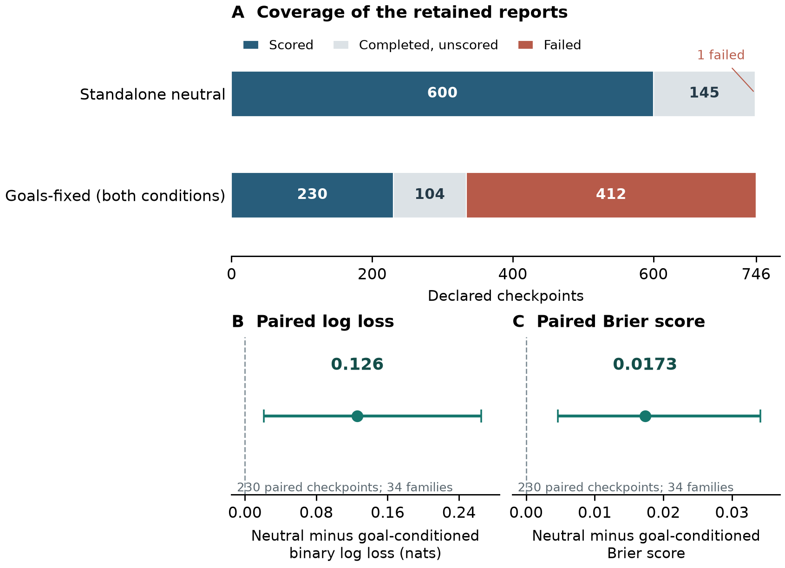

# Source-grounded goal conditioning for speculative read execution in language-model agents

**Working manuscript. Retained seed17 results are reported; remaining outcomes are pending.**

## Abstract

We study whether source-grounded representations of a user's requested outcome help an auxiliary predictor select useful read-only tool invocations while an unchanged language-model actor is generating. Acephale combines workflow and episodic memory with explicit argument binding, calibrated invocation scores and deployment-specific admission measurements. Speculative results remain isolated until the actor requests the exact invocation and validation succeeds. The frozen study separates common-panel replay, prefix-level opportunity profiling and paired native outcomes. In retained seed17 replay, 230 jointly scored checkpoints across 34 families yield an equal-family neutral-minus-goal-conditioned log-loss difference of 0.126 nats (95% bootstrap interval 0.021 to 0.265) and Brier difference of 0.0173 (0.0046 to 0.0341). However, each condition retained 412 failures among 746 declared checkpoints; these observed-subset estimates do not establish an all-checkpoint or heldout benefit. The study is an exploratory, machine-audited custom tau-compatible pilot, with zero human annotation reviews. Native task outcomes remain pending, so this draft makes no task-success or speedup claim.

## 1. Introduction

Tool latency and model generation occupy different parts of an agent's execution path. Predicting an authorized read before the actor requests it may hide some latency, but prediction errors can waste work and simultaneous requests can contend for serving resources. Successful speculation therefore requires more than an accurate next-call classifier: it also requires correct argument binding, isolation from authoritative state, cancellation and a useful overlap window on the actual deployment.

A user's requested outcome offers additional information about future reads. Its value is empirical: inferred goals can be incorrect, retrieval can distract the predictor, and extra inference can erase saved tool latency. We distinguish prediction evidence from operational admission and task-level evaluation. None substitutes for the others.

Acephale uses a frozen actor and a smaller auxiliary predictor. Goal hypotheses represent mutually exclusive interpretations of the complete requested outcome, including concurrent explicit objectives. Execution permission is checked independently. The actor receives a prefetched result only after asking for that invocation and passing validation. The mechanism does not change actor weights or claim an engine-level vLLM co-scheduler.

The intended contributions are a goal-conditioned prediction and binding mechanism, deployment-bound admission measurements that account for benefits and overhead, and an evaluation separating replay, prefix profiling and paired native outcomes. Whether these mechanisms improve the declared endpoints remains to be determined by the completed frozen study.

## 2. System

Public trajectory checkpoints provide messages, tool contracts and current argument evidence. Hidden task state, future actions and independent outcomes are excluded from prediction inputs. Workflow and episodic memory publications are immutable. Candidate construction deduplicates exact invocations, checks current bindings and creates a common token-budgeted window before goal conditioning. Ranking retains at most three selected candidates.

Default admission limits are two simultaneous speculative reads per run, four globally, twelve speculative starts per run, one-hop lookahead and a five-second deadline. These limits govern work inside a trial; they are not trial concurrency. Authoritative work retains priority. Exact requests may join managed speculative jobs; mutations invalidate stale evidence and shutdown drains children.

Native reads use Python-owned isolated snapshots with freshness checks. Speculative, wasted and validation reads count as physical work even if logical actor calls remain unchanged. A rejected speculative result cannot be presented as an authoritative observation.

## 3. Experimental design

The actor is Qwen3.5-9B and the predictor is Qwen3.5-0.8B at the exact revisions in the frozen methods. The actor is unchanged across live arms. Predictor artifacts retain their weight, adapter, precision and numerical-qualification lineage. The serving contract uses the pinned vLLM image and BF16 runtime. No failed qualification threshold is relaxed during continuation.

Families are partitioned before annotation and memory mining. Goal annotations observe public checkpoints only. The exploratory annotation audit has zero human reviews. Its separate request and prompt use the same pinned model as the teacher; reviewer-model independence is not claimed. Machine audit does not satisfy the separate human-reviewed design by relabeling reviewers.

Replay compares neutral-fixed, goals-fixed and goals-selected conditions. Fixed-panel comparisons use common candidate IDs and any-next-batch binary labels. The resulting score is not full-action cross entropy or true conditional entropy. The helper's existing three-condition concurrency remains on one accepted GPU host, preserving the original resource and ordering contract.

Opportunity profiling reconstructs native state from public prefixes. It pairs identical seeded actor inputs run alone and alongside one neutral ranking request. Once ranking returns, background goal refresh overlaps the admitted native snapshot read and freshness refresh. Pair order alternates. The profiler records gateway-inclusive timing spans, drains background work and retains failures. At least ten completed measurements are required for aggregation. These measurements support an admission heuristic, not a causal task-level speedup estimate.

Live arms are base actor, neutral-memory prefetch and goal-conditioned memory prefetch. Paired blocks share tasks, trial seeds, tools, budgets and step limits; arm order is randomized within declared blocks. Development precedes heldout selection. The original selection receipt determines the eligible heldout subset. Zero eligible blocks is an explicit terminal outcome, not permission to substitute tasks.

## 4. Analysis

The unchanged analysis code reports binary log loss, Brier score, common-panel coverage and missing or failed predictions, with its existing family-clustered paired uncertainty calculation. Calibration fits training data only. Development diagnostics do not permit fitting on test labels.

Native reporting separates reward/pass1, constraints, two-trial consistency, logical actor calls, physical reads and validations, total latency, model overhead, tail denominators and costs. Paired comparisons preserve block identities and failures. Tail estimates require observed sample counts. Partial outcomes cannot be presented with a nominal full-study denominator.

AWS infrastructure expenditure and hosted model API expenditure are separate accounting categories. Failed infrastructure attempts remain visible even when they generated no model requests. Historical components keep their original execution identities. Operational continuations retain earlier failed generations and the same permanent scientific assignment.

## 5. Retained results and pending outcomes

### 5.1 Retained seed17 replay and calibration

The accepted seed17 analysis contains two distinct fixed-panel reports. The standalone neutral report declared 746 checkpoints: 745 completed prediction and one failed. Scores were available for 600 checkpoints. The goals-fixed report declared the same 746 checkpoints for each condition but recorded 334 completed predictions and 412 failures per condition. Its paired analysis uses 230 jointly scored checkpoints across 34 families. These coverage differences prevent treating the standalone neutral estimate and the goals-fixed estimates as one common-cohort comparison.

Within the goals-fixed report's jointly observed cohort, the original equal-family paired analysis estimates neutral minus goal-conditioned binary log loss as 0.125995 nats (95% family bootstrap interval 0.021043 to 0.265059). The corresponding Brier difference is 0.017339 (0.004602 to 0.034146). Positive values favor the goal-conditioned scores on this observed subset. Both intervals come directly from the original report's 2,000 bootstrap samples with seed 42. They do not account for potentially selective missing outcomes, and they do not establish an improvement across all declared checkpoints, fresh heldout tasks or native task execution.

| Retained report / condition | Declared checkpoints | Prediction completed / failed | Scored checkpoints | Binary log loss (nats) | Brier |
|---|---:|---:|---:|---:|---:|
| Standalone neutral | 746 | 745 / 1 | 600 | 1.087892 | 0.111409 |
| Goals-fixed / neutral | 746 | 334 / 412 | 230 | 1.199627 | 0.107620 |
| Goals-fixed / goal-conditioned | 746 | 334 / 412 | 230 | 0.969563 | 0.077217 |

**Figure 1. Retained replay quality and coverage.** The upper panel separates scored checkpoints, checkpoints that completed prediction without a score, and retained failures; the goals-fixed bar applies to both conditions. Lower panels reproduce the original equal-family paired estimates and 95% bootstrap intervals on 230 jointly scored checkpoints in 34 families. Positive differences favor goal-conditioned scores on this observed subset. The standalone neutral report is shown for coverage only and is not the baseline for the paired estimates. Intervals do not incorporate unobserved outcomes. All plotted values come from the accepted report artifacts; no bootstrap was rerun.

The two goals-fixed rows share the paired cohort. Their displayed checkpoint means differ from the equal-family paired estimand above. The original reports explicitly disclaim a heldout claim and are not restricted to the test partition. All conditions retain 266 eligible read checkpoints and candidate-panel any-hit coverage 0.458647; this panel-coverage denominator differs from the scored-checkpoint denominator.

The calibration receipt reports six agreements among 141 graded cases and a conservative reliability value of 0.019646160425252017, produced by its reserved-calibration full-cohort 95% Wilson lower-bound method. Separately, the annotation audit accepted 19 of 20 machine-reviewed annotations. There were zero human reviews; the reviewer used a separate request and prompt to the same model. The six-of-141 agreement count and the 19-of-20 annotation audit describe different evaluations.

Sources: accepted seed17 analysis component SHA 647f23466bed49876e0901dda865c121e62e13916d83a3792ddbeccbfd7e511f; [neutral report](sources/seed17-neutral-fixed-score-report.json), [goals-fixed report](sources/seed17-goals-fixed-score-report.json), and [goal reliability](sources/seed17-goal-reliability.json). Exact source, manifest and successful command-receipt hashes are recorded in retained-results-evidence-01.json. Seed29 and native outcomes remain pending.

### 5.2 Opportunity profiling

The Ohio seed17 profile reached its original profiling code in two operational generations. Each recorded twenty failures before timing spans or model requests: first from missing native dependencies, then from an unresolved historical task-bundle path. These forty retained error records correspond to repeated operational executions of the same twenty declared checkpoints, not forty independent scientific trials. Later continuations preserve the records and completed preparation under the same permanent assignment. No opportunity estimate is reported until an accepted closure is available.

The recovered prefix-construction check successfully built all twenty declared prefixes with network access denied and no actor or predictor request. This is an operational readiness check, not a timing measurement or native outcome.

### 5.3 Paired native evaluation

Development, selection and heldout outcomes remain unreported. Planned counts are not completed counts. The final report must state actual dispatched, completed, failed, censored and eligible denominators for each arm and seed.

## 6. Limitations

This is a custom tau-compatible pilot, not an official complete benchmark score. Retrospective replay is not a causal actor intervention. Prefix profiling does not execute newly proposed actor actions and cannot establish task-level reward or speedup. Teacher agreement does not establish native success. The machine audit provides neither human review nor reviewer-model independence.

Qualification and operational failure history constrain comparisons. Equal discrepancies across two GPU configurations do not identify a loader or numerical defect. No such causal diagnosis is asserted. Hardware transitions retain explicit provenance and must pass the original numerical gates.

## 7. Reproducibility

The scientific source, model revisions, input hashes, permanent identities, original validators and failed generations are retained. Editable writing files remain separate from execution roots. The accepted report and versioned journal exports govern the final completion declaration. Every outcome claim and figure requires its exact accepted source artifact before publication.
