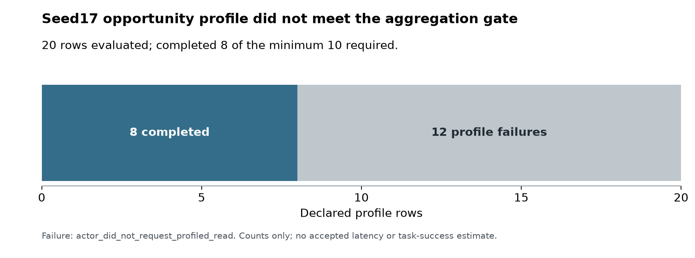

# Seed17 opportunity profile: negative outcome

The subsequent Ohio seed17 opportunity profile evaluated all twenty declared checkpoints under the original protocol. Eight measurements completed; twelve retained the profile failure label actor_did_not_request_profiled_read. The unchanged admission rule requires at least ten completed measurements. The profile therefore recorded readyForAggregation=false, and the whole opportunity unit failed. Its receipt is closed, cleanup failures are empty and all owned children are drained. The twenty row identities and order match the profile plan, and each individual evidence file matches its versioned hash.

**Figure 2. Complete disposition of the seed17 opportunity profile.** Of twenty declared profile rows, eight completed and twelve retained the recorded profile failure. Eight is below the original minimum of ten completed measurements, so no opportunity aggregate was accepted. These are profile checkpoints, not completed native task episodes. The figure shows counts only; it does not select the eight completed rows for a latency, speedup or task-success estimate.

The twelve profile failures remain part of the result. They are not recoded as infrastructure errors or replaced by reruns. The eight completed rows provide descriptive records only; conditioning a performance estimate on that selected subset would omit the failed majority. This paper reports no admission quantiles, latency gain or native score from the profile.

A separate post hoc inspection of retained public responses found that all twelve profile failures requested a different tool from the profiled candidate in both paired actor responses. This describes candidate alignment at those checkpoints, not actor correctness or customer-task failure, and it does not change the recorded labels. [The descriptive inventory](posthoc/posthoc-note.md) remains separate from the original outcome and its acceptance gate.

Two earlier operational executions had each recorded twenty failures before timing spans or model requests, from missing native dependencies and an unresolved historical task-bundle path. Those forty pre-model error records are retained separately. They are repeated operational records for the same twenty declared checkpoints, not forty additional scientific trials and not part of the twenty-row scientific denominator. The prior offline prefix-construction check was operational readiness evidence only.

Sources: the versioned generation06 worker result SHA 63a713b4df5844a2df542412832db10e62aaf221c1531e5e0ba440b93c00f28c, the twenty-row measurements file SHA 41d8f3de2b114220b3789ddee28a43069582acd2cc67982ac22aa8ff16a7b6ed, and the closed profile receipt SHA cc83d0a8b16f7503e630c6bc1e8a3fd8fea582afe279c785b297cb7df7f98df6. [Exact source and row lineage](negative-outcome-evidence.json) retain all twenty outcomes and the same permanent assignment.

