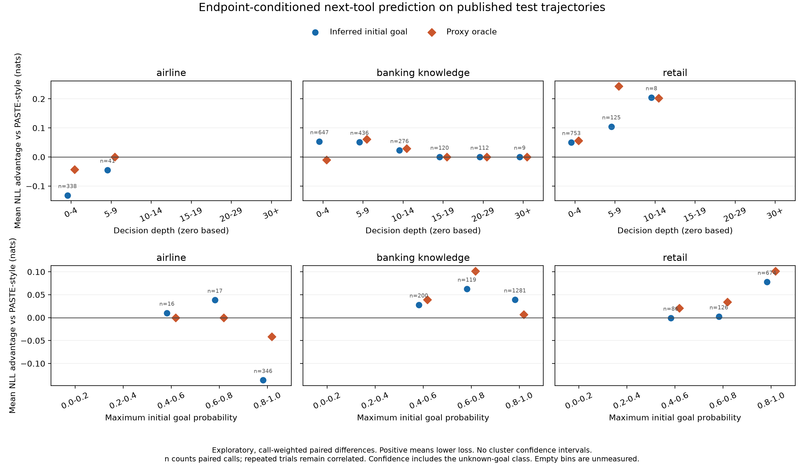

# GoalSpec: first published-trajectory evaluation

Evaluation date: September 11, 2026, America/Los_Angeles. This report covers the
implemented pre-scheduler research platform and its first real-trajectory pilot.
**This pilot does not establish that GoalSpec outperforms the local PASTE-style
predictor on the primary metric.** LLM GoalSpec improves held-out tool Top-1
accuracy by 1.57 percentage points, but its macro next-tool loss is worse at the
point estimate and the paired interval includes zero. Argument-match gains also
persist under shuffled goals. No traditional-PASTE system, latency or SOTA win is
established. All four frozen development/test replays completed successfully.

## What was implemented and tested

The isolated Python package now imports published native trajectories, builds
offline terminal-goal proxies, splits related requests together, mines recurring
control flow and symbolic argument dependencies, classifies initial goals, and
replays identical actor traces across goal and shuffled-control conditions.
Predictors receive causal public context. One structural context is shared across
conditions, so goal conditioning does not silently change the workflow history.
Frozen artifacts bind source, training data, model configuration and predictions.

The implementation passes **179 tests**, including batch/future-leakage boundaries,
task/trial grouping, unseen-goal fallback, symbolic binding, invalid model output,
cached classifier integrity, paired statistics and report tamper detection. Ruff
passes for source, tests and scripts; the uv lock check passes. The added GitHub
Actions workflow has not been run remotely. See [validation](validation.json)
and the [exact software/source manifest](software.json).

Training used 616 trajectories, mining 413 successful trials into **45 goal
signatures, 16,294 patterns and 1,753 argument bindings**. The full fit took 78.85
seconds. A bounded reference cache made fitting practical without changing the
mined artifact: on a fixed 12-trajectory stress subset, the complete optimized
and uncached pattern pools were byte-identical, with 1.64 versus 65.02 seconds
wall time. This is a **39.6x offline fitting improvement over our uncached code**,
not an agent latency improvement or a comparison with PASTE's implementation.
See the [engineering profile](cache-profile.json), [completed fit](fit-summary.json)
and [preserved unfinished first fit](fit-attempt-1.json).

## Corpus and comparison contract

The source corpus contains **1,500 published real actor trajectories, 375 tasks,
four trials per task and 19,074 tool calls**. It includes airline, retail, telecom
and banking knowledge. Actors were recorded by the benchmark authors; we did not
rerun or independently regrade them. Every observed tool name and argument object
validates against independently reconstructed catalogs.

Prediction uses **1,044 trajectories across 261 tasks**: 616 training, 204
development and 224 test trials. Telecom's 456 trials remain in descriptive actor
outcomes but were excluded from prediction before fitting because its three
request families fail the unchanged five-family minimum. The final test set
contains 56 tasks in 52 request families. Development and test use the same frozen
parameters, with no selection or tuning from their scores.

This is `tau3-public-replay`, not a new full native leaderboard evaluation.
Endpoint labels are automatic semantic proxies requiring human review. Unsupported
endpoints stay unlabeled; goals absent from successful training map to an explicit
unknown fallback. The oracle is therefore a **proxy oracle within the training
ontology**, not an omniscient upper bound on all endpoint information.
Finite pattern counts, smoothing, backoff and soft mixtures also mean this hard
label condition is not guaranteed to score better than an inferred mixture.

Our `paste` arm is an **independent local PASTE-style predictor**. It shares mining,
binding, contexts and actor targets with GoalSpec. We did not execute the authors'
PASTE serving stack. Published PASTE recall or latency percentages are not directly
comparable to this cohort. See the [baseline audit](baseline-audit.md) and
[complete methodology and source links](methodology.md).

## Primary action-prediction result

The primary estimator is held-out next-tool negative log likelihood (NLL, lower
is better), averaging steps within trials, trials within tasks and then domains
equally. Its paired 95% interval resamples whole request families within domain,
using 2,000 replicates and seed 42. This measures predictive cross-entropy under
bounded models, not the true Shannon entropy of the environment. Positive NLL
improvement means baseline loss minus treatment loss.

The final held-out comparison contains **224 trials, 56 tasks, 52 request families
and 2,865 tool calls**. PASTE, oracle and shuffled-oracle outputs and the donor
assignments match exactly between the lexical and LLM runs.

| Test predictor | Macro NLL | NLL improvement over local PASTE [95% CI] |
| --- | ---: | ---: |
| Local PASTE-style | 1.96176 | Reference |
| Lexical initial GoalSpec | 1.96781 | -0.00605 [-0.01894, +0.00705] |
| Lexical dynamic GoalSpec | 1.96793 | -0.00617 [-0.01828, +0.00617] |
| LLM initial GoalSpec | 1.98323 | -0.02146 [-0.14618, +0.06073] |
| LLM with shuffled initial goals | 2.01073 | -0.04897 [-0.09537, -0.00963] |
| Proxy oracle | 1.95331 | +0.00846 [-0.03835, +0.04934] |
| Shuffled proxy oracle | 2.03285 | -0.07108 [-0.11507, -0.03462] |

LLM GoalSpec's point estimate is a **1.09% increase in primary loss**, not an
established reduction. Its advantage over the matched shuffled-LLM control is
0.02751 NLL [-0.07222, +0.10543], also inconclusive. The proxy oracle reduces loss
by only 0.43% at the point estimate. It beats shuffled oracle labels, but neither
inferred goals nor oracle labels establish improvement over local PASTE.

The secondary diagnostics below weight individual calls equally. They must not
replace the primary task/domain-balanced estimator after inspecting results.

| Test predictor | Tool Top-1 | Tool Top-3 | Exact tool + arguments Top-1 | Exact tool + arguments Top-3 |
| --- | ---: | ---: | ---: | ---: |
| Local PASTE-style | 33.58% | 62.09% | 3.73% | 5.03% |
| Lexical initial GoalSpec | 32.77% | 62.09% | 10.75% | 12.60% |
| Lexical dynamic GoalSpec | 34.14% | 62.13% | 10.75% | 12.60% |
| LLM initial GoalSpec | 35.15% | 62.93% | 7.36% | 10.23% |
| LLM with shuffled initial goals | 33.86% | 59.41% | 7.43% | 10.02% |
| Proxy oracle | 33.33% | 63.14% | 6.91% | 8.13% |

LLM GoalSpec gains **1.57 percentage points in tool Top-1** and **3.63 points in
exact tool-and-argument Top-1** over local PASTE as descriptive point estimates.
The shuffled LLM's exact-match score is slightly higher, so the latter gain cannot
establish endpoint-specific benefit. Micro NLL also favors the LLM, 1.93444 versus
1.95860, while the primary macro result reverses direction. Longer trajectories
and differing domain/task weights therefore materially affect the aggregate;
reporting only the favorable micro view would misrepresent the predeclared
comparison.

For lexical GoalSpec, all 2,865 test steps have identical candidate sets and exact
Top-1/Top-3 hit status under inferred and shuffled goals. Both gain 201 Top-1 hits
over PASTE; in 200 cases the true call was absent from PASTE's entire candidate
set. The [test lexical audit](test-lexical-candidate-union-audit.json) confirms the
development mechanism. The [test LLM audit](test-llm-candidate-union-audit.json)
records different candidate sets on some steps, but does not establish a reliable
paired endpoint benefit.

Full condition/domain rows, including every lexical shuffled arm, are in
[prediction-metrics.csv](data/prediction-metrics.csv); primary intervals are in
[paired-comparisons.csv](data/paired-comparisons.csv).

Development provides an independent checkpoint, with 204 trials, 51 tasks,
48 request families and 3,515 scored calls:

| Predictor | Macro NLL | NLL improvement over local PASTE [95% CI] |
| --- | ---: | ---: |
| Local PASTE-style | 1.91944 | Reference |
| Lexical initial GoalSpec | 1.92478 | -0.00534 [-0.01752, +0.00611] |
| Lexical dynamic GoalSpec | 1.92366 | -0.00421 [-0.01541, +0.00630] |
| LLM initial GoalSpec | 1.89853 | +0.02091 [-0.03089, +0.06569] |
| Proxy oracle | 1.91021 | +0.00923 [-0.02959, +0.04627] |

Neither inferred backend nor the proxy oracle establishes lower development loss
than local PASTE. The LLM does outperform its matched shuffled-posterior control
by 0.06203 NLL [0.00030, 0.12107], but beating that weaker control does not establish
improvement over PASTE. These are fixed comparisons, without multiplicity
adjustment; the small positive lower bound should not carry a broader claim.
Controls use one frozen task-donor shuffle. The intervals resample request
families; they do not include variability across alternative shuffle assignments.

The lexical full tool-and-argument Top-1 result rises from 4.44% to 8.71% on
development, but its matched shuffled control achieves exactly the same hits.
A [candidate audit](development-lexical-candidate-union-audit.json) finds identical
candidate sets and identical Top-1/Top-3 hit status between inferred and shuffled
conditions at every step. All 150 Top-1 gains occur in both; 148 arise from a true
call absent from PASTE's entire candidate set. Positive-mass goal mixtures admit
additional goal-specific bindings. This is evidence of candidate-pool expansion,
not evidence that correctly identifying the request's endpoint caused those gains.

## Goal prediction and classifier overhead

The initial-goal LLM is `gpt-5.6-sol` with reasoning effort `high`. Each independent
CLI session sees one initial public context and only training-derived goal
signatures. It receives no task ID, evaluator label, hidden user scenario, future
trajectory or other task. Tools and web search are disabled, and any tool event or
invalid probability distribution fails the capture. Existing CLI authentication
provided model access; the research code did not inspect or copy credentials.

| Initial-goal diagnostic | Development | Test |
| --- | ---: | ---: |
| Trials / labeled trials | 204 / 184 | 224 / 196 |
| Labeled trials with goals unseen in training | 64 | 44 |
| Top-1, including explicit unknown | 65.76% | 63.27% |
| Top-3, including explicit unknown | 88.59% | 79.59% |
| Top-1 on seen goals only | 58.33% | 59.21% |
| Top-3 on seen goals only | 83.33% | 73.68% |
| Unique classifier requests | 164 | 186 |
| Mean classifier request time | 10.40 s | 9.03 s |
| Classifier request p95 / p99 | 16.54 / 22.80 s | 14.36 / 17.36 s |

Exact duplicate public inputs share a captured prediction. All 350 unique requests
completed with valid outputs. The two partitions used 5,305,491 input tokens and
82,494 output tokens in total; cached-input and reasoning-token counters are
subsets, not extra totals. These are CLI-reported usage and measured request wall
times. They do not measure saved agent latency or dollar cost, and cached replay
does not make the original classification free. Full counts, per-domain results
and capture verification are in [classifier-usage.csv](classifier-usage.csv) and
[classifier-usage.json](classifier-usage.json).

## Actor outcomes and unmeasured metrics

The following success rates describe the original published actors, with every
declared trial retained. They are identical for every prediction arm.

| Domain | Successful / declared trials | Success |
| --- | ---: | ---: |
| Airline | 166 / 200 | 83.00% |
| Retail | 372 / 456 | 81.58% |
| Telecom | 409 / 456 | 89.69% |
| Banking knowledge | 165 / 388 | 42.53% |

Banking retains 41 infrastructure-error trials as unsuccessful in this full-cohort
view. The pinned native aggregator's available-trial task average is 47.05%; the
published submission lists 46.91%. That residual discrepancy remains unresolved
and is preserved in the [native aggregation audit](banking-native-aggregate-audit.json).
It is not evidence of any GoalSpec effect.

No speculative tool executes in these experiments. Execution hit rate, useful or
wasted speculation, throughput, end-to-end latency improvement, p95/p99 latency
improvement and live task-success improvement are **unmeasured**. Exact prediction
matches are not executed speculation hits. Original actor call counts and pass^k
are descriptive, with pass^k meaning success across all k trials.

## Decision and next research step

The [depth/confidence analysis](figures/README.md) shows heterogeneous behavior:
airline's inferred-goal loss is worse, including its highest-confidence bin, while
banking and retail mostly show positive call-weighted means. Some late bins are
tiny, including eight retail calls at depths 10-14. These exploratory profiles
have no clustered intervals and do not establish a reliable uncertainty collapse
across domains or depths.

The agreed scheduler gate requires reviewed, provenance-complete native tau3
development evidence, at least 10% oracle NLL reduction with a positive paired
interval, and initial-goal prediction recovering at least 25% of that positive
oracle gain with its own positive interval. Public reconstructed contexts and
automatic proxy labels cannot authorize that gate regardless of their scores.

The development proxy-oracle point estimate is only a **0.48% NLL reduction**,
with an interval that includes zero. It does not meet the numerical Experiment A
criterion even apart from evidence eligibility. All run manifests retain
`scheduler_allowed=false`; the gate status is `insufficient_evidence` because the
native provenance and reviewed-label contract is unmet. We have not relaxed the
threshold, changed the labels or selected a favorable metric to open the gate.

The conclusion is a **negative result for the configured pre-scheduler pilot**:
better initial goal classification and selected accuracy point estimates have
not translated into a reliable reduction in held-out future-action uncertainty.
This does not prove that terminal goals carry no predictive information in
general. Proxy labels, unseen endpoints, finite pattern support, the bounded
binder and the local baseline limit that inference. They motivate new controlled
experiments; they are not demonstrated explanations that erase this result.

The current platform supplies a reproducible test of endpoint conditioning. A
claim of outperforming traditional PASTE, Salesforce memory or the state of the
art requires those executable baselines and the corresponding execution metrics.
The full scheduler, Salesforce memory arms, PlanBench-XL, ToolSandbox, BFCL V4,
GTA-2 and the original PASTE benchmark families have not been evaluated here.

Next work must preserve this result and use a new preregistered native cohort with
reviewed terminal signatures and request-family labels. Include a direct
query-conditioned predictor and a goal-independent mixture of goal-specific
patterns to separate endpoint information from generic query information and
candidate-pool expansion. Inspect ontology coverage and exact argument binding on
development data, freeze any changes, then use new held-out tasks. Do not relabel
this test set or tune on it and continue calling it held out.

## Reproduction and artifacts

The [exact reproduction commands](REPRODUCE.md) and [package guide](../../README.md)
document native environment setup, source acquisition, capture, fitting, replay
and reporting. The measured local run root
is `research/goalspec/runs/public-pilot-20260911`; its final training bundle is
`artifacts-v2`, at source SHA256
`e44f25558951f10291a4060246d4e0388927274263f2fee4e865d20f627c1572`.
Run directories are deliberately ignored by Git and remain available locally.
Use new output directories when reproducing; never overwrite a frozen run.

The result package includes [verified aggregate benchmarks](data/BENCHMARKS.md),
[frozen evidence and path mappings](evidence/README.md), and
[standalone depth/confidence figures](figures/README.md). Raw published inputs,
full replay logs and per-request CLI prompts/events remain under the local run
root with their hashes recorded. Repeating model calls can produce different
outputs; exact classifier reproduction uses the captured posterior artifacts.

The figures are exploratory call-weighted profiles, with no confidence intervals.
They use fixed depth and confidence bins; unknown-goal confidence is included.
They do not replace the primary paired family-bootstrap comparison.

[artifact-manifest.json](artifact-manifest.json) records every other file in this
report package by byte count and SHA256, together with the analysis-script hashes.
Source, evidence copies, figure hashes and authored document links were verified
after report assembly. The package preserves exact bytes across Git checkouts.
