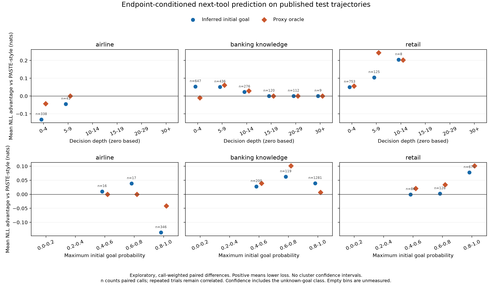

# Exploratory prediction profiles

Every dot is a measured mean over paired authoritative calls from the integrity-verified test replay. Positive values mean lower loss than this repository's PASTE-style predictor. Counts, raw paired differences, and unknown-choice fractions are in the CSV files. These call-weighted profiles are exploratory, have no uncertainty intervals, and do not replace the primary task-equal/domain-macro estimator with family-cluster bootstrap. Initial confidence includes the unknown-goal class. Proxy-oracle curves use the same inferred-confidence bins. Empty bins have no observations and are not interpolated. No speculative tools were executed.
