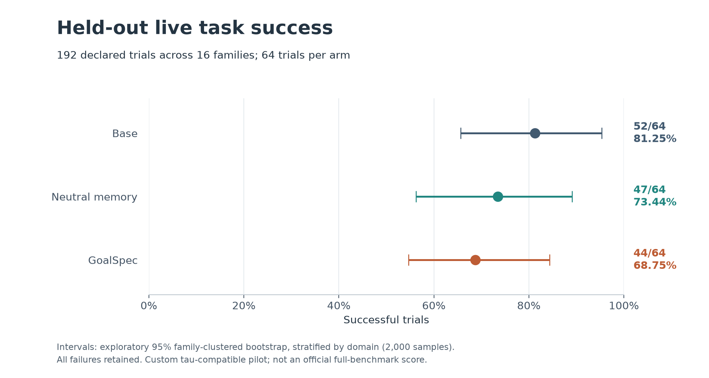
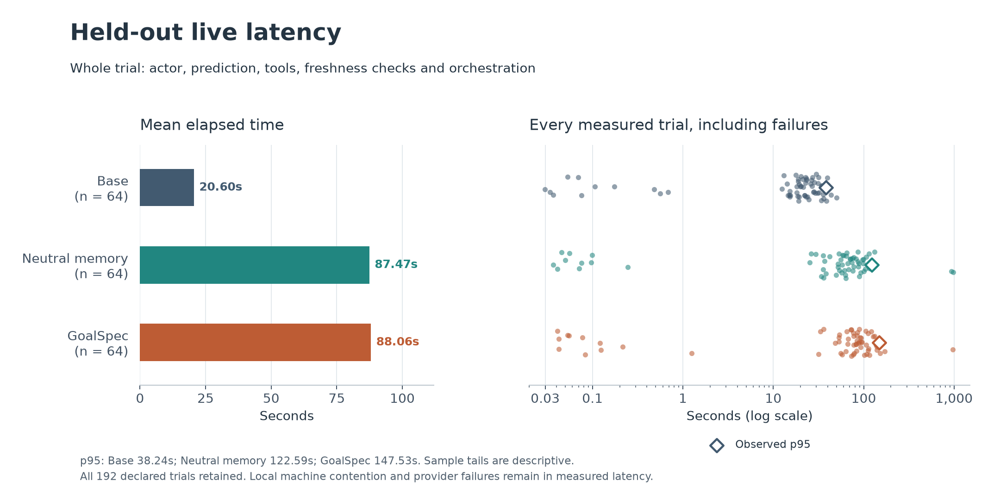

# GoalSpec v1: local evaluation

GoalSpec's shared TypeScript runtime executes real speculative reads and exposes verified evidence, but this local experiment does **not** show an improvement in task success or latency. On the complete 192-trial held-out cohort, GoalSpec succeeded on **44/64 trials (68.75%)**, compared with **52/64 (81.25%)** for the base actor. Whole-trial mean latency increased from **20.60 seconds to 88.06 seconds**.

These are results from a **custom tau-compatible pilot**, not an official full-benchmark score. All declared trials, including infrastructure and actor failures, remain in the analysis. No failed trial was replaced. The earlier Python pilot and its reports remain intact.

## Live results

| Measure | Base actor | Neutral memory + prefetch | Full GoalSpec |
| --- | ---: | ---: | ---: |
| Successes / trials | 52/64 | 47/64 | 44/64 |
| Success / pass^1 | 81.25% | 73.44% | 68.75% |
| Both trials succeed, 32 tasks | 78.13% | 65.63% | 56.25% |
| Mean whole-trial latency | 20.60 s | 87.47 s | 88.06 s |
| Median whole-trial latency | 21.32 s | 63.16 s | 80.15 s |
| Observed p95, n=64 | 38.24 s | 122.59 s | 147.53 s |
| Observed p99, n=64 | 46.04 s | 948.77 s | 465.12 s |
| Physical authoritative executions | 213 | 162 | 142 |
| Physical speculative executions | 0 | 221 | 212 |
| Exact-call consumption | 0 | 54 | 63 |
| Unmatched speculative executions | 0 | 167 | 149 |
| Speculation hit rate | N/A | 24.43% | 29.72% |
| Rejected candidates | 0 | 213 | 199 |
| Native freshness lease checks | 0 | 153 | 150 |
| Execution-error terminations | 11 | 14 | 14 |
| Physical executions per successful trial | 4.10 | 8.15 | 8.05 |

The paired GoalSpec-minus-base success difference is **-12.50 percentage points**, with an exploratory family-clustered 95% interval of **[-21.88, -4.69] points**. The neutral-minus-base difference is **-7.81 points**, interval **[-15.63, 0.00]**. GoalSpec-minus-neutral is **-4.69 points**, interval **[-15.63, 4.69]**. The mean GoalSpec latency increase over base is **67.46 seconds**, interval **[43.74, 102.20] seconds**.

Intervals resample complete families within domains, with equal domain and family weights and 2,000 bootstrap samples. They are exploratory and have no multiplicity correction. Shared host interruptions are not modeled by this resampling. Tail estimates have only 64 observations per arm. Hosted model sampling remains stochastic despite paired native task seeds. These intervals do not establish how the systems would compare under a different infrastructure failure rate.

There were zero recorded constraint violations, budget terminations, cancellations, and physical validation rereads. Native lease checks hash isolated environment state and are reported separately from database/tool rereads. Whole-trial latency includes prediction and freshness-validation waits encountered during orchestration. The final success checker is narrower than a human review of all behavior.

The latency timer surrounds `orchestrator.run()`. It includes the actor's interaction, prediction and in-trial freshness waits, and ends before the independent completion checker. Service startup, fixture preparation, final archival and offline scoring are outside this timer. This measures the long-lived service's native interaction interval, not a cold-start deployment time.

Exact-call consumption is a lower bound on usefulness: evidence can inform an actor without a later identical call. Unmatched executions are consequently an upper bound on waste. Fewer authoritative calls alone are not an efficiency improvement: enhanced arms performed extra speculative reads and had more failed trials. Detailed counts, calls per success, missing costs, paired differences and complete outcomes are in the [machine-readable live analysis](../../runs/local-heldout-analysis-v1-20260915/summary.json).

## Failure and cost interpretation

Of the 49 unsuccessful held-out trials, 39 ended with execution errors and ten reached user termination with an unsuccessful independent verdict. Every execution error maps to one failed model attempt and one retained unresolved request reservation. The last 32 failures occurred within 28.403 seconds, all on the mini model, with no completed provider responses in those trials. Three earlier logged attempts lasted about 15 minutes, beyond the configured two-minute SDK timeout. The provider event log omits HTTP status and caught transport-error details. The [billing and failure audit](../../runs/local-budget-audit-v1-20260915/audit.md) preserves this evidence and timing discrepancy. Directory date labels are not event timestamps: live events were recorded on 2026-09-14 UTC.

A later, bounded read of the [Windows System power log](../../runs/local-host-power-audit-v1-20260915/events.json) independently confirms Modern Standby starting at 20:32:45.738 UTC, standby networking disconnected at 20:32:53.591, a power-state transition around 20:48:09.753, and exit from standby at 20:53:18.445. Those transitions coincide with the long event gaps and precede the final failure cluster. Host suspension and network disconnection are therefore observed confounders, not merely guesses. They do not establish the precise API error or charge for each request, or explain all 39 failures. The raw OS projection and its hash are preserved without changing the experiment.

Consequently, the primary success and latency results describe this entire local run, including temporally clustered execution failures. They do not isolate model competence or an infrastructure-independent treatment effect. Excluding the failed trials after seeing the results would change the declared cohort, so they remain included.

Held-out **known provider-reported usage cost is $12.181323**. The native summary's $11.802214 omits $0.379109 of completed usage inside seven trials whose total charge is unknown. All 39 uncertain trials retain their complete $1.25 parent allowance, so held-out spent-or-reserved commitment is **$60.552214**. The unresolved child maximums, totaling $0.745500, are already inside those parent allowances and are not added again. No unknown charge is treated as free, and no uncertain reservation has been released. Prices are usage-derived, not invoice-reconciled.

Final [all-phase accounting](../../runs/local-final-accounting-v1-20260915/budget-report.json) records **$21.920303 known usage** and **$70.291194 spent or reserved**, below the $500 ceiling. Preparation used $5.675192, training $1.378294, development $2.348912, held-out known usage $12.181323, and prediction replay $0.336582. AWS charges and contingency usage are zero. Protected allocations were not reallocated. The final journal was validated, copied verbatim and hash-verified after paid dispatch ended. All 39 unresolved requests remain reserved.

## Design and frozen experience

The experiment used 24 training families, six development families and 16 held-out families, balanced between retail and airline, with two variants per family. Training collected 48 trials. Development collected 36 paired trials across the three arms. Held-out evaluation collected two trials per variant across all arms, totaling 192 trials. Arms were randomized within paired blocks, with three blocks allowed concurrently on the local machine. All arms shared model settings, task instances, native seeds and the 40-step limit.

The largest completed development cost was $0.120782 and no development run was censored. The specified allowance rule therefore selected b=$1.25 and N=16 families using development costs alone. All 192 trial allowances were reserved atomically before execution. Held-out failures were not replaced and test execution could not update the frozen retrieval library.

Training's uniform verifier amendment corrected four false consent refusals, yielding 46/48 successes. Original executions and verdicts remain archived, and no actor was rerun. The two genuine failures remain. The amendment and independent fixture checks precede the held-out source freeze.

The native library contains 32 compatible read workflows and 32 embeddings supported by verified training episodes. Snapshot `native-training-v1-20260915` has content hash `90f5555ae711279cf085bde86fc3182dffdf9729ceecc99eb65bb6f4ef2bfb97`. The 0.8 pattern admission threshold is a fixed engineering default, not a fitted probability calibration. The families test new compositions of known operations, not unseen primitive tools.

The [source freeze](../../runs/local-freeze-v2-20260915/manifest.json) preserves 478 actual source files, including uncommitted code, with source-tree hash `7d3c48a015bd8f7ced8759d8d08e125830428e65591146661a227270b9e65156`. It also binds fixtures, records, development outcomes and configuration. The native checkout is pinned to `2174a603f6d014ef94473ffa95957f6ce27100db`. An earlier archive was rejected before held-out dispatch because a documentation file changed during capture; it is not the experiment freeze.

## Separate execution replay

The [native execution replay](../../runs/native-execution-replay-development-v1-20260915/report.json) reused recorded candidate predictions and authoritative actions from all 24 enhanced-arm development traces. It replayed 153 decision boundaries with real isolated reads and reproduced every recorded native observation and complete final state.

Python counted **78 speculative reads, 25 exact-call consumptions, 53 unmatched executions, 60 authoritative executions and 91 lease checks**. Scheduler starts were 94, including 16 jobs cancelled before physical execution. There were zero model calls, provider charges and physical validation rereads. Boundary replay latency was median 6.86 ms and p95 53.08 ms over 153 boundaries. This is execution replay timing, separate from the measured live trial latency above.

## Goal and candidate contract reliability

The [saved live-goal audit](../../runs/local-live-goal-audit-v1-20260915.json) found that the GoalSpec arm accepted 56 of 174 goal responses (32.18%). It rejected 118: 77 for probability sums, 40 for invisible source paths, and one for a constraint missing its source reference. The safe fallback was an unknown goal set. All 378 recorded GoalSpec decision contexts pass the frozen goal validator, but only 115 (30.42%) contain positive nonunknown hypotheses; these span 34 of the 64 declared runs. Cached contexts are repeated observations, not independent goal predictions. Fifty-three GoalSpec runs reached a recorded decision context.

The neutral arm's 399 recorded contexts all contain the intended empty hypothesis set with unknown mass one. Source/schema or malformed-JSON candidate rejections also occurred: 149 rejection events in GoalSpec and 167 in the neutral arm. These are contract-validation events and differ from the admission rejection counts in the live table. A response can contain both admitted and rejected candidates.

The separate 213-checkpoint frozen requested-goal replay produced **one contract-valid output and 212 failures**. All failed predictions retain unknown fallback in the frozen cache. Its 213 paid provider responses cost $0.336582 by reported usage: 212 had completed provider status, and one was incomplete at the output limit. There were no failed transport attempts in this phase. The prediction artifacts record 110 `SyntaxError` and 102 other `Error` failures after response receipt; they do not retain enough rejected response detail to diagnose every cause. These are distinct from the native trials' unresolved transport charges.

This is a protocol reliability failure; it cannot be presented as a successful measurement of semantic goal inference. The live and replay prompts are distinct frozen contracts, so their rejection rates are reported separately. Passing source/path validation establishes provenance shape, not semantic correctness.

## Frozen prediction comparisons

Independent teacher annotation completed for all 109 unique visible inputs, and all 213 checkpoints were scored. Requested-goal Top-1 and Top-3 are both **0/213**: the 212 failed predictions count as misses, and the sole accepted prediction missed the complete requested objective. This is the observed pipeline result, not a measurement of reliable semantic inference. The empirical bootstrap interval [0, 0] is degenerate and does not establish zero population accuracy. Teacher references and semantic matching are automated, not human ground truth.

Replay covers 213 tool decisions from 53 base-arm trajectories across 14 families. The canonical export still includes all 64 base episodes and all 16 families. Two airline families contributed no tool decisions after execution failures; their outcomes remain in the live cohort. All comparisons use this same checkpoint stream.

| Paper-based condition | Tool Top-1 | Full arguments Top-1 | Tool NLL | Full-action NLL |
| --- | ---: | ---: | ---: | ---: |
| Stateless | 16.90% | 0.00% | 2.637135 | 27.631021 |
| Local PASTE | 38.97% | 17.84% | 2.166188 | 22.962887 |
| PASTE + memory | 42.25% | 17.84% | 1.991363 | 22.914939 |
| GoalSpec without episodic memory | 38.97% | 17.84% | 2.166188 | 22.962887 |
| Full GoalSpec | 39.44% | 17.84% | 2.153038 | 22.979444 |
| Oracle endpoints | 37.56% | 17.84% | 2.111705 | 22.975030 |
| Shuffled goals | 39.44% | 17.84% | 2.154547 | 22.979444 |

NLL is predictive cross-entropy in nats, with lower values better and the frozen 1e-12 floor for missing action probability. The table uses decision-weighted means. Paired estimates give equal weight to domains and families, so they are not simple subtractions of those table means. Relative to local PASTE, GoalSpec's family-weighted tool-NLL improvement is **0.003639**, 95% interval **[-0.051440, 0.057372]**; its action-NLL improvement is **-0.010295**, interval **[-0.014312, -0.005745]**. Estimated relative cross-entropy reductions are **0.165085% for tools** and **-0.041547% for full actions**. These are loss estimates, not measurements of true conditional entropy.

PASTE + memory improves family-weighted tool NLL by **0.119280**, interval **[0.068166, 0.173371]**, and action NLL by **0.028980**, interval **[0.015857, 0.040808]**, in this replay. GoalSpec and shuffled goals have identical tool hit counts, argument hit counts and action NLL. The results do not establish an inferred-goal benefit.

With the identical-candidate-pool control, stateless full-argument Top-1 and Top-3 increase to **38/213 (17.84%)**, matching every other condition. Its controlled action NLL is 23.243995. Other listed scores remain unchanged. Tool scores are divided uniformly among same-tool bindings; this does not evaluate a learned argument ranker. The apparent raw stateless argument deficit comes from candidate availability, not demonstrated goal-aware ranking.

Endpoint proxies are separate from requested goals. Of 213 reference endpoint labels, 146 map to unknown. All **145 correct GoalSpec endpoint Top-1 matches are unknown endpoints**, with zero correct nonunknown matches. The superficial 68.08% endpoint score must not be called requested-goal accuracy. Oracle endpoints are offline diagnostics, not deployable actor predictions.

The [complete diagnostics](PREDICTION_DIAGNOSTICS.md), [14-condition CSV](prediction-conditions.csv), [paired estimates and intervals](prediction-comparisons.csv), and [frozen summary](../../runs/local-prediction-analysis-v1-20260915/summary.json) preserve all controls, Top-3 metrics and exact values. These are local paper-based baselines, not verified upstream reproductions of PASTE or other systems.

## Implemented system and integration

One framework-independent TypeScript core serves Derya and the long-lived research service. It shares versioned JSON Schema contracts and canonical-hash fixtures with Python, preserves requested objectives separately from inferred goals and achieved outcomes, and retains server-owned authorization. It retrieves compatible workflows, binds arguments to current visible sources, predicts reads, schedules admitted jobs and exposes verified evidence at actor boundaries. Unrequested evidence is a context section, never a fabricated function result.

The scheduler caps ranked candidates at three, speculative concurrency at two per run and four globally, starts at twelve per run, lookahead at two hops and new exposed entries at two per boundary. Speculative tools have five-second deadlines. Exact authoritative calls join existing jobs; cancellation must complete before duplication. Mixed mutation/read batches invalidate pending evidence and keep authoritative batch behavior. Speculative writes and commitments are denied.

Derya's generic loop retains its existing prefetching, six-round limit, RFQ/proposal branches and gpt-5.6 actor. Its five audited early reads require office-wide operator authorization and complete scoped rereads in separate short read-only transactions at exposure or consumption. Independent-connection tests cover inserts into empty results, deletions, ordering, joined fields, ownership transfer and revoked access. All validation SQL is counted; reuse is not claimed to avoid database work. Native benchmark results do not measure live Derya performance.

Python retains native state, orchestration, user simulation and independent checks. The authenticated step gateway transfers correlated public decisions to Node, and speculative reads use isolated snapshots and Python-owned freshness leases. Research PostgreSQL/pgvector is separate from Derya's application data. Business evidence, historical experience and temporary speculative evidence remain separate.

The pinned 5,000-record APIGen release retains source-reported, research-only lineage. Its stratified 100-request teacher pilot produced 99 validated annotations and one retained failure. It was not upgraded to independently replayed native experience. An overlap audit found one genuine cross-split request overlap and one lexical false positive, so that provisional source split is annotation-only. Toucan, Nemotron and NNetNav streaming importers are implemented and tested; their full corpora were not downloaded. This experiment makes no scaling claim from these data.

Local WebArena adapter, reset/verifier bridge, deployment definitions and isolated browser tests are implemented. Full upstream containers and paid browser evaluation remain deferred. Safe backend fingerprints and state cloning are prerequisites, and unsupported isolation fails closed.

## Final artifacts and cleanup

The [research database export](../../runs/repository-final-export-v1-20260915/manifest.json) contains **22 tables and 31,395 rows** in 47 files, with every JSONL and Parquet hash verified and every Parquet payload reconstructing the original JSONL bytes. It includes 276 native runs/outcomes, 1,657 execution frames, 1,435 candidates and 19,259 events. All eleven frozen memory-table hashes remained unchanged through evaluation. Three tables are explicitly empty: budget reservations use the durable file journal; this run's intervention records live in frames/events; evaluation feedback application is disabled for the frozen repository.

The telemetry exporter was repaired after execution to preserve failures that had no public user request. It records an explicitly unobserved objective and provenance instead of an invalid empty string or a fabricated hidden objective. All 32 such failures remain failures. The original 158 partial imports remain byte-identical. An intermediate retry failed because the dedicated database had stopped across a session transition; original partial artifacts are preserved. The successful v3 import and [verification receipts](../../runs/repository-final-verification-v1-20260915/database-verification.json) describe the sequence. No actor was rerun.

The [final accounting manifest](../../runs/local-final-accounting-v1-20260915/manifest.json) binds the closed mixed-version budget journal and 18,473 native-service OTLP spans. Prediction, annotation and grading events remain in their separate immutable JSONL artifacts. Recorded events without wall-clock timestamps are explicitly omitted from OTLP, not assigned invented times.

The dedicated local PostgreSQL cluster has been stopped after verified export. Automatic tool policy blocked deletion of the temporary DPAPI-encrypted API-key copy; it remains encrypted outside the repository and is excluded from the archive. The tool returned only `blocked by policy`. The [cleanup receipt](../../runs/local-final-accounting-v1-20260915/cleanup.json) records that limitation. No further provider dispatch is active.

The [deliverable archive](../../../../outputs/goalspec-local-v1-final.zip) contains the frozen source, current allowed analysis/export overlays, raw cohorts, dataset lineage, requested annotations, prediction caches, reports, database export and final accounting. Its [SHA-256 sidecar](../../../../outputs/goalspec-local-v1-final.zip.sha256) and [verification record](../../../../outputs/goalspec-local-v1-final.zip.verification.json) allow independent file checking. Reproduction instructions and explicit input selection are in [PACKAGE_BUILD.md](PACKAGE_BUILD.md). Source and frozen-input verification is recorded in [verify-final.json](../../runs/local-freeze-v2-20260915/verify-final.json).

## Verification and reproduction

Before held-out dispatch, 242 Python tests and Ruff passed. The TypeScript suite passed 41 tests with one optional database case skipped; a separate three-test Derya PostgreSQL run covered database behavior. Both real-browser and Node/Python browser-provider tests passed. Core and full application TypeScript checks passed; the full application check needed an 8 GB Node heap. Native service parity passed retail and airline, including actual lease consumption and identical observations, state, termination and reward.

The existing unrelated model-source scan still misclassifies a vehicle fixture as an AI model. Windows process-restart recovery is tested; power-loss durability and multi-host ledger ownership are unvalidated. Development included an incompletely specified informational request and simulator mistakes. Held-out user scenarios were audited before execution and stayed frozen. Results do not justify superiority over traditional PASTE or state-of-the-art systems.

Use the [local reproduction guide](../../../../docs/goalspec/LOCAL_REPRODUCTION.md), [implementation status](../../../../docs/goalspec/IMPLEMENTATION_STATUS.md), and [operation/recovery guide](../../../../services/goalspec-runtime/RECOVERY.md). Local execution used Windows 11, an i5-1235U CPU, about 8 GB RAM, Node 22.16.0 and Python 3.12.14. Model inference used the hosted OpenAI API. No AWS resources were created.

Pinned research identities are `gpt-5.4-2026-03-05` for actor/teacher, `gpt-4.1-mini-2025-04-14` for goal/candidate/user, and `text-embedding-3-small` with 1,536 dimensions. Actor reasoning is medium and output cap 4,096; prediction output cap is 1,024. Actor input cap is 32,768 and predictor input caps are 8,192. Standard token prices were rechecked on 2026-09-15 against the official [GPT-5.4](https://developers.openai.com/api/docs/models/gpt-5.4), [GPT-4.1 mini](https://developers.openai.com/api/docs/models/gpt-4.1-mini), and [embedding](https://developers.openai.com/api/docs/models/text-embedding-3-small) pages. Usage-derived charges are not invoice-reconciled billing.
