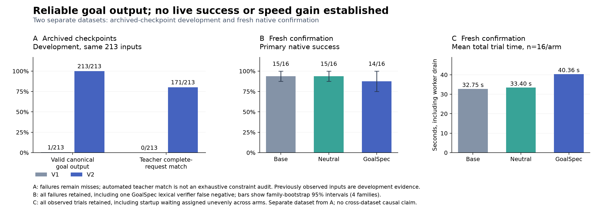

# GoalSpec local v2 results and report helpers

Download the [local v2 result package](../../../../outputs/goalspec-local-v2-final.zip), its [file manifest](../../../../outputs/goalspec-local-v2-final.zip.manifest.json), and its [SHA-256 checksum](../../../../outputs/goalspec-local-v2-final.zip.sha256). The preserved [v1 package](../../../../outputs/goalspec-local-v1-final.zip) is an external dependency for historical source and result reproduction. Final archive hashes live in the sidecars so the report does not hash its own containing ZIP.

GoalSpec v2 improved archived goal inference: **213/213 valid outputs and 171/213 complete-request matches**, compared with v1's 1/213 valid outputs and 0/213 matches on the same inputs. **A live success or latency improvement was not established.** The single precommitted fresh confirmation cohort produced 15/16 base successes, 15/16 neutral successes, and 14/16 GoalSpec successes. Its [confirmation report](CONFIRMATION_RESULTS.md) retains three unresolved actor-request failures and one lexical communication false negative without rescoring any outcome.

The [final three-stage analysis](final-three-stage-analysis/README.md) retains all 96 native trials across two development rounds and one confirmation cohort. Each stage is reported separately. Confirmation known usage was $3.228021, with one unknown-cost trial in each arm. Its four families were disjoint from development families; two variants and two trials per variant produce 16 trials per arm.

| Fresh confirmation arm | Primary success / pass@1 | Both trials succeed | Mean total s (n=16) | Observed total p95 s (n=16) | All physical tool calls / successful trial |
| --- | ---: | ---: | ---: | ---: | ---: |
| Base | 15/16 / 0.9375 | 7/8 | 32.754877 | 50.774352 | 85/15 = 5.666667 |
| Neutral memory prefetch | 15/16 / 0.9375 | 7/8 | 33.402158 | 51.758722 | 146/15 = 9.733333 |
| GoalSpec | 14/16 / 0.8750 | 6/8 | 40.355460 | 60.336241 | 138/14 = 9.857143 |

GoalSpec's success difference versus either baseline is -0.0625, family CI [-0.125, 0.000]. Mean total time was 23.204430% above base; all failures and uneven startup waiting remain included. Pass@1 is mean per-task trial success, and both-trial success is not best-of-two. Calls include every trial, including failures; the denominator is successful trials. Physical calls include reads and writes. Sample p95 is descriptive with only 16 observations per arm. The [detailed confirmation tables](CONFIRMATION_RESULTS.md) give native/drain times, all family intervals, unknown costs and exact physical reads. Live GoalSpec consumed **12/61 speculative reads (19.672131%)** by exact matching calls, a lower bound on broader usefulness.

The full post-fix replay produced **213/213 valid predictions** and **171/213 (80.281690%) automated teacher-scored complete-request matches**, at both top-1 and top-3. The original v1 outputs on the same 213 inputs had 1/213 valid predictions and 0/213 semantic matches; all 212 original prediction failures remain misses. The [independent prediction audit](legacy-prediction-audit.json) checks canonical shape, probability, and all 1,338 current-source references. The [requested-goal assessment](legacy-requested-analysis/report.md) uses the original 109 unchanged teacher references with complete grading coverage. Its family-weighted semantic estimate is 77.373132%, CI [68.194103%, 86.263638%], distinct from the checkpoint-weighted 80.281690% rate. These previously observed v1 checkpoints are development evidence for v2, not fresh confirmation.

The earlier [protocol smoke](../../runs/local-v2-protocol-smoke-b-20260915/manifest.json) produced **12/12 valid predictions** and **8/12 teacher-scored complete-request matches** before the prompt change requiring literal identity details in grouped constraints. Its four misses omitted named flight, account, payment, or passenger identity details; passing grades also sometimes omitted details. Automated semantic match is not an exhaustive constraint audit, and annotation and grading share the same teacher model. The 42 misses in the full replay remain part of the reported result.

The [full legacy replay analysis plan](LEGACY_REPLAY_ANALYSIS_PLAN.md) defines requested-goal scoring and all seven frozen prediction conditions plus their seven identical-candidate-pool controls. Endpoint-label prediction and action prediction remain separate from complete-request teacher matching. Protocol reliability improved on the paired archived inputs; this does not establish a live success or speed gain on the new native tasks.

| Archived prediction condition (n=213 each) | Tool top-1 | Tool top-3 | Full-argument top-1 / top-3 | Mean tool NLL | Mean action NLL |
| --- | ---: | ---: | ---: | ---: | ---: |
| Stateless | 36/213 | 70/213 | 0/213 / 0/213 | 2.637135236 | 27.631021116 |
| Local PASTE | 83/213 | 135/213 | 38/213 / 38/213 | 2.166188433 | 22.962887492 |
| PASTE + memory | 90/213 | 149/213 | 38/213 / 38/213 | 1.991362596 | 22.914939341 |
| GoalSpec without memory | 79/213 | 135/213 | 38/213 / 38/213 | 2.148090094 | 22.963374577 |
| GoalSpec | 91/213 | 141/213 | 38/213 / 38/213 | 2.040356118 | 22.959270599 |
| Oracle endpoint goals | 80/213 | 147/213 | 38/213 / 38/213 | 2.111704888 | 22.975029523 |
| Shuffled goals | 84/213 | 141/213 | 38/213 / 38/213 | 2.156909235 | 22.967314438 |

GoalSpec reduces tool NLL versus local PASTE by **0.108296517 nats**, family CI **[0.021795076, 0.207352812]**, a family-weighted relative reduction of **4.912339%**. Its action-NLL reduction is **0.001590225**, CI **[-0.006320501, 0.009057514]**. PASTE plus memory has lower mean tool and action NLL than GoalSpec, while GoalSpec has one additional correct tool top-1 prediction. These results support a tool-prediction improvement versus local PASTE on this development set, with no demonstrated full-argument accuracy improvement. NLL uses a probability floor of 1e-12. The reported "entropy reduction" is predictive cross-entropy reduction, not measured true conditional entropy.

The [paired comparison](legacy-comparison/README.md) verifies the same 213 inputs and targets, unchanged goal-independent baseline rows, and **all 2,982 prediction rows** across seven main conditions and seven identical-pool controls. With the same candidate pool, stateless full-argument accuracy rises to 38/213 and action NLL becomes 23.243994580; every other row above is unchanged. This isolates candidate availability from tool ranking. Probability is uniform among argument candidates of a tool, so these controls do not test a learned within-tool argument ranker. Full tables, family intervals, and separate v2-versus-v1 loss differences are exported as [condition CSV](legacy-comparison/prediction-conditions.csv), [within-v2 paired NLL CSV](legacy-comparison/paired-nll-differences.csv), and [paired version-loss CSV](legacy-comparison/paired-version-loss-differences.csv). Checkpoint means and family-weighted interval estimates use different weights.

Endpoint-goal labels are a separate proxy. V2 GoalSpec matches 52/213 endpoint labels at top-1, with zero unknown-label matches; v1's 145/213 matches were all unknown-label matches from mostly failed inference. Neither proxy rate is the 171/213 complete-request semantic result. The oracle condition is an endpoint diagnostic and does not supply requested-goal teacher references.



The figure is also available as an editable [SVG](figures/goal-and-native-results.svg). All primary native failures remain included, including the documented lexical communication false negative. Archived development and fresh confirmation are distinct datasets.

Final shared accounting records **$29.271244 known usage-priced cost** and **$86.195518 spent or reserved** under the **$500 global cap**, retaining **43 unresolved requests**: 39 from v1, one from development round 2, and three from confirmation. V2 added **$7.350941 known usage** and **$15.904324 spent or reserved**; v1 ledger entries remain unchanged. The [closed accounting receipts](../../runs/local-final-accounting-v2-20260915/stage-accounting.json) attribute post-v1 leaf usage and unresolved reservations. Known subtotals are not invoice reconciled, and they do not settle unknown attempts. This work used no AWS.

The corrected [real native execution replay](native-replay-analysis/README.md) completed all **32 speculative-arm action tapes with observation and final-state parity**, using zero provider calls. Its coverage preserves all 48 primary outcomes and explicitly excludes 16 base tapes without candidate sessions. Of 572 saved candidate events, it replayed only the 147 originally admitted and excluded all 425 rejected candidates. Neutral executed 65 speculative reads with 26 exact consumptions; GoalSpec executed 45 with 10. Both had 102 total physical reads. These fixed-tape counts are separate from live counts above: they neither rescore task success nor measure model-inclusive live latency. The reused original report's before-actor availability wording is explicitly qualified for asynchronous v2.

The final protected execution and frozen inputs [verified unchanged](../../runs/local-v2-final-candidate-verification-20260915/postrun-source-verification.json). The whole application [TypeScript check](../../runs/local-v2-postrun-app-check-20260915/verification.json), final [core check](../../runs/local-v2-postrun-app-check-20260915/core-verification.json), and report-local replay [semantic TypeScript check](native-replay-typecheck.json) passed. Replay input hashes, service ownership, event closure, observations and final states also passed. The packaged receipts retain the exact scope of each check.

The v2 architecture gives the model a compact strict structured-output contract for complete requested objectives and their uncertainty alternatives. It uses opaque current-source IDs; the server expands those into canonical provenance, hashes, and runtime metadata and checks every reference. Literal entity identities, dates, and numeric limits remain in grouped constraints. Token accounting includes instructions, input, and the response schema. The unchanged canonical contract remains the runtime boundary.

Managed goal and read prediction runs alongside the actor and can update later boundaries; scope, revision, and generation checks prevent stale adoption. Closing a trial drains its managed work. Both speculative arms use the same requested-objective retrieval, with frozen retrieval cached by revision, scope, and snapshot. Already observed bound reads are removed before calibration. Python records exact-call consumption and verifies native leases separately from physical reads. User completion guidance is identical across arms and preserves native STOP handling. These implementation changes target protocol reliability and safe reuse; live benefit must still be judged by the retained confirmation outcomes above.

Both development rounds use the same four development family IDs and request compositions, with fresh instance values and seeds in round 2. They do not supply eight independent development families. Family identities repeated across stages are not independent, so stage results and intervals remain separate. The confirmation family set remains disjoint from the development family set.

[Development round 1](development-1-analysis/README.md) retained all 24 infrastructure failures, with 0/8 successes per arm and $0.024155 known usage cost. The [diagnosis](DEVELOPMENT_1_DIAGNOSIS.md) links the early host guard failure to the limited exposure of the runtime while keeping request-level uncertainty explicit. This round supports no comparative speed or success claim.

[Development round 2](development-2-analysis/README.md) retained all 24 outcomes, including six failures where the simulated user stopped on a confirmation before the requested writes and one actor model-attempt failure after the first of two writes. Its [diagnosis](DEVELOPMENT_2_DIAGNOSIS.md) reports the trace evidence, complete timing and read counts, and $1.575900 of known usage with one unresolved trial charge. GoalSpec produced 27 goal responses without recorded predictor contract rejections; 33 of 67 valid actor goal contexts were nonunknown. Structural validity is separate from semantic completeness and live benefit.

The [user completion guidance probe](USER_STOP_PROBE.md) produced 6/6 expected marker decisions: four pending-work confirmations continued and two completed-task controls stopped. All six requests completed, with $0.002799 known usage and zero unknown attempts. It checks selected development turns under the same updated guidance for every arm, while preserving native STOP handling and all original failures. It is not a new native task-success score.

[summarize_study.py](summarize_study.py) reads completed native cohorts and emits JSON, Markdown, arm CSV, paired-difference CSV, and source manifests into a new subdirectory here. It performs no provider calls. It rejects incomplete paired designs and reused stage or run identities. It does not overwrite existing reports.

Run from the repository root after a stage finishes:

```powershell
research/goalspec/.venv/Scripts/python.exe research/goalspec/reports/2026-09-15-local-v2/summarize_study.py --stage development-1=research/goalspec/runs/DEVELOPMENT_OUTPUT --events research/goalspec/runs/BUDGET_DIRECTORY/events-PROCESS.jsonl --output research/goalspec/reports/2026-09-15-local-v2/development-1-analysis
```

Repeat `--stage` for `development-2=DIR` and `confirmation=DIR`; repeat `--events` for their event logs. Prefer the exact stage event files to scanning a shared directory. No stage arguments produces a preparation report containing only the pre-fix smoke result.

Success and paired differences reuse the existing `evaluation_v1.py` family-cluster bootstrap, with 2,000 default draws, equal domain and family weights, and all paired trial outcomes. Intervals are exploratory, unadjusted for multiple comparisons, and limited by the small number of families. V1 scores provide historical context only; the v2 tasks do not support a paired causal comparison with v1.

Timing fields have distinct meanings:

| Field | Measurement |
| --- | --- |
| `latencyMs` | Native orchestration through termination, before managed-worker drain |
| `totalTrialSeconds` | Native orchestration plus both actor/user worker drains |
| `serviceDrainSeconds` | Time requesting and awaiting those worker closes |
| `serviceWallSeconds` | Whole service phase wall time, reported separately |

Means and sample quantiles include failures when their timing was recorded. Sums of overlapping trial durations are not phase wall time. Missing telemetry remains unmeasured.

The first three native orchestrations start while the Node service reconstructs its ledger and boots. Their recorded native and total trial times therefore include startup waiting. Randomized arm order means this overhead is not assigned to identical arms in every paired block. It is retained in the observed times without subtraction or correction; interpret arm timing differences with this startup imbalance in mind. `serviceWallSeconds` remains a separate whole-phase measurement.

Read counts distinguish physical read executions, exact-call promotions, native lease checks, and writes. The helper reports a physical-read split only when transcript tool responses and consumed promotions reconcile with the authoritative execution counters. Exact-call promotions are a lower bound on usefulness; unmatched speculative reads are an upper bound on waste.

Event diagnostics independently check GoalSet shape, probability mass, and source paths against each saved frame. This does not establish semantic goal correctness. Completed prediction cycles include failed cycles. Scheduler rejections, candidate admission rejections, and predictor contract rejections retain separate denominators and reasons. Provider usage is grouped by actor, user, goal, candidate, and embedding role. Known usage-priced subtotals do not resolve unknown charges and are not invoice reconciled.
