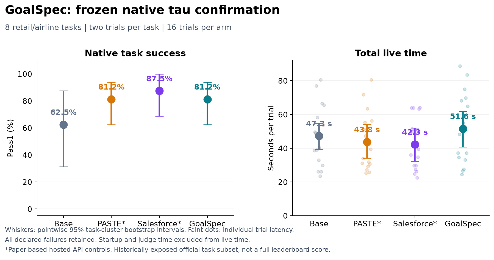

# GoalSpec v3: native tau task subset and prediction replay

**GoalSpec did not establish a live performance advantage.** On the frozen native subset it succeeded in 13/16 trials (81.25%), compared with Base 10/16, PASTE 13/16 and Salesforce-style 14/16. Its mean live time was 51.608 seconds, versus 47.310, 43.775 and 42.264 seconds respectively. GoalSpec's paired success intervals include no difference from every comparator; its time was higher than both paper controls in the pointwise paired intervals. The paper controls executed no speculative reads, so their observed task-score differences do not demonstrate a benefit from active paper-style acceleration.

In the separate frozen prediction replay, complete-request Top-1 teacher agreement was 63.64 [45.68, 80.01]% across 77 scored visible-request revisions (3 revisions lacked a completed annotation or grade). GoalSpec next-tool accuracy was 30.88 [25.00, 34.94]% and exact full-argument Top-1 accuracy was 27.94 [23.68, 32.31]% on 68 saved read-only actor decisions, with 91.18 [85.71, 96.97]% read-proposal coverage. These are prediction diagnostics, not native task-success scores.

These are new live executions of **eight published official tasks, two trials per task and four arms: 64 declared trials, 16 per arm**. Confirmation IDs are disjoint from v3 development. All 164 published retail/airline task IDs had appeared in earlier public replay in this project, so this is a previously exposed official-task subset, not an unseen test set or a full official leaderboard result. Every declared failure remains in the primary denominator.

| Arm (n=16) | Success; % [95% CI] | Both trials; % [95% CI] | Mean live s | Authoritative | Speculative | Lease checks | Physical attempts | Physical / success |
|---|---|---|---|---|---|---|---|---|
| Base | 10/16; 62.50 [31.25, 87.50] | 4/8; 50.00 [12.50, 87.50] | 47.310 | 92 | 0 | 0 | 92 | 9.200 |
| PASTE | 13/16; 81.25 [62.50, 93.75] | 5/8; 62.50 [25.00, 87.50] | 43.775 | 89 | 0 | 0 | 89 | 6.846 |
| Salesforce-style | 14/16; 87.50 [68.75, 100.00] | 6/8; 75.00 [37.50, 100.00] | 42.264 | 88 | 0 | 0 | 88 | 6.286 |
| GoalSpec | 13/16; 81.25 [62.50, 93.75] | 5/8; 62.50 [25.00, 87.50] | 51.608 | 68 | 53 | 43 | 121 | 9.308 |

GoalSpec reduced authoritative executions from 92 to 68 compared with Base (26.09%), but added 53 speculative executions: 121 total physical attempts versus 92 (31.52% more). The 43 freshness checks are lease validations, not 43 additional physical reads. Physical revalidation calls were zero in every arm. All counts retain failed trials. These totals are descriptive comparisons across complete paired cohorts, not counts of causally eliminated calls.

Pass1 is success across all declared repetitions. Observed pass^2 is the fraction of tasks whose two trials both succeed; it is not the square of pooled pass1 or the probability of at least one success. Latency includes measured failures. The observed p95 has only 16 observations per arm and is descriptive. Physical calls per successful trial counts attempts from failures in the numerator and is unavailable when physical telemetry is incomplete.

| Paired comparison | Success difference, pp [95% CI] | Pass^2 difference, pp [95% CI] | Live difference, s [95% CI] | Tasks / matched trials |
|---|---|---|---|---|
| GoalSpec - Base | 18.75 [0.00, 43.75] | 12.50 [0.00, 37.50] | 4.298 [-0.897, 9.039] | 8 / 16 |
| GoalSpec - PASTE | 0.00 [-18.75, 18.75] | 0.00 [-37.50, 37.50] | 7.833 [1.894, 14.547] | 8 / 16 |
| GoalSpec - Salesforce-style | -6.25 [-25.00, 12.50] | -12.50 [-50.00, 25.00] | 9.344 [2.164, 16.902] | 8 / 16 |

| Domain | Arm | Success; % [95% CI] | Both trials; % [95% CI] |
|---|---|---|---|
| airline | Base | 7/8; 87.50 [62.50, 100.00] | 3/4; 75.00 [25.00, 100.00] |
| airline | PASTE | 8/8; 100.00 [100.00, 100.00] | 4/4; 100.00 [100.00, 100.00] |
| airline | Salesforce-style | 8/8; 100.00 [100.00, 100.00] | 4/4; 100.00 [100.00, 100.00] |
| airline | GoalSpec | 7/8; 87.50 [62.50, 100.00] | 3/4; 75.00 [25.00, 100.00] |
| retail | Base | 3/8; 37.50 [0.00, 75.00] | 1/4; 25.00 [0.00, 75.00] |
| retail | PASTE | 5/8; 62.50 [50.00, 87.50] | 1/4; 25.00 [0.00, 75.00] |
| retail | Salesforce-style | 6/8; 75.00 [50.00, 100.00] | 2/4; 50.00 [0.00, 100.00] |
| retail | GoalSpec | 6/8; 75.00 [50.00, 100.00] | 2/4; 50.00 [0.00, 100.00] |

Intervals are pointwise 95% task-cluster bootstrap intervals, with both repetitions and matched arms resampled together. They are not adjusted for multiple comparisons. Per-domain results have only four tasks. A small or uniform sample can yield a zero-width bootstrap interval without establishing certainty on other benchmark tasks. Matched timing comparisons disclose missing observations rather than filling them with zero.

| Arm | Primary failures / 16 | Returned reward zero | Reward absent | Reward one / measured | Trials with unknown charge |
|---|---|---|---|---|---|
| Base | 6 | 5 | 1 | 10/15 | 1 |
| PASTE | 3 | 3 | 0 | 13/16 | 0 |
| Salesforce-style | 2 | 1 | 1 | 14/15 | 2 |
| GoalSpec | 3 | 3 | 0 | 13/16 | 1 |

All 14 failures remain primary failures: 12 completed trajectories returned native reward zero, and two actor transport errors had no reward. The late Base and Salesforce retail111 trial-0 errors were `APIConnectionError` with `ECONNRESET`, outside the frozen retry allowlist. GoalSpec airline19 trial 0 and successful Salesforce retail111 trial 1 recovered from an allowed `UND_ERR_SOCKET` retry; their first-attempt charges remain unknown. GoalSpec airline19's reward zero followed an extra confirmed booking after the reference cancellation, not a terminal transport error. There are no reward-one/primary-failure discrepancies.

The [closed failure audit](../../runs/local-v3-confirmation-diagnosis-20260915/README.md) covers all 14 failures and the successful trial with an unknown charge. It records an unverified color assumption in retail79, premature native-user STOP at consent in three retail5 trials, later user-request changes, and PASTE's incorrect one-modification-per-order restriction in retail111. Simulated dialogue differed despite matched seeds; apparent task gains cannot be attributed entirely to architecture. No transcript is rescored or repaired.

All native tool responses were non-error, which does not establish correct task actions. Selected nonempty NL assertions were returned and passed in six trials; two required evaluations were absent after execution errors. The remaining 24 retail trials had empty selected assertion sets; 32 airline trials did not select NL assertions in their reward basis. Reference full-argument action recall was Base 86.11%, PASTE 83.33%, Salesforce-style 86.11%, and GoalSpec 80.56%. This overlap diagnostic can fall when evidence removes an actor read and is not task accuracy.

## What the four live arms implement

The source audit distinguishes [PASTE, revised June 2026](https://arxiv.org/abs/2603.18897v3), from [Salesforce's Speculate with Memory, July 2026](https://arxiv.org/abs/2607.12236v1). APIGen-MT is a separate dataset contribution. The audit did not locate a verified executable author release; the local controls are **paper-based implementations**, not validated upstream reproductions. The [component audit](../../../../docs/goalspec/V3_SOURCE_AUDIT.md) records the source and implementation differences.

| Arm | Predictor and memory | Actor-visible behavior | Fidelity limit |
|---|---|---|---|
| Base | No speculative execution | Native public context | Common model/transport adapter applies to every arm |
| PASTE | Current-source late binding, pattern support, utility admission, exact-call reuse | Actor input unchanged; unrequested results hidden | Hosted API cannot reproduce the paper's vLLM decode, KV-pressure and in-engine scheduling controls |
| Salesforce-style | Frozen contextual episodes, positive/negative transitions, argument provenance, misses and recurring confusions | Actor input unchanged; exact-call reuse | Local frozen memory and hosted execution are not the paper's complete original training/serving pipeline |
| GoalSpec | Complete-request hypotheses, current-source binding, contextual memory and bounded speculative reads | Verified evidence and goal guidance can change planning and eliminate actor calls | This is a behavior-changing treatment, not an actor-identical lossless optimization |

Salesforce's paper also studies observation prediction followed by action prediction; its published tau2 prediction figures are not task-success scores. This local replay predicts actions from already saved current public state and does not reproduce that chained observation-prediction denominator. Neither the paper's prediction percentages nor PASTE's locally served workload speedups are direct baselines for these hosted native-subset measurements.

The live admission estimate starts with zero exposed native-tool saving, 8.5 ms validation and 1 ms scheduling allowance. These native in-memory tools are cheap, so the lossless paper controls abstain when expected benefit is nonpositive. GoalSpec separately uses a 1,000 ms engineering estimate for a possibly skipped actor round, not a fitted probability or measured speedup. Actual admission, execution and usefulness are reported below. If a control performs no speculative work, its task results do not test the benefit of active paper-style acceleration. Separate replay evaluates predictor quality without asserting live speed gains.

| Arm | Exact promotions | Exposed jobs | Physical reads not promoted | Unexposed/unconsumed jobs at close |
|---|---|---|---|---|
| Base | 0 | 0 | 0 | 0 |
| PASTE | 0 | 0 | 0 | 0 |
| Salesforce-style | 0 | 0 | 0 | 0 |
| GoalSpec | 17 | 26 | 36 | 3 |

GoalSpec's 17 exact promotions out of 53 speculative executions (32.08%) are a lower bound on useful speculation, not a measured overall useful-read rate. Its 26 exposed jobs may replace planning work without an exact promotion. The 36 unpromoted physical reads and three unexposed/unconsumed jobs have different units and must not be combined. There were zero speculative executions, exact promotions or evidence exposures in either lossless paper control.

| Arm | Actor returned | User returned | Goal returned | Candidate returned | Judge returned | Actor failed attempts | Returned retry attempts | Actor provider seconds, sum |
|---|---|---|---|---|---|---|---|---|
| Base | 172 | 95 | 0 | 0 | 1 | 1 | 0 | 562.340 |
| PASTE | 159 | 86 | 0 | 0 | 2 | 0 | 0 | 518.456 |
| Salesforce-style | 165 | 91 | 0 | 0 | 1 | 2 | 1 | 493.368 |
| GoalSpec | 162 | 93 | 72 | 94 | 2 | 1 | 1 | 593.214 |

Returned provider-attempt counts include successful retries; failed attempts are separate and remain charged as unknown. GoalSpec used 162 returned actor calls versus Base 172, but added 72 goal and 94 candidate calls. Its actor provider duration summed to 593.214 seconds versus Base 562.340 seconds. Concurrent predictor durations overlap actor work and cannot be added to derive live time or assigned a causal latency contribution. The extra predictor work and longer returned actor durations are consistent with the absence of a live speedup.

Verified observations are typed runtime evidence with current authorization, provenance and freshness; they are not fabricated function outputs. Exact promoted calls reuse the original native ToolMessage. Historical entity values cannot become current tool arguments without current-source binding. Speculation never writes native state. Audited dependency projections preserve isolated reads and detect direct external changes; writes and state replacement invalidate leases. Pure `calculate` remains ineligible for speculation but does not unnecessarily invalidate read-only history.

Exact consumed promotions establish tool reuse and are a lower bound on usefulness. Evidence exposure can eliminate a later call without a promotion, but exposure alone does not prove use. Unpromoted calls are not automatically wasted. Physical counts include actual authoritative and speculative native executions; nested snapshot-wrapper timings and freshness lease checks are separate.

## Task and timing fidelity

The native implementation is Sierra's [tau2-bench](https://github.com/sierra-research/tau2-bench), pinned to `2174a603f6d014ef94473ffa95957f6ce27100db`; the local checkout is named `tau3`. Original task bytes, domain policies, initial databases, user prompt and role flipping, STOP semantics, orchestration and evaluator algorithms are retained. Evaluation uses the original task reward basis with strict replay. The common actor adapter replaces the upstream text protocol's JSON-only output instruction with native API tool calls and ordinary user-facing text; it does not add task-specific business rules.

| Role | Pinned research model |
|---|---|
| Actor | `gpt-5.4-2026-03-05`, medium reasoning, 4,096 output cap |
| Goal, candidate and user | `gpt-4.1-mini-2025-04-14` |
| Teacher annotation, semantic grading and native assertion judge | `gpt-5.4-2026-03-05` |
| Embedding | `text-embedding-3-small` |

The native assertion judge differs from upstream's default `gpt-4.1-2025-04-14`; report these scores with that configured-model qualification. Actor, user, judge configuration and limits are common across the four arms. All use maximum 200 steps, 10 errors and 600-second timeout.

The service acknowledges the exact frozen manifest after workers and reservations are ready, before trial clocks start. One native trial runs at a time, with randomized arm positions in matched task/seed blocks. Matching seeds does not force identical model-generated dialogue. `totalTrialSeconds` includes native actor/user orchestration and acknowledged drain; service startup and official evaluation occur outside this live measure. Total including evaluation is reported separately. No observed waiting time is removed after measurement.

| Arm | Median live s | Observed p95 live s | Mean drain s | Mean evaluation s | Mean including evaluation s | Timing n / missing |
|---|---|---|---|---|---|---|
| Base | 44.748 | 77.882 | 0.0124 | 1.017 | 48.331 | 16 / 0 |
| PASTE | 36.732 | 73.895 | 0.0131 | 1.269 | 45.047 | 16 / 0 |
| Salesforce-style | 37.763 | 63.976 | 0.0118 | 0.976 | 43.244 | 16 / 0 |
| GoalSpec | 50.046 | 84.788 | 0.0299 | 1.285 | 52.897 | 16 / 0 |

Service startup was 65.917 seconds and is outside every trial clock. Service wall time was 3336.683 seconds, including a final service drain of 0.978 seconds. These are distinct phase measures, not sums to add to per-trial means. GoalSpec's mean acknowledged drain was only 29.9 ms; late drain did not account for its several-second mean latency differences. Its 53 snapshot-wrapper measurements had median 0.912 ms and observed p95 135.070 ms; actual speculative tool execution had median 0.035 ms and p95 0.223 ms. Wrapper and inner-tool durations are nested. The very cheap native tools leave little direct tool-runtime saving for lossless speculation.

Primary success requires raw upstream reward one plus successful execution, evaluator and drain completion. Raw reward and coverage remain separately visible. Non-error native tool responses are an execution diagnostic, not policy compliance. Selected NL assertions are audited for coverage; stored assertions outside the chosen reward basis do not require a judge. Empty selected assertion sets are vacuous, and none of these checks establishes exhaustive policy correctness.

## Goal and next-action prediction

The closed replay retains 172 of 172 source checkpoints from 16 Base runs and 8 task families; 0 checkpoints were omitted by the predeclared selection. Selection content hash: `bb1476a8468751ed291a8528cb2a0f381ed44d5edab90bb79e827c82adba914a`. Decision counts are `{"message": 79, "no_response": 1, "other_tool": 1, "read_only": 68, "write_only": 23}`. Unscorable checkpoints remain explicit: `{"actor_returned_no_saved_response": 1}`. The read-only next-action denominator is 68; all-decision read/no-read metrics use their separately recorded denominators. See [selection](../../runs/local-v3-confirmation-prediction-corrected-20260915/selection.json), [execution receipt](../../runs/local-v3-confirmation-prediction-corrected-20260915/execution-receipt.json) and [uncertainty report](../../runs/local-v3-confirmation-prediction-corrected-report-20260915/report.md).

A postrun implementation audit identified 38 shuffled-control requests rejected before provider dispatch: the donor goal hint was inserted after input compilation and exceeded the 8,064-token compiled-input allowance (8,072-8,280 tokens). All 38 had an eligible donor. The affected labels were 10 reads and 28 non-read decisions. A separately frozen correction compiled the same donor hint before budgeting, then dispatched only these 38 missing predictions with the same model, output limit, policies, memory and public prefixes. The other seven conditions, the 133 completed shuffled predictions and the one unscorable checkpoint were preserved exactly. All 172 checkpoints remain; no failed native task or prediction label was replaced. The candidate union and ranking diagnostics below were recomputed from the corrected predictions. The [original replay](../../runs/local-v3-confirmation-prediction-20260915/execution-receipt.json), [original report](../../runs/local-v3-confirmation-prediction-report-20260915/report.md), [failure reconstruction](../../runs/local-v3-replay-availability-audit-20260915/diagnostic.json) and [correction receipt](../../runs/local-v3-shuffled-correction-20260915/completion.json) remain separately archived. These are transparently amended control results, not an additional independent experiment.

Prediction replay uses saved public prefixes and original actor next calls, never future observations or native reward as predictor input. Private user instructions, gold actions and native task criteria remain outside actor/predictor inputs. Complete-request teacher annotations are frozen before inference and use only visible requests and public policy. The teacher also grades semantic agreement, so annotation and grading can share systematic errors; these are automated references, not independent human truth.

| Goal weighting | Scored denominator | Top-1 % [95% CI] | Top-3 % [95% CI] |
|---|---|---|---|
| Unique visible-request revisions | 77 | 63.64 [45.68, 80.01] | 63.64 [45.68, 80.01] |
| Checkpoint weighted | 162 | 65.43 [44.38, 84.11] | 65.43 [44.38, 84.11] |

There are 80 unique revisions, 77 scored revisions, 0 failed goal predictions, 0 unknown teacher references and 8 connected family components. Missing teacher annotations/grades are excluded from semantic-agreement denominators and explicitly reported, not counted as correct. Semantic scores alone do not establish full structural-validity audit coverage.

Goal structural validity and complete-request semantic agreement are separate. Repeated checkpoints sharing one visible-request revision do not create independent goal labels. Show unique-revision and checkpoint weighting separately. Goal uncertainty resamples connected task-family components when a cached revision links families. Failed inference remains a miss when a reference exists; unavailable annotations or grades retain explicit coverage rather than becoming successes.

| Condition | Read n | Tool Top-1 % [CI] | Full args Top-1 % [CI] | Full args Top-3 % [CI] | Tool CE nats [CI] | PASTE minus CE, nats [CI] |
|---|---|---|---|---|---|---|
| stateless | 68 | 16.18 [9.38, 22.22] | 13.24 [7.04, 20.97] | 16.18 [7.35, 28.07] | 5.208 [4.435, 5.998] | -2.652 [-3.229, -2.169] |
| paste | 68 | 23.53 [8.06, 35.00] | 11.76 [2.86, 21.43] | 14.71 [5.45, 24.24] | 2.556 [1.738, 3.255] | 0.000 [0.000, 0.000] |
| paste_memory | 68 | 22.06 [15.96, 28.99] | 19.12 [9.23, 28.99] | 41.18 [25.92, 57.14] | 2.610 [2.108, 3.048] | -0.054 [-0.680, 0.380] |
| goalspec_no_episodic | 68 | 30.88 [21.62, 40.85] | 25.00 [16.67, 37.88] | 50.00 [35.63, 66.67] | 2.041 [1.446, 2.881] | 0.515 [-0.548, 1.191] |
| goalspec | 68 | 30.88 [25.00, 34.94] | 27.94 [23.68, 32.31] | 52.94 [38.89, 68.66] | 2.452 [1.619, 3.359] | 0.104 [-0.834, 0.611] |
| oracle_goals | 68 | 33.82 [25.42, 46.97] | 29.41 [18.57, 45.31] | 50.00 [34.52, 67.16] | 2.569 [1.989, 3.372] | -0.014 [-0.995, 0.608] |
| shuffled_goals | 68 | 25.00 [21.05, 29.23] | 23.53 [19.48, 28.79] | 44.12 [32.84, 56.25] | 2.801 [2.357, 3.455] | -0.246 [-1.293, 0.370] |
| salesforce | 68 | 20.59 [15.00, 27.42] | 17.65 [8.45, 27.42] | 29.41 [13.21, 49.18] | 4.438 [3.488, 5.183] | -1.882 [-2.777, -0.928] |

| Condition | Read coverage % [CI] | Conditional tool precision % [CI] | Conditional args precision % [CI] | Predicted-read n | Binary read NLL [CI] | Binary n |
|---|---|---|---|---|---|---|
| stateless | 72.06 [60.27, 82.81] | 22.45 [13.33, 30.00] | 18.37 [10.00, 28.57] | 49 | 1.973 [1.811, 2.223] | 171 |
| paste | 50.00 [35.41, 61.80] | 47.06 [17.86, 75.00] | 23.53 [6.06, 48.00] | 34 | 1.818 [1.593, 2.070] | 171 |
| paste_memory | 80.88 [69.49, 92.19] | 27.27 [21.43, 32.73] | 23.64 [12.50, 32.73] | 55 | 1.849 [1.604, 2.074] | 171 |
| goalspec_no_episodic | 88.24 [82.89, 94.44] | 35.00 [24.14, 45.95] | 28.33 [19.05, 43.10] | 60 | 1.812 [1.579, 2.029] | 171 |
| goalspec | 91.18 [85.71, 96.97] | 33.87 [26.53, 39.19] | 30.65 [25.49, 35.85] | 62 | 1.791 [1.552, 2.064] | 171 |
| oracle_goals | 89.71 [81.71, 98.46] | 37.70 [28.07, 50.70] | 32.79 [22.22, 47.83] | 61 | 1.807 [1.487, 2.098] | 171 |
| shuffled_goals | 88.24 [81.54, 96.23] | 28.33 [23.53, 34.55] | 26.67 [21.88, 33.93] | 60 | 1.833 [1.591, 2.064] | 171 |
| salesforce | 76.47 [64.71, 90.77] | 26.92 [21.95, 32.00] | 23.08 [12.16, 32.00] | 52 | 1.934 [1.654, 2.171] | 171 |

| Condition | Recorded statuses and reason counts | Completed-predictor tool % [CI] | Completed-predictor args % [CI] |
|---|---|---|---|
| stateless | {"completed": 171, "unavailable": 1} | 16.18 [9.38, 22.22] | 13.24 [7.04, 20.97] |
| paste | {"completed": 171, "unavailable": 1} | 23.53 [8.06, 35.00] | 11.76 [2.86, 21.43] |
| paste_memory | {"completed": 171, "unavailable": 1} | 22.06 [15.96, 28.99] | 19.12 [9.23, 28.99] |
| goalspec_no_episodic | {"completed": 171, "unavailable": 1} | 30.88 [21.62, 40.85] | 25.00 [16.67, 37.88] |
| goalspec | {"completed": 171, "unavailable": 1} | 30.88 [25.00, 34.94] | 27.94 [23.68, 32.31] |
| oracle_goals | {"completed": 162, "failed": 9, "reason:prediction_exception": 9, "unavailable": 1} | 33.82 [25.42, 46.97] | 29.41 [18.57, 45.31] |
| shuffled_goals | {"completed": 171, "unavailable": 1} | 25.00 [21.05, 29.23] | 23.53 [19.48, 28.79] |
| salesforce | {"completed": 171, "unavailable": 1} | 20.59 [15.00, 27.42] | 17.65 [8.45, 27.42] |

Primary proposal accuracy includes valid deterministic fallback candidates after a model failure; failures without a valid proposal remain misses. The completed-predictor columns require status completed and retain the same unconditional read denominator, exposing how much apparent accuracy survives that restriction. Status reason counters overlap status totals and must not be added as extra checkpoints. All intervals are pointwise and unadjusted.

The nine retained oracle-control failures arise from three unavailable teacher-reference revisions, before a candidate request was dispatched. They include two read targets and seven non-read targets; they are reference-availability failures, not nine failed model responses. Empty proposals retain read-target misses and count as abstentions on non-read decisions. The original shuffled run similarly received 28 mechanical non-read abstentions from its compiler failures; the amended scores above replace those missing predictions. GoalSpec correctly abstained on only 16/103 non-read decisions (15.53 [12.80, 19.51]%), so its high read coverage does not establish good selectivity.

The eight replay conditions are stateless, local PASTE, PASTE plus memory, GoalSpec without episodic memory, full GoalSpec, teacher-reference goals, shuffled goals and the Salesforce-style memory condition. Next-tool and exact full-argument accuracy are conditional on a saved **read-only** actor decision, using its first actual call as the next-action target. Message, write, mixed and pure-compute decisions have separate read/no-read diagnostics. Predicting the actor's action correctly does not establish that the action was necessary, policy-correct or part of an optimal task solution.

Categorical tool cross-entropy uses the complete declared read-tool support: maximum candidate confidence per tool, normalized and mixed with epsilon 0.001 uniform mass, with uniform abstention. This is a confidence-derived tool score, not a calibrated full-action probability distribution. Exact arguments have accuracy/recall measures; **full-argument NLL is not estimated**. PASTE-minus-condition cross-entropy is an estimated score reduction, not measured true entropy reduction. Binary read/no-read NLL remains separate.

| GoalSpec minus condition | Tool difference pp [CI] | Full-args difference pp [CI] | Tool CE difference nats [CI] |
|---|---|---|---|
| goalspec_no_episodic | 0.00 [-9.09, 7.84] | 2.94 [-7.84, 10.75] | 0.411 [0.004, 0.775] |
| oracle_goals | -2.94 [-16.67, 6.76] | -1.47 [-14.82, 7.53] | -0.118 [-0.472, 0.134] |
| paste | 7.35 [-1.45, 18.64] | 16.18 [9.89, 22.86] | -0.104 [-0.611, 0.834] |
| paste_memory | 8.82 [-1.56, 16.92] | 8.82 [-1.56, 16.92] | -0.158 [-0.601, 0.460] |
| salesforce | 10.29 [0.00, 18.29] | 10.29 [0.00, 18.29] | -1.986 [-2.868, -0.795] |
| shuffled_goals | 5.88 [-1.92, 12.05] | 4.41 [-2.04, 10.61] | -0.349 [-0.997, 0.198] |
| stateless | 14.71 [6.82, 20.83] | 14.71 [6.82, 20.83] | -2.756 [-3.225, -2.061] |

Paired differences use the same checkpoints and task families. Higher accuracy is better; lower cross-entropy is better. These contrasts and the PASTE-minus-CE reductions are within this frozen replay, not before/after development gains. Conditional zero-denominator bootstrap draws are omitted with counts preserved in the machine-readable report and metrics CSV; no zero-filled estimate is introduced.

Full GoalSpec's tool cross-entropy is higher than GoalSpec without episodic memory by 0.411 [0.004, 0.775] nats. This is a regression on the declared confidence-derived score, despite the modest exact-argument point improvement. It prevents a claim that episodic memory improved every measured aspect.

| Same-pool ranking | Matched read n | Tool Top-1 % [CI] | Full-args Top-1 % [CI] | Pool oracle full-args % [CI] |
|---|---|---|---|---|
| contextual_memory | 68 | 69.12 [57.69, 81.67] | 52.94 [36.84, 71.70] | 58.82 [43.14, 77.05] |
| goal_plus_memory | 68 | 66.18 [54.29, 79.42] | 50.00 [35.71, 68.97] | 58.82 [43.14, 77.05] |
| pattern_frequency | 68 | 66.18 [53.85, 79.72] | 50.00 [33.96, 69.23] | 58.82 [43.14, 77.05] |
| uniform | 68 | 51.47 [41.86, 63.16] | 45.59 [32.26, 60.32] | 58.82 [43.14, 77.05] |

| Paired ranking comparison | Metric | Difference pp [CI] |
|---|---|---|
| uniform - goal_plus_memory | toolTop1 | -14.71 [-23.81, -1.82] |
| uniform - goal_plus_memory | fullArgumentsTop1 | -4.41 [-15.25, 6.06] |
| pattern_frequency - goal_plus_memory | toolTop1 | 0.00 [-9.52, 8.34] |
| pattern_frequency - goal_plus_memory | fullArgumentsTop1 | 0.00 [-9.52, 8.34] |
| contextual_memory - goal_plus_memory | toolTop1 | 2.94 [0.00, 9.68] |
| contextual_memory - goal_plus_memory | fullArgumentsTop1 | 2.94 [0.00, 9.68] |

On the identical corrected candidate pool, contextual-memory ranking yields 69.12 [57.69, 81.67]% tool accuracy and 52.94 [36.84, 71.70]% exact-argument accuracy; goal-plus-memory ranking yields 66.18 [54.29, 79.42]% and 50.00 [35.71, 68.97]%. Candidate availability is held equal here. These local feature controls and their paired intervals do not establish a general benefit from adding inferred goals.

Identical-pool controls rank the same deduplicated candidate union and expose oracle pool coverage. They separate candidate availability from ranking behavior. The `uniform` control uses equal scores with deterministic candidate-ID tie breaking, not randomized expected rank. Pattern-frequency, contextual-memory and goal-plus-memory ranking are fixed local diagnostic rules, not additional paper replications. These controls do not correct for candidates missing from every predictor.

Teacher-reference goals supply only the independently annotated visible request, not hidden native ground truth. The shuffled control substitutes a donor objective and constraints from a different task family and run, preferring the same domain with deterministic hash selection. It alters only a predictor goal-hint section; donor text cannot authorize a current read or supply a current binding. No eligible donor remains explicitly unavailable. Oracle/shuffle results diagnose reliance on semantic context and do not establish live task or latency effects.

## What changed during development

The three development rounds reuse the same four official task IDs with new matched seeds. They are not independent task sets and are not pooled to increase the confirmation denominator.

| Development round, n=4 per arm | Base success / mean seconds | PASTE success / mean seconds | Salesforce success / mean seconds | GoalSpec success / mean seconds |
|---|---|---|---|---|
| 1 | 3/4 / 36.449 | 3/4 / 35.548 | 3/4 / 48.117 | 3/4 / 43.719 |
| 2 | 2/4 / 52.939 | 2/4 / 53.303 | 3/4 / 47.851 | 3/4 / 59.804 |
| 3 | 2/4 / 48.965 | 3/4 / 47.569 | 2/4 / 51.051 | 3/4 / 56.903 |

Development-1 exposed a real native wire-envelope mismatch; the next build decoded the observation for the authorization guard while preserving the raw native lease. Audited projection snapshots replaced whole-database copying. Development-2 exposed a policy-ineligible high-confidence candidate suppressing model fallback, missing typed identity-to-profile binding, and unnecessary calculator invalidation. Development-3 measured those repairs and one explicitly budgeted socket retry, preserving ambiguous charges. These correctness and compute improvements did not themselves establish a live performance gain.

Completed development-3 traces motivated one final compact-context instruction: use authorized reads when needed to fulfill the current request, ask for unresolved choices or required consent, and avoid asking users to repeat facts in current verified records. **Development-3 scores precede that amendment. Only the single frozen confirmation measures it.** Models, tools, admission configuration, native policies and simulator remained unchanged.

The [development diagnosis](../../runs/local-v3-development-3-diagnosis-20260915/README.md) retains failures and explains major limitations: retail13's base user requested an extra mouse return; airline15's Salesforce user requested an additional confirmed booking after the correct original update; airline39 has a potential, unproven gold/policy mismatch. These are not grounds for task-specific simulator edits, exception rules, or retrospective favorable scoring.

V2 remains separate immutable history: its replay produced 213/213 structurally valid goal outputs and 171/213 teacher matches on already observed checkpoints, but its custom-task confirmation had base 15/16 and GoalSpec 14/16 successes, with mean total times 32.755 and 40.355 seconds. Different tasks and protocols prevent a causal v2-versus-v3 comparison. The [v2 report](../2026-09-15-local-v2/README.md) and original ZIP remain unchanged.

## Frozen inputs, costs and reproducibility

The study ID is `goalspec-official-v3-20260915`, study hash `4cdb59547656e64a81760ef2f3233e90aedf8f7fba2e1889ed0c9b3f0e50bc77`. Confirmation source tree hash is `39d7c7aaef4241d96fd9c274355862632eb45d6adec9882394fc7f45d6b8e022`. Source and input byte archives bind the study, configuration, memory and native files. Confirmation size used only completed development costs and remaining heldout allocation: eight balanced tasks, two repetitions, four arms, $2.50 reserved per trial, $160 maximum cohort commitment. A reservation is not a measured bill.

Frozen memory contains 48 custom v1 training runs and 48 custom v2 development runs, with 110 provenance files; historical official/public-pilot traces are excluded. The memory artifact file SHA256 is `2412c9a59610f130ac93a3bdbd6653181f0c9540b59e1aa18ff3b9e7ad39694b`; the frozen workflow-record file SHA256 is `ffec2bf1cfafb319bafa34320d9fd3277eba3da94fb0c3fd41c90b8acc32c8e8`. No historical entity becomes current evidence merely because it appears in memory.

The final closed ledger reports **$44.367714 in settled request usage**, **$114.209793 spent or conservatively reserved**, and **50 unresolved requests**, against the unchanged $500 ceiling. The report's legacy `knownUsageCostUsd` field counts settled logical requests; it is not an exhaustive total of every usage-bearing response.

| Allocation | Ceiling USD | Settled request usage USD | Spent/reserved USD | Unresolved |
|---|---:|---:|---:|---:|
| Infrastructure | 35 | 0.000000 | 0.000000 | 0 |
| Preparation | 30 | 7.930248 | 7.930248 | 0 |
| Training | 60 | 1.378294 | 1.378294 | 0 |
| Development | 40 | 8.975217 | 13.590165 | 4 |
| Held-out allocation | 240 | 21.017066 | 86.244197 | 46 |
| Prediction replay | 30 | 5.066889 | 5.066889 | 0 |
| Contingency | 65 | 0.000000 | 0.000000 | 0 |
| **Total** | **500** | **44.367714** | **114.209793** | **50** |

These are cumulative project totals, including prior v1/v2 work. Relative to the immutable v2 closure ($29.271244 settled; $86.195518 committed), v3 added $5.023451 settled development usage, $5.607722 settled native-confirmation usage and $4.465297 settled prediction replay usage, $15.096470 combined. Prediction includes the original $4.376243 run and the separately pre-reserved $0.089054 correction; offline execution replay used no provider calls. Infrastructure and contingency allowances were not transferred.

The confirmation event audit also identifies $0.015381 of reported successful-retry usage inside two still-unresolved logical requests. Their first attempts have unknown charges. That amount is already covered by retained maxima and is not added to spent/reserved commitments. This supplement audits confirmation only, not every historical unresolved request. See the [source-bound reconciliation](../../runs/local-v3-confirmation-cost-audit-20260915/README.md).

The [post-correction closure](../../runs/local-final-accounting-v3-20260915-b/closure.json) explicitly supersedes the preserved earlier closure only for the declared 38-case correction. It verifies the final journal copy, unchanged original results and closed provider host. No further paid dispatch remains active.

Costs are usage-priced estimates, not invoice reconciliation. Known usage, unresolved requests and spent-or-reserved commitments are separate. Unknown request reservations already include known child usage and must not be added to it again. All prior v1/v2 and v3 failures and ambiguous charges remain in the global $500 ledger; a new namespace does not reset the budget. The local experiment used no AWS execution. Native per-trial cost subtotals are not a replacement for final child-ledger accounting.

The final pre-documentation check verified all 544 captured source files and 257 frozen inputs, including protected execution, study configuration and input archives. Later handoff/report/export additions are disclosed as overlays; the executed source capture remains immutable. See the [source verification](../../runs/repository-final-verification-v3-20260915/source-freeze-final-pre-docs.json).

Validation includes 189 Node tests with one optional database skip, 303 Python tests, core and full-application TypeScript checks, 13 actual-native verification groups, a separate 3/3 Derya database run and two browser isolation tests. The final prompt change passed 29 focused regressions. Replay tooling passed 37 Node and 11 Python checks; the shuffled correction adds 16 focused tests, strict TypeScript and a full 38-input injected-model smoke with zero provider calls. These suites overlap and are not additive. See [development validation](../../runs/local-v3-validation-development-3-20260915), [confirmation validation](../../runs/local-v3-confirmation-validation-20260915/verification.json), [correction validation](../../runs/local-v3-shuffled-correction-validation-20260915/dispatch-validation.json) and [correction smoke](../../runs/local-v3-shuffled-correction-source-20260915/smoke-receipt.json).

A separate [real native execution replay](../../runs/local-v3-confirmation-execution-replay-20260915-b/execution-replay-summary.md) retained all 64 saved action tapes, including partial error traces. All 64 matched original tool observations and recorded final database state. The fresh scheduler admitted 40 of 53 submitted GoalSpec reads and produced 10 exact promotions, 75 authoritative calls and 115 physical calls. Two terminal frames had no recorded actor response and remain unscorable. No actor, user or evaluator model ran. Its fixed-tape timings are offline measurements, not live task latency or new success scores. The [initial failed setup attempt](../../runs/local-v3-confirmation-execution-replay-20260915/report.json) and [reader correction receipt](../../runs/local-v3-execution-replay-reader-fix-20260915/fix-receipt.json) remain preserved separately; those postrun adapter errors are not additional live-trial failures.

The portable native archive contains four cohorts, 112 trials, 148 original files and 18,926 records with exact UTF-8/JSONL/Parquet roundtrip checks. Two initial database-import attempts failed and rolled back; a separately tested bounded importer then completed exact readback in the isolated append-only schema. The 22 legacy tables and 42,707 rows retain their original byte hashes, including the frozen experience tables. Research PostgreSQL is stopped after verified export. See [import attempts](../../runs/repository-final-verification-v3-20260915/importer-attempts.json), [successful import](../../runs/repository-final-verification-v3-20260915/v3-archive-import.json), [legacy preservation](../../runs/repository-final-verification-v3-20260915/legacy-table-preservation.json) and [shutdown](../../runs/repository-final-verification-v3-20260915/research-postgres-shutdown.json).

Derya's existing GPT-5.6 actor was not included in these research-model live trials. Its audited database adapter passed local freshness/authorization tests; those checks do not establish production task accuracy or latency. Paid WebArena evaluation remains deferred. No AWS resources were used.

- [Native confirmation report](../../runs/local-v3-confirmation-analysis-20260915/report.json), [failure diagnosis](../../runs/local-v3-confirmation-diagnosis-20260915/README.md) and [native metrics CSV](../../runs/local-v3-final-writeup-staging-20260915/native-metrics.csv).
- [Corrected prediction report](../../runs/local-v3-confirmation-prediction-corrected-report-20260915/report.md), [derived execution receipt](../../runs/local-v3-confirmation-prediction-corrected-20260915/execution-receipt.json) and [corrected prediction Parquet](../../runs/local-v3-confirmation-prediction-corrected-parquet-20260915/manifest.json).
- [Original prediction report](../../runs/local-v3-confirmation-prediction-report-20260915/report.md), [original execution receipt](../../runs/local-v3-confirmation-prediction-20260915/execution-receipt.json), [38-case correction plan](../../runs/local-v3-shuffled-correction-plan-20260915/plan.json) and [correction closure](../../runs/local-v3-shuffled-correction-20260915/completion.json).
- [Native execution replay](../../runs/local-v3-confirmation-execution-replay-20260915-b/execution-replay-summary.md) and [completion receipt](../../runs/local-v3-confirmation-execution-replay-20260915-b/completion.json).
- [Frozen confirmation source](../../runs/local-v3-confirmation-source-20260915/source.zip), [input archive](../../runs/local-v3-confirmation-source-20260915/inputs.zip), [study](../../runs/local-study-v3-20260915/study.json), [experience memory](../../runs/local-memory-v3-20260915/artifact.json) and [figure data](figures/plot-data.json).
- [Final accounting](../../runs/local-final-accounting-v3-20260915-b/budget-report.json), [closure](../../runs/local-final-accounting-v3-20260915-b/closure.json) and [confirmation retry usage audit](../../runs/local-v3-confirmation-cost-audit-20260915/README.md). The earlier accounting closure is preserved and explicitly superseded only by the declared correction.
- [Portable native JSONL/Parquet manifest](../../runs/local-final-artifact-archive-v3-20260915-b/manifest.json), [legacy database export](../../runs/repository-final-export-v3-20260915/manifest.json).
- [Final reproducibility ZIP](../../../../outputs/goalspec-local-v3-final.zip), [SHA256](../../../../outputs/goalspec-local-v3-final.zip.sha256), [member manifest](../../../../outputs/goalspec-local-v3-final.zip.manifest.json) and [verification](../../../../outputs/goalspec-local-v3-final.zip.verification.json). Historical [v2 artifacts](../../../../outputs/goalspec-local-v2-final.zip) remain unchanged.

The archive preserves exact original UTF-8 source text, numeric spelling and newlines in canonical JSONL and Parquet, with independent reconstruction checks. Any optional local PostgreSQL import uses the separate append-only `goalspec_v3_archive` schema and is accompanied by legacy-table isolation checks. Portable files remain the primary evidence. Published content must be finalized before ZIP creation; final ZIP hashes belong in external sidecars to avoid self-hash circularity.
